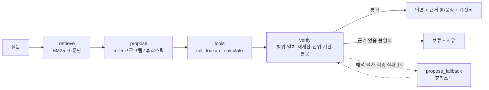

# TableTrace

**한국어 표와 영어 화학 문서를 읽고, 답변의 근거(셀·문장)와 계산 과정을 검증하는 언어모델 연구 워크벤치**

[](https://github.com/sokldjs554/tabletrace/actions/workflows/ci.yml)
[](https://github.com/sokldjs554/tabletrace/actions/workflows/pages.yml)


> **공개 데모 상태: 아직 배포되지 않았습니다.** 이 프로젝트를 만든 세션이 GitHub에 푸시할 수 없어(Claude GitHub App 미설치, 403) Pages 워크플로가 한 번도 실행되지 않았습니다. 푸시 후 `main`에서 자동 배포되도록 [pages.yml](.github/workflows/pages.yml)을 작성해 두었고, 배포될 주소는 <https://sokldjs554.github.io/tabletrace/> 입니다(**지금은 이 주소가 열리지 않을 수 있습니다**).
> **지금 바로 볼 수 있는 방법**: `docker compose up --build` 후 <http://localhost:8000> — 같은 화면이 실제 모델·도구로 동작합니다(§12). 정적 데모(저장된 실행 결과)도 로컬에서 빌드해 Playwright로 검증했습니다(§13).
> **정직한 한 줄 요약**: 튜닝한 mT5-small(300M, CPU 학습)은 미튜닝 모델보다 크게 나아졌지만 단순한 어휘 겹침 기준선을 전체 평가에서 넘지 못했습니다. 약점은 셀 **좌표**(열) 생성입니다. 상세는 §9, §11.


## 목차

1. [어떤 문제를 푸는가](#1-어떤-문제를-푸는가)
2. [공개 데모와 사용 흐름](#2-공개-데모와-사용-흐름)
3. [화면](#3-화면)
4. [핵심 기능](#4-핵심-기능)
5. [데이터 출처·라이선스](#5-데이터-출처라이선스)
6. [모델과 학습 방법](#6-모델과-학습-방법)
7. [아키텍처와 Agent·도구 호출 흐름](#7-아키텍처와-agent도구-호출-흐름)
8. [데이터 분할과 평가 방법](#8-데이터-분할과-평가-방법)
9. [모델 튜닝·강화학습 비교 결과](#9-모델-튜닝강화학습-비교-결과)
10. [추론 최적화·멀티 GPU 실험 결과](#10-추론-최적화멀티-gpu-실험-결과)
11. [실패 사례와 한계](#11-실패-사례와-한계)
12. [로컬 실행](#12-로컬-실행)
13. [테스트·CI·배포](#13-테스트ci배포)
14. [실제 수행한 것과 하지 못한 것](#14-실제-수행한-것과-하지-못한-것)

## 1. 어떤 문제를 푸는가

표를 읽는 언어모델은 "답"은 자주 맞히지만 **어느 셀을 근거로 어떤 계산을 했는지**는 보여 주지 않습니다. 답이 문서에 없을 때도 그럴듯한 값을 만들어 냅니다. 숫자·단위·기간이 섞인 표(매출액 (억원) vs (백만원), 2017년 개봉작의 2018년 순위, kPa로 적힌 임계 압력)에서는 이 두 가지가 곧바로 오답이 됩니다.

TableTrace는 이 문제를 **"모델은 제안하고, 도구가 실행·검증한다"**는 구조로 다룹니다.

- 모델(mT5-small 튜닝)은 답 대신 **프로그램**을 냅니다: `op: diff ; cells: r0c4, r1c4 ; answer: 1,062,201`.
- 검증기는 셀 좌표가 표 안에 있는지, 답이 그 셀의 텍스트와 같은지, 계산이라면 **제한된 계산기로 다시 계산**해 같은지, 단위가 맞는지, 질문의 연도와 근거 행의 연도가 맞는지 검사합니다.
- 근거가 없거나 검사에 실패하면 **답변을 보류**하고 이유를 말합니다.

같은 구조로 한국어 위키 표(KorWikiTQ)와 영어 화학 교과서(OpenStax *Chemistry 2e*)의 본문+표를 다룹니다.

## 2. 공개 데모와 사용 흐름

1. 상단에서 **한국어 표** 또는 **영어 화학 문서**를 고릅니다.
2. 왼쪽 목록에서 문서를 고르면 가운데에 본문과 표가 나옵니다. 표의 모든 셀에는 `r행c열` 좌표가 있습니다.
3. 왼쪽 아래 **대표 질문**(셀 근거 · 계산 · 본문+표 · 단위/기간 주의 · 답 없음→보류)을 누르거나, 실시간 모드에서는 직접 질문을 입력합니다.
4. 오른쪽에 상태(대기→실행 중→완료/보류/오류)가 흐르고, 답변 카드에 **근거 셀 번호 배지 · 문장 · 계산식(값·단위) · 검증 항목 · 실행 추적(LangGraph 노드·도구 호출·소요 ms)**이 표시됩니다.
5. 근거 배지를 누르면 가운데 표의 셀로 이동해 강조됩니다. 본문 근거는 문장이 하이라이트됩니다.
6. 상단 **연구 결과** 탭에서 모델 비교, 강화학습, 추론 최적화, 멀티 GPU 실험의 조건과 결과를 봅니다.

데모 화면은 **실시간 실행**(백엔드 연결, 초록 배지)과 **저장된 실행 결과**(정적 호스팅, 파란 배지 + 기록 시각·모델·커밋)를 구분해 표시합니다. 모델이 실행되지 않은 결과를 실시간처럼 보이게 하지 않습니다.

## 3. 화면

| 데스크톱 — 답변과 근거 셀 | 모바일 — 질문·결과 탭 | 답변 보류 |
|---|---|---|
|  |  |  |

화면 구조와 상태 설계는 [docs/design/screens.md](docs/design/screens.md), 참고한 제품 UI 조사는 [docs/design/ui-research.md](docs/design/ui-research.md)에 있습니다. 스크린샷은 `scripts/console_screenshots.py`(Playwright)가 데스크톱 1440×900·모바일 390×844에서 자동으로 찍고 동작을 검사합니다(`docs/images/e2e-*.json`).

## 4. 핵심 기능

| 기능 | 설명 | 구현 |
|---|---|---|
| 문서·표 검색 | 질문으로 관련 표와 문단을 BM25로 찾음. 한국어는 Kiwi 형태소(조사·어미 제거), 영어는 경량 토크나이저 | `retrieval/` |
| 프로그램 제안 | 모델이 `op / cells / answer` 한 줄 문법으로 근거 셀과 연산을 제안. 모델이 없으면 어휘 겹침 휴리스틱 | `agent/program.py`, `model/planner.py`, `agent/heuristic.py` |
| 도구 실행 | 셀 조회, 셀 검색, 제한 산술 계산(diff/sum/avg/ratio/pct_change, 단위 파싱·검사). AST 기반 평가기, `eval` 없음 | `tools/` |
| 검증·보류 | 셀 범위 · 답-셀 일치 · 재계산 일치 · 단위 일치 · 기간 일치 · 본문 포함 검사 → 답변 또는 보류(사유 7종) | `verify/verifier.py` |
| Agent 워크플로 | LangGraph 상태 그래프: retrieve → propose → (tool) → verify → finalize, 검증 실패 시 1회 보완 제안 | `agent/graph.py` |
| 서비스 API | FastAPI: 문서/표 조회, 검색, 비동기 작업(큐 제한·동시 실행 제한·시간 초과), 트레이스, 계산 도구, 그래프 | `service/` |
| 콘솔 | 3단 워크벤치(문서 / 본문·표 / 질문·결과), 근거 셀↔배지 연결, 실시간/저장 결과 구분, 모바일 탭, 키보드 조작 | `console/` |
| 학습 | SFT(PyTorch + Transformers), GRPO 방식 강화학습(검증기 보상), 평가 러너, 벤치마크 | `training/`, `eval/`, `bench/` |

## 5. 데이터 출처·라이선스

| 데이터 | 용도 | 출처 | 라이선스 | 접근 방법 |
|---|---|---|---|---|
| **KorWikiTQ** (LG AI연구원) | 한국어 표 QA 학습·평가 | github.com/LG-NLP/KorWikiTableQuestions | CC BY-SA 4.0 | GitHub LFS 미디어 경로, SHA256 검증 |
| **KorQuAD v1.0** (LG CNS) | 본문 답변(`op: text`) 학습 700 / 선택 100 | korquad.github.io | CC BY-ND 2.0 KR (파생 파일 미배포, git-ignore) | GitHub raw |
| **OpenStax Chemistry 2e** (Rice Univ.) | 영어 화학 문서(본문+표) | github.com/openstax/osbooks-chemistry-bundle | CC BY-NC-SA 4.0 | CNXML 원본 clone |
| 합성 QA | 계산·보류 연산 학습 | 이 저장소 `scripts/data/synth_*.py` | — | 템플릿 생성 |
| 수작업 평가 | 범주별 평가(ko 30, chem 32) | 이 저장소 `data/*/custom_eval.jsonl` | — | 직접 작성, 스크립트 검수 |
| **mT5-small** (Google) | 기본 언어모델 | gs://t5-data/pretrained_models/mt5/small | Apache-2.0 | TF 체크포인트 → PyTorch 직접 변환 |

KorWikiTabular(사전학습 코퍼스)와 EXAONE(모델)은 접근이 막혀 사용하지 못했습니다(§14, [docs/experiments/exaone.md](docs/experiments/exaone.md)). 조사·전처리·제외 기준·검수 방법은 [docs/research/datasets.md](docs/research/datasets.md).

## 6. 모델과 학습 방법

- **기본 모델**: mT5-small(300M, 101개 언어). Hugging Face Hub가 차단된 환경이라 Google Cloud Storage의 Mesh-TensorFlow 체크포인트를 받아 `scripts/model/`로 PyTorch·Transformers 형식으로 직접 변환했습니다. 변환 검증: 190개 텐서 shape 일치, 센티널 채우기(`<extra_id_0> … <extra_id_1>`) 생성 확인, 디노이징 손실 5–7 nats(균등 추측 12.4 nats).
- **입력**: `question: … title: … context: (본문 300자) table: header: … ; r0: … ; r1: …` (≤512 토큰; 넘치면 뒤 행부터 생략, 학습에서는 정답 행이 잘린 예제 제외).
- **출력(프로그램)**: `op: lookup ; cells: r6c4 ; answer: 5,436,789` / `op: diff ; cells: r0c4, r1c4 ; answer: 1,062,201 명` / `op: text ; cells: - ; answer: 2018년 1월 1일` / `op: abstain ; … ; reason: not_in_document`.
- **SFT**: AdamW 3e-4, 선형 워밍업·감쇠, 배치 8, 2 epoch (stage 1: 표 lookup + 합성 계산·보류) → stage 2 (본문 답변 추가, 1 epoch) → 화학(합성 lookup/계산/보류 + 한국어 재생, 2 epoch). CPU 4스레드.
- **강화학습**: GRPO 방식 — 프롬프트당 G=4 샘플, 검증기 기반 보상(정답·근거 셀 일치·연산 일치·보류의 적절성), 그룹 정규화 이점으로 정책 경사, SFT 참조 모델과의 k3 KL(β=0.02), 60 step. on-policy 1회 업데이트라 중요도 비율·클리핑이 없습니다. DPO 같은 선호 학습이 아니라 **샘플링→보상→정책 업데이트**를 실제로 수행합니다. 첫 실행은 dropout 불일치로 NaN, 둘째(v1)는 **보상 편법**(쓰레기 프로그램이 의도적 보류와 같은 점수)이 발견되어, 보상을 고친 v2를 처음부터 다시 학습했습니다(§9.4). 규모가 작아 **예비 실험**입니다.
- 재현 명령: [scripts/train/README.md](scripts/train/README.md).

## 7. 아키텍처와 Agent·도구 호출 흐름

```
사용자 ──> 콘솔(정적) ──HTTP──> FastAPI (service/app.py)
                                   │  POST /v1/ask  → JobRunner(세마포어·큐 제한·타임아웃)
                                   ▼
                          LangGraph (agent/graph.py)
         retrieve ──> propose ──> verify ──┬──> finalize ──> AnswerResult(답·근거·계산·검사·추적)
         (BM25)    (mT5 | 휴리스틱)  (tools)  └─retry──> propose_fallback(휴리스틱) ──> verify
```



- **신뢰 경계**: 문서 텍스트·셀·질문은 데이터입니다. 모델 출력은 정규식 문법으로만 해석되고(`agent/program.py`), 셀 좌표는 범위 검사, 도구 인자는 pydantic 검증, 계산기는 숫자·사칙연산·괄호만 받는 AST 평가기입니다. 임의 코드 실행 경로가 없습니다(`tests/test_api.py::test_document_text_is_data_not_commands`).
- **비동기 처리**: CPU 바운드 추론은 스레드 풀에서 실행하고 이벤트 루프는 상태 조회·정적 파일을 계속 처리합니다. 상태: `queued → running → done | failed | timeout`, 큐 초과 시 429.
- **LangGraph를 쓴 이유**: 분기(검증 실패 → 보완 제안)가 있는 짧은 워크플로를 명시적 그래프로 두면 노드 경계가 곧 콘솔의 실행 추적 단계가 되고, 플래너(모델/휴리스틱/외부 엔진)를 바꿔 끼워도 그래프가 같습니다. `GET /v1/graph`가 Mermaid를 반환합니다.
- **gRPC**: 쓰지 않았습니다. 클라이언트가 브라우저 하나뿐이고 스트리밍·다중 언어 클라이언트 요구가 없어 REST+JSON이 검증·디버깅에 유리했습니다.

## 8. 데이터 분할과 평가 방법

- **한국어**: KorWikiTQ 공개 train/dev는 표 {{data/ko/official_split_profile.json|shared_tables_by_url|int}}개를 공유합니다(직접 측정, `scripts/data/profile_korwikitq.py`). 그래서 URL+표 내용 해시로 **표 단위 재분할**(train 900 / dev 60 / test 180 표; 분할 간 공유 표 0, `data/ko/build_report.json`). 평가는 test 539문항(원본, lookup) + 합성 160(계산·보류) + 수작업 30(범주별).
- **영어 화학**: 모듈(문서) 단위 분할 train 40 / dev 5 / test 11. 수작업 평가 32문항은 모두 test 문서에서 작성.
- **지표**(`eval/metrics.py`): verified EM(검증기를 거친 최종 답/보류가 정답과 일치), raw EM(모델 제안 자체), 근거 셀 정확 일치, 연산 정확도, 계산값 일치, 단위 오류율, 보류 재현율(답 없는 문항에서 보류), 오보류율(답 있는 문항에서 보류), 파싱 실패율.
- **검수**: 수작업 사례는 작성 직후 스크립트가 셀 텍스트·계산기 결과·본문 포함 여부를 자동 확인(`scripts/check_data.py`, CI에서도 실행).

## 9. 모델 튜닝·강화학습 비교 결과

아래 표는 `scripts/render_results.py`가 `experiments/` 산출물에서 생성하고, CI가 `--check`로 낡은 표를 잡습니다(손으로 적은 숫자 없음). 문장 속 수치도 산출물에 묶여 있습니다. 실행 환경: 4 vCPU Intel Xeon 2.10GHz, 15 GB RAM, **GPU 없음**. 표본이 작은 수작업 평가(30·32문항)는 1 표준오차가 6–9%p라 참고치입니다.

**결과 요약 — 좋은 소식과 나쁜 소식 모두**

- ✅ **튜닝은 효과가 있었습니다.** 한국어 독립 test(699문항) verified EM이 미튜닝 {{experiments/eval/base_ko_test/metrics.json|metrics.verified_em|pct}}% → SFT {{experiments/eval/sft_ko_ko_test/metrics.json|metrics.verified_em|pct}}% → {{experiments/eval/sft_ko2_ko_test/metrics.json|metrics.verified_em|pct}}% → 화학 SFT 후 {{experiments/eval/sft_chem_ko_test/metrics.json|metrics.verified_em|pct}}%.
- ✅ **원본 KorWikiTQ 539문항만 보면 모델이 어휘 겹침 기준선을 앞섭니다**: {{experiments/eval/sft_chem_ko_test/analysis.json|by_source_verified.korwikitq.verified_em|pct}}% 대 {{experiments/eval/heuristic_ko_test/analysis.json|by_source_verified.korwikitq.verified_em|pct}}%.
- ❌ **전체 평가에서는 기준선({{experiments/eval/heuristic_ko_test/metrics.json|metrics.verified_em|pct}}%)을 넘지 못했습니다.** 합성 계산·보류 160문항에서 모델은 {{experiments/eval/sft_chem_ko_test/analysis.json|by_source_verified.synthetic.verified_em|pct}}%, 기준선은 {{experiments/eval/heuristic_ko_test/analysis.json|by_source_verified.synthetic.verified_em|pct}}%입니다. 다만 이 합성 문항은 기준선의 의도 패턴과 같은 사람이 쓴 템플릿이라 **독립적인 비교가 아닙니다**.
- ❌ **약한 고리는 셀 열 좌표입니다**: 모델이 인용한 열이 맞는 비율 {{experiments/eval/sft_chem_ko_test/analysis.json|lookup_citation.col_correct|pct}}%(행은 {{experiments/eval/sft_chem_ko_test/analysis.json|lookup_citation.row_correct|pct}}%). 검증기의 "근거 복구"가 답 텍스트로 올바른 셀을 찾아 줘서 점수를 지탱합니다.
- ❌ **본문+표 질문은 실패했습니다.** 모델이 평가에서 `op: text`를 한 번도 내지 않았습니다. 학습의 본문 답변 예제가 전부 빈 표와 함께여서 "표에 행이 없으면 text"라는 형식 지름길을 배웠습니다(학습 형식 입력에서는 100번 중 {{experiments/eval/sft_ko2_text_dev/analysis.json|op_confusion_top.0.1|int}}번 `op: text`).
- ⚠️ **보류 재현율 지표는 그대로 믿으면 안 됩니다.** 답 없는 문항에서 모델이 직접 `op: abstain`을 낸 비율은 test 기준 SFT stage 2 {{experiments/eval/sft_ko2_ko_test/analysis.json|abstain_breakdown.planner_chose_abstain_recall|pct}}%인데, 최종 상태가 "보류"인 비율은 {{experiments/eval/sft_ko2_ko_test/analysis.json|abstain_breakdown.final_abstain_recall|pct}}%입니다. 차이는 해석 불가·퇴화 프로그램이나 검증 실패로 우연히 보류된 경우입니다(§11).
- ⚠️ **영어 화학**: 합성 dev는 {{experiments/eval/sft_ko2_chem_syndev/metrics.json|metrics.verified_em|pct}}% → {{experiments/eval/sft_chem_chem_syndev/metrics.json|metrics.verified_em|pct}}%로 올랐지만 손으로 쓴 32문항은 {{experiments/eval/sft_ko2_chem_custom/metrics.json|metrics.verified_em|pct}}% → {{experiments/eval/sft_chem_chem_custom/metrics.json|metrics.verified_em|pct}}%(2문항 차이, 잡음 수준)이고 기준선은 {{experiments/eval/heuristic_chem_custom/metrics.json|metrics.verified_em|pct}}%입니다.
- ⚠️ **int8 동적 양자화는 처리량을 {{experiments/bench/inference.json|results.0.throughput_ex_per_s}} → {{experiments/bench/inference.json|results.4.throughput_ex_per_s}} 예제/s로 올리지만** 한국어 test 정확도를 {{experiments/eval/sft_chem_ko_test/metrics.json|metrics.verified_em|pct}}% → {{experiments/eval/sft_chem_int8_ko_test/metrics.json|metrics.verified_em|pct}}%로 떨어뜨립니다.
- 🔎 **강화학습**: @@PENDING:readme_rl@@

### 9.1 한국어 표 QA

<!-- results:ko:start -->
**한국어 표 QA — 독립 test (원본 539 + 합성 160)**

| 플래너 / 모델 | n | verified EM % | raw EM % (답 있는 문항) | lookup EM % | calc EM % | 근거 셀 일치 %(최종) | 근거 셀 일치 %(모델 인용) | 보류 재현율 % | 오보류율 % | 파싱 실패 % | ms/예제 |
|---|---:|---:|---:|---:|---:|---:|---:|---:|---:|---:|---:|
| 휴리스틱 기준선 | 699 | **36.2** | 21.7 | 26.2 | 59.1 | 31.6 | 31.6 | 94.0 | 42.4 | 0.0 | 21 |
| mT5-small 기본(미튜닝) | 699 | **7.1** | 0.0 | 0.0 | 0.0 | 0.0 | 0.0 | 100.0 | 100.0 | 100.0 | 399 |
| SFT stage1 | 699 | **25.0** | 26.7 | 29.9 | 1.8 | 25.4 | 18.5 | 24.0 | 28.8 | 0.0 | 591 |
| SFT stage2(+본문) | 699 | **27.5** | 28.0 | 32.3 | 4.5 | 28.0 | 21.4 | 26.0 | 31.0 | 0.0 | 422 |
| GRPO RL | 699 | **26.8** | 27.4 | 30.6 | 4.5 | 26.7 | 20.6 | 34.0 | 37.9 | 0.0 | 460 |
| 화학 SFT | 699 | **29.8** | 33.4 | 37.1 | 0.0 | 30.8 | 17.1 | 16.0 | 19.4 | 0.0 | 615 |

**한국어 표 QA — 수작업 30문항**

| 플래너 / 모델 | n | verified EM % | raw EM % (답 있는 문항) | lookup EM % | calc EM % | 근거 셀 일치 %(최종) | 근거 셀 일치 %(모델 인용) | 보류 재현율 % | 오보류율 % | 파싱 실패 % | ms/예제 |
|---|---:|---:|---:|---:|---:|---:|---:|---:|---:|---:|---:|
| 휴리스틱 기준선 | 30 | **50.0** | 20.0 | 38.5 | 41.7 | 44.0 | 44.0 | 100.0 | 40.0 | 0.0 | 133 |
| mT5-small 기본(미튜닝) | 30 | **16.7** | 0.0 | 0.0 | 0.0 | 0.0 | 0.0 | 100.0 | 100.0 | 100.0 | 242 |
| SFT stage1 | 30 | **16.7** | 12.0 | 7.7 | 0.0 | 4.0 | 8.0 | 80.0 | 80.0 | 0.0 | 447 |
| SFT stage2(+본문) | 30 | **23.3** | 8.0 | 7.7 | 8.3 | 8.0 | 12.0 | 100.0 | 80.0 | 0.0 | 480 |
| GRPO RL | 30 | **20.0** | 8.0 | 7.7 | 0.0 | 4.0 | 12.0 | 100.0 | 84.0 | 0.0 | 437 |
| 화학 SFT | 30 | **3.3** | 8.0 | 7.7 | 0.0 | 4.0 | 4.0 | 0.0 | 48.0 | 0.0 | 536 |

**한국어 수작업 — 범주별 verified EM % (n)**

| 범주 | 휴리스틱 기준선 | mT5-small 기본(미튜닝) | SFT stage1 | SFT stage2(+본문) | GRPO RL | 화학 SFT |
|---|---:|---:|---:|---:|---:|---:|
| abstain | 100.0 (5) | 100.0 (5) | 80.0 (5) | 100.0 (5) | 100.0 (5) | 0.0 (5) |
| calc | 83.3 (6) | 0.0 (6) | 0.0 (6) | 16.7 (6) | 0.0 (6) | 0.0 (6) |
| cell | 44.4 (9) | 0.0 (9) | 11.1 (9) | 11.1 (9) | 11.1 (9) | 11.1 (9) |
| text_table | 0.0 (5) | 0.0 (5) | 0.0 (5) | 0.0 (5) | 0.0 (5) | 0.0 (5) |
| unit_period | 20.0 (5) | 0.0 (5) | 0.0 (5) | 0.0 (5) | 0.0 (5) | 0.0 (5) |


<!-- results:ko:end -->

### 9.2 영어 화학 문서

<!-- results:chem:start -->
**영어 화학 문서 — 수작업 32문항 (test 분할 문서)**

| 플래너 / 모델 | n | verified EM % | raw EM % (답 있는 문항) | lookup EM % | calc EM % | 근거 셀 일치 %(최종) | 근거 셀 일치 %(모델 인용) | 보류 재현율 % | 오보류율 % | 파싱 실패 % | ms/예제 |
|---|---:|---:|---:|---:|---:|---:|---:|---:|---:|---:|---:|
| 휴리스틱 기준선 | 32 | **56.2** | 40.7 | 84.6 | 14.3 | 55.6 | 55.6 | 100.0 | 25.9 | 0.0 | 0 |
| mT5-small 기본(미튜닝) | 32 | **15.6** | 0.0 | 0.0 | 0.0 | 0.0 | 0.0 | 100.0 | 100.0 | 100.0 | 138 |
| SFT stage1 | 32 | **12.5** | 18.5 | 7.7 | 0.0 | 3.7 | 7.4 | 60.0 | 70.4 | 0.0 | 399 |
| SFT stage2(+본문) | 32 | **9.4** | 7.4 | 0.0 | 0.0 | 0.0 | 0.0 | 60.0 | 81.5 | 0.0 | 352 |
| GRPO RL | 32 | **15.6** | 7.4 | 0.0 | 0.0 | 0.0 | 0.0 | 100.0 | 81.5 | 3.1 | 424 |
| 화학 SFT | 32 | **15.6** | 22.2 | 7.7 | 7.1 | 7.4 | 22.2 | 60.0 | 66.7 | 3.1 | 459 |

**영어 화학 — 합성 dev 80문항(템플릿, 참고용)**

| 플래너 / 모델 | n | verified EM % | raw EM % (답 있는 문항) | lookup EM % | calc EM % | 근거 셀 일치 %(최종) | 근거 셀 일치 %(모델 인용) | 보류 재현율 % | 오보류율 % | 파싱 실패 % | ms/예제 |
|---|---:|---:|---:|---:|---:|---:|---:|---:|---:|---:|---:|
| SFT stage2(+본문) | 80 | **22.5** | 26.6 | 22.5 | 0.0 | 14.1 | 23.4 | 56.2 | 57.8 | 0.0 | 442 |
| 화학 SFT | 80 | **41.2** | 39.1 | 57.5 | 8.3 | 26.6 | 29.7 | 50.0 | 35.9 | 2.5 | 521 |

**화학 수작업 — 범주별 verified EM % (n)**

| 범주 | 휴리스틱 기준선 | mT5-small 기본(미튜닝) | SFT stage1 | SFT stage2(+본문) | GRPO RL | 화학 SFT |
|---|---:|---:|---:|---:|---:|---:|
| abstain | 100.0 (5) | 100.0 (5) | 60.0 (5) | 60.0 (5) | 100.0 (5) | 60.0 (5) |
| calc | 28.6 (7) | 0.0 (7) | 0.0 (7) | 0.0 (7) | 0.0 (7) | 14.3 (7) |
| cell | 80.0 (10) | 0.0 (10) | 10.0 (10) | 0.0 (10) | 0.0 (10) | 10.0 (10) |
| text_table | 0.0 (6) | 0.0 (6) | 0.0 (6) | 0.0 (6) | 0.0 (6) | 0.0 (6) |
| unit_period | 75.0 (4) | 0.0 (4) | 0.0 (4) | 0.0 (4) | 0.0 (4) | 0.0 (4) |


<!-- results:chem:end -->

### 9.3 학습 실행

<!-- results:training:start -->
| 실행 | 학습 예제/프롬프트 | 스텝 | 소요 (CPU 4스레드) | best dev verified EM % | dev 추이 % |
|---|---:|---:|---:|---:|---|
| SFT stage1 (ko 표) | 3431 | 858 | 120 min | 20.8 | 15.1, 20.8 |
| SFT stage2 (ko 표+본문) | 1542 | 193 | 30 min | 29.3 | 29.3 |
| SFT chem | 937 | 236 | 32 min | 42.5 | 38.8, 42.5 |
| GRPO RL (ko) | 3485 | 60 | 29 min | 30.2 | 28.2, 30.2, 26.5, 24.1 |

<!-- results:training:end -->

### 9.4 강화학습(GRPO 방식) — 보상 편법을 찾아 고친 이야기

**v1(보상 허점)**: 답이 없는 문항에서 "최종 상태가 보류면 +1.0"으로 채점했습니다. 그러자 검증기가 거부하는 쓰레기 프로그램도 의도적 보류와 같은 점수를 받았고, 60 step 동안 보상은 거의 오르지 않는 채 정책이 `lookup`에서 `diff`로 이동했습니다(모델의 명시적 abstain 비율과 최종 보류율의 격차 참고). 이 실행은 증거로 보존했습니다(`experiments/rl_ko_v1/`).

<!-- results:rl_v1:start -->
<!-- results:rl_v1:end -->

**v2(보상 수정)**: 모델이 직접 `op: abstain`을 낸 경우만 +1.0, 검증기가 잡은 근거 없는 제안 +0.2, 해석 불가·퇴화 프로그램 0.0(답이 있는 문항에서는 −0.5). SFT stage 2 모델에서 처음부터 다시 학습했습니다.

<!-- results:rl:start -->
<!-- results:rl:end -->

@@PENDING:readme_rl_detail@@

## 10. 추론 최적화·멀티 GPU 실험 결과

### 10.1 추론 최적화 (CPU 실측)

<!-- results:bench:start -->
_추론 벤치 산출물 없음_

<!-- results:bench:end -->

### 10.2 멀티 GPU Model Parallelism — 2-스테이지 파이프라인 (CPU 2프로세스 기능 검증)

<!-- results:pp:start -->
조건: CPU(gloo), n=16, bs=8, 단일 프로세스 300,176,768 파라미터

| 구성 | 장치 | 스테이지 파라미터 | 처리량 예제/s | 메모리 MB | 평균 배치 지연 s |
|---|---|---:|---:|---:|---:|
| 단일 프로세스 | cpu | 300,176,768 | 1.472 | 1747 | 5.44 |
| 파이프라인 rank0 (encoder) | cpu | 146,940,608 | 1.46 | 1159 | 5.47 |
| 파이프라인 rank1 (decoder+lm_head) | cpu | 281,293,504 |  | 1618 | 5.47 |

단일 프로세스와 2-스테이지의 생성 출력 일치: **예** (16개 입력)

<!-- results:pp:end -->

**읽는 법** (자세한 해석은 [docs/REPORT.md §8–§9](docs/REPORT.md)):

- KV 캐시를 끄면 p50이 {{experiments/bench/inference.json|results.0.p50_ms}} ms → {{experiments/bench/inference.json|results.2.p50_ms}} ms로 약 2.7배 느려집니다. 배치 8은 처리량을 약 2.2배 올립니다.
- int8 동적 양자화는 파일을 {{experiments/bench/inference.json|results.0.state_dict_mb}} → {{experiments/bench/inference.json|results.3.state_dict_mb}} MB로 줄이고 처리량을 올리지만 **정확도를 크게 잃습니다**(출력 문자열 일치 {{experiments/bench/inference.json|results.3.agreement_with_fp32_bs1|pct}}%, 한국어 test verified EM {{experiments/eval/sft_chem_ko_test/metrics.json|metrics.verified_em|pct}}% → {{experiments/eval/sft_chem_int8_ko_test/metrics.json|metrics.verified_em|pct}}%). 프로세스 peak RSS는 오히려 {{experiments/bench/inference.json|results.0.peak_rss_gb}} → {{experiments/bench/inference.json|results.3.peak_rss_gb}} GB입니다(fp32로 로드한 뒤 변환하기 때문).
- 파이프라인 병렬은 모델을 두 프로세스에 나눠 **출력이 단일 프로세스와 일치**함을 확인했지만 CPU 4코어를 나눠 쓰므로 속도 이득은 없습니다. **GPU 성능은 측정하지 못했습니다.**
- 공유 VM이라 지연은 실행마다 20% 이상 변동합니다. 설정 간 비율을 보세요.

GPU 실행 명령·예상 자원은 [docs/experiments/parallel.md](docs/experiments/parallel.md), vLLM/SGLang 준비 상태는 [docs/experiments/serving.md](docs/experiments/serving.md).

## 11. 실패 사례와 한계

구체적인 실패 문항은 각 평가의 `predictions.jsonl`에서 `verified_correct: false`를 찾으면 됩니다(모델 원문 출력, 예측 셀, 검사 결과가 함께 있습니다). `analysis.json`에는 오류 유형 집계(행·열 정확도, 보류 사유, 연산 혼동)가 있습니다. 전체 목록은 [docs/REPORT.md §15](docs/REPORT.md).

**실패 사례 (실제 예측에서)**

- *열 좌표 오류*(test, qid `30350_2`): 질문 "배우 서현진이 2015년에 출연한 SBS의 예능은 무엇입니까?" — 화학 SFT 모델 원문 출력 `lookup r3c1 ; answer: 일요일이 좋다 - 런닝맨`, 정답 셀은 `r3c2`. **답 텍스트는 맞고 열 좌표만 틀렸습니다.** 검증기가 답 텍스트로 `r3c2`를 찾아 근거를 고치고 그 사실을 실패 검사(`evidence_repaired`)로 남깁니다. 그래서 verified EM은 맞게 나오지만 모델 원문의 근거 셀은 틀렸습니다.
- *퇴화 계산*(수작업 `ko_custom_01`, SFT stage 2): 질문 "2018년 박스오피스에서 안시성의 관객수는 몇 명입니까?" — 원문 `diff ; cells: r6c4, r6c4 ; answer: 5,436,789`. 답 숫자는 맞지만 같은 셀을 두 번 쓰는 무의미한 차이 계산이라 검증기가 `invalid_program`으로 막아 보류합니다(정답이 있는 문항이므로 오보류). 이런 출력이 test {{experiments/eval/sft_ko2_ko_test/analysis.json|n|int}}문항 중 SFT stage 2에서 {{experiments/eval/sft_ko2_ko_test/analysis.json|degenerate_calc_outputs|int}}건, RL v1에서 {{experiments/eval/rl_ko_v1_ko_test/analysis.json|degenerate_calc_outputs|int}}건입니다.
- *환각 답변*(수작업 `ko_custom_08`, 화학 SFT 모델): 표에 없는 "보헤미안 랩소디"의 관객수를 물었더니 `lookup ; cells: r0c1 ; answer: 신과함께: 인과 연`을 내고 **그대로 답했습니다.** 검증기는 "답이 인용한 셀의 텍스트와 같은가"를 보지만 그 셀이 질문 대상(보헤미안 랩소디)에 대한 것인지는 확인하지 않아 통과합니다. 이것이 현재 검증기의 실제 허점입니다.
- *보류 재현율 지표의 허점*: 답 없는 문항에서 최종 상태가 보류인 비율(`final_abstain_recall`)은 SFT stage 2에서 test {{experiments/eval/sft_ko2_ko_test/analysis.json|abstain_breakdown.final_abstain_recall|pct}}%지만, 모델이 **직접** `op: abstain`을 낸 비율은 {{experiments/eval/sft_ko2_ko_test/analysis.json|abstain_breakdown.planner_chose_abstain_recall|pct}}%입니다. 나머지는 해석 불가·퇴화 프로그램({{experiments/eval/sft_ko2_ko_test/analysis.json|abstain_breakdown.abstained_via_invalid_program_recall|pct}}%)이나 검증 실패({{experiments/eval/sft_ko2_ko_test/analysis.json|abstain_breakdown.abstained_via_verifier_recall|pct}}%)로 우연히 보류된 것입니다. 휴리스틱 기준선은 직접 보류 재현율이 {{experiments/eval/heuristic_ko_test/analysis.json|abstain_breakdown.planner_chose_abstain_recall|pct}}%입니다. 즉 "모델이 근거 부족을 판단해 보류한다"는 주장은 이 실험으로 뒷받침되지 않습니다.
- *본문 답변 실패*: "김일성 주석이 사망한 날짜는?"처럼 답이 표가 아니라 본문에 있는 질문에서 `op: text`를 내지 않습니다.

**구조적 한계**

- **모델 크기·환경**: GPU가 없어 mT5-small(300M)만 CPU로 학습했습니다. EXAONE 등 수십억 파라미터 모델과의 비교는 하지 못했습니다. 모든 수치는 이 한 환경(4 vCPU)의 값입니다.
- **입력 예산 512 토큰**: test의 {{experiments/eval/heuristic_ko_test/metrics.json|metrics.truncated_gold_rate|pct}}%는 정답 행이 잘려 원리적으로 맞힐 수 없습니다. 긴 표·다중 표 질문은 다루지 않습니다.
- **연산 범위**: 두 셀 간 차·합·평균·비율·증감률과 셀/문장 조회만 지원합니다. argmax, 조건 집계, 단위 환산(원↔억원, kPa↔atm)은 도구에 없습니다.
- **합성 데이터**: 계산·보류 학습 예제는 템플릿이라 표현이 단조롭고, 기준선에 유리한 편향이 있습니다. 화학은 논문이 아니라 교과서 표입니다. 수작업 평가는 62문항뿐입니다.
- **검색**: BM25만 사용합니다. 표 검색 hit@1은 한국어 {{experiments/eval/retrieval/metrics.json|ko_test_lookup.hit_at_1|pct}}%, 화학 {{experiments/eval/retrieval/metrics.json|chem_custom.hit_at_1|pct}}%라 문서를 지정하지 않으면 시작부터 틀리는 질문이 있습니다.
- **강화학습**: 60 step 예비 실험이고, 보상이 검증기에 의존해 검증기의 허점이 곧 보상 허점이 됩니다(실제로 한 번 발생해 고쳤습니다).
- **서빙·병렬**: vLLM/SGLang과 멀티 GPU는 코드·명령만 준비했고 GPU 실측이 없습니다. int8 양자화는 정확도를 해칩니다.

**다음에 할 일(우선순위)**: ① 본문 답변 예제를 실제 표와 함께 만들어 재학습 ② 답을 먼저 쓰고 좌표는 도구가 찾는 "answer-then-locate" 출력 형식 ③ 계산 예제를 늘리고 비-템플릿 질문 수집 ④ 선택적 양자화 ⑤ GPU에서 EXAONE LoRA + vLLM TP=2.

## 12. 로컬 실행

```bash
git clone https://github.com/sokldjs554/tabletrace && cd tabletrace
python3.11+ -m venv .venv && source .venv/bin/activate
pip install -e ".[dev]"            # 휴리스틱 플래너 + API + 콘솔 (torch 없음)
pip install -e ".[model]"          # + PyTorch/Transformers (모델 플래너)
python scripts/check_data.py       # 데이터 무결성
pytest -q                          # 70+ 테스트(모델 없으면 모델 테스트 skip)
tabletrace serve                   # http://127.0.0.1:8000  (모델이 models/mt5-small-tabletrace 에 있으면 자동 사용)
```

Docker: `docker compose up --build` (휴리스틱) 또는 `WITH_MODEL=1 docker compose up --build` (모델; `models/` 마운트). 환경 변수는 `.env.example`.

모델 가중치는 git에 없습니다. `scripts/train/README.md`의 명령으로 재학습하거나, `models/mt5-small-base`를 만들려면 `scripts/model/`(GCS 다운로드 + 변환)을 실행합니다.

## 13. 테스트·CI·배포

- **테스트**: `tests/` — 숫자·단위 파서, 제한 계산기(코드 주입 거부 포함), 프로그램 문법, 검증기(근거 복구·퇴화 계산 거부 포함), 휴리스틱, 검색, API(정상·422·404·409·429, 비동기 작업·동시 5건·타임아웃·큐 제한), 서빙 엔진 모의 서버, 학습 데이터·RL 보상, 모델 로딩. 최종 실행: **{{experiments/tests/summary.json|passed}}개 통과, {{experiments/tests/summary.json|skipped}}개 skip, {{experiments/tests/summary.json|failed}}개 실패**(`experiments/tests/summary.json`). 모델 가중치가 없으면 모델 테스트는 skip됩니다.
- **E2E**: `scripts/console_screenshots.py` — 실시간/정적 모드 × 데스크톱/모바일에서 배지·문서·대표 질문·결과·근거 강조·보류·입력 오류·연구 결과 화면을 검사하고 스크린샷을 찍습니다. 최종 실행: 실시간 {{docs/images/e2e-summary.json|live.passed}}/{{docs/images/e2e-summary.json|live.total}}, 정적 {{docs/images/e2e-summary.json|static.passed}}/{{docs/images/e2e-summary.json|static.total}} 통과(`docs/images/e2e-*.json`). 보류 화면 검사는 신경망 플래너가 보류하지 않는 사례가 있어 휴리스틱 플래너로 렌더링을 확인합니다.
- **Docker**: 이미지(786 MB)를 이 세션에서 빌드하고 컨테이너 smoke(health·release·corpora·ask·콘솔)를 통과했습니다(`experiments/docker/smoke.json`). Docker Hub·ECR이 429를 돌려 MCR 베이스 이미지로 빌드했습니다.
- **CI**: `.github/workflows/ci.yml`(ruff, pytest, 데이터 무결성, **README·REPORT 표·수치 대조**, Docker 빌드·smoke)를 작성했지만 **원격에서 한 번도 실행되지 않았습니다**(푸시 불가). 같은 명령을 로컬에서 실행해 통과시켰습니다.
- **배포**: `.github/workflows/pages.yml`이 `main` 푸시 시 정적 데모를 GitHub Pages에 배포하도록 작성했으나 **실행되지 않았습니다**. 공개 URL은 아직 없습니다.

## 14. 실제 수행한 것과 하지 못한 것

| 항목 | 상태 | 비고 |
|---|---|---|
| 한국어 표 QA 데이터 재분할·합성·수작업 평가 | 완료 | `data/ko/`, 공개 분할의 표 누수 측정·제거 |
| 영어 화학 문서 코퍼스·합성·수작업 평가 | 완료 | `data/chem/` (논문이 아니라 교과서 표) |
| mT5-small 변환(GCS TF → PyTorch) | 완료 | docs/dev/issues-log.md 1–4 |
| 한국어 SFT 2단계 | 완료 | 튜닝 전후 개선, 기준선에는 미달(§9.1) |
| 화학 SFT (튜닝 전후 비교) | 완료 | 합성 dev 개선, 수작업은 잡음 수준(§9.2) |
| GRPO 방식 RL 예비 실험 | @@PENDING:readme_rl_status@@ | v1 보상 편법 발견·수정, v2 재학습(§9.4) |
| 추론 최적화 실측(fp32/int8/배치/KV 캐시) | 완료(CPU) | int8은 정확도 하락(§10.1) |
| 멀티 GPU Model Parallelism | **구현 후 미실행(GPU 없음)** | CPU 2프로세스로 분할·출력 일치만 검증(§10.2) |
| vLLM / SGLang 서빙 | **구현 후 미실행(GPU 없음)** | 모의 서버 테스트 |
| EXAONE 사용 | **미실행** | HF 차단·GPU 없음; 라이선스·조건 확인(docs/experiments/exaone.md) |
| FastAPI + LangGraph + 도구 + 비동기 작업 | 완료 | 테스트 통과 |
| 콘솔(데스크톱·모바일·상태·키보드) + E2E | 완료 | `docs/images/` |
| Docker 이미지 | 완료 | 로컬 빌드·컨테이너 smoke |
| GitHub Actions CI | **구현 후 미실행** | 푸시 불가(403) |
| GitHub Pages 공개 배포 | **구현 후 미실행** | 푸시 불가(403) |
| gRPC | 미구현(불필요 판단) | §7 |
