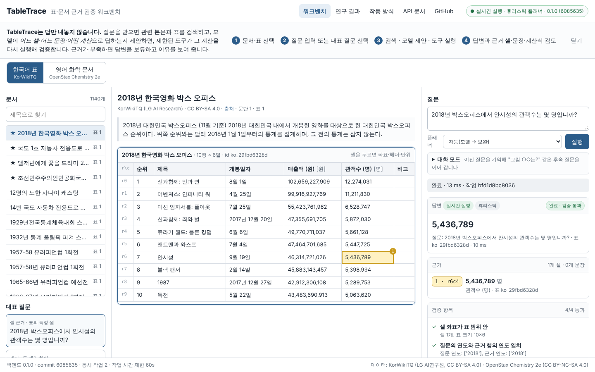
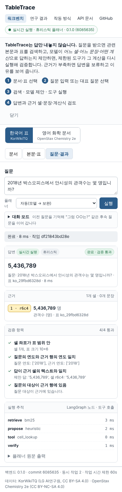
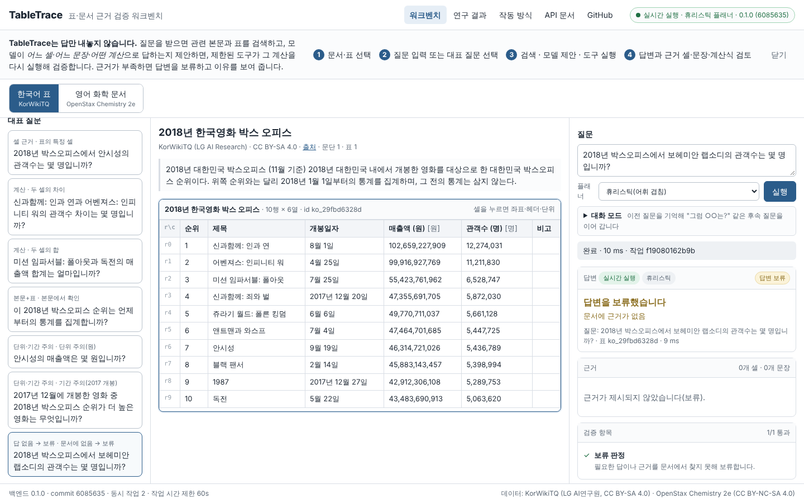
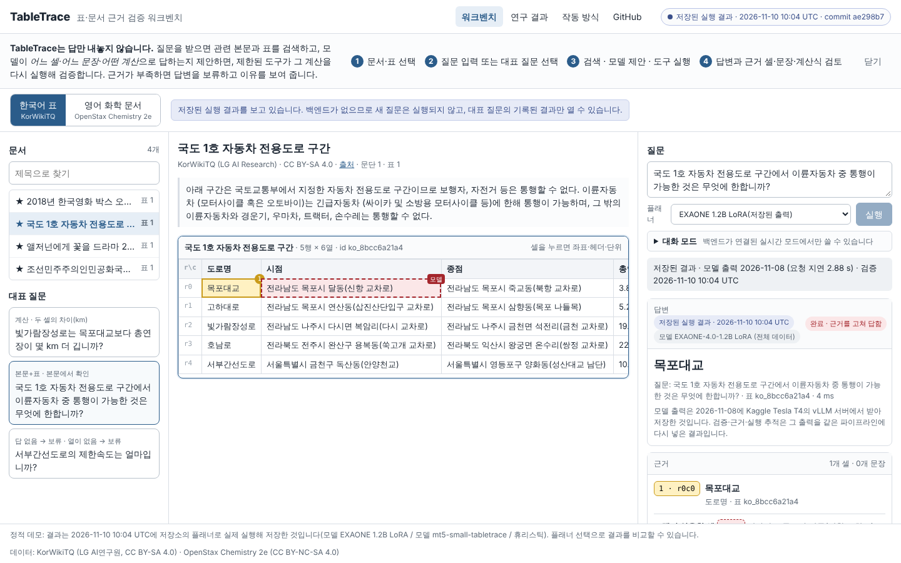
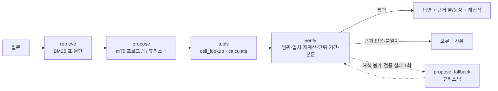

# TableTrace

**한국어 표 질의응답(Table MRC)에서 모델이 답과 근거 셀을 함께 내고, 검증기가 그 셀로 답을 다시 확인해 맞지 않으면 보류하는 연구 프로젝트**

[](https://github.com/sokldjs554/tabletrace/actions/workflows/ci.yml)
[](https://github.com/sokldjs554/tabletrace/actions/workflows/pages.yml)


**이 프로젝트가 잰 것** (한국어 독립 test 699문항, 표 단위 재분할. 표와 구간은 [§9.6](#96-보강-측정--근거-셀-오류-검증기-앞뒤-표-겹침))

- **답이 맞아도 근거 셀은 절반 넘게 틀립니다. 전체 데이터로 학습하거나, 표 입력에 열 번호를 붙이면 1~3%대가 됩니다.** 답 텍스트가 맞은 조회 답 가운데 모델이 인용한 셀에 그 답이 없는 비율은 mT5-small 최종 모델 <!-- num:experiments/eval/evidence_error.json:rl_v3_ko_test.strict.rate:pct -->52.6<!-- /num -->%, EXAONE-4.0-1.2B LoRA 300개 <!-- num:experiments/eval/evidence_error.json:exaone_vllm_ko_test.strict.rate:pct -->65.2<!-- /num -->%, 같은 모델 전체 데이터 <!-- num:experiments/eval/evidence_error.json:exaone_full_vllm_ko_test.strict.rate:pct -->1.3<!-- /num -->%입니다. 같은 300개 학습에서 표의 셀마다 열 번호(`c0`, `c1`, …)를 붙여 주기만 해도 <!-- num:experiments/eval/evidence_error.json:exaone_colid_vllm_ko_test.strict.rate:pct -->3.2<!-- /num -->%가 됩니다. 다만 답 정확도는 그대로였고, 검증기를 통과하는 오답은 오히려 늘었습니다.
- **검증기는 오답 유출을 줄입니다.** 전체 데이터 EXAONE의 출력을 그대로 내보내면 전체 문항의 <!-- num:experiments/eval/evidence_error.json:exaone_full_vllm_ko_test.raw.wrong_answer_rate.rate:pct -->21.6<!-- /num -->%가 오답이고, 검증기를 거치면 <!-- num:experiments/eval/evidence_error.json:exaone_full_vllm_ko_test.verifier_subject_check.wrong_answer_rate.rate:pct -->12.0<!-- /num -->%입니다. 대가는 답하는 비율 <!-- num:experiments/eval/evidence_error.json:exaone_full_vllm_ko_test.raw.coverage:pct -->95.3<!-- /num -->% → <!-- num:experiments/eval/evidence_error.json:exaone_full_vllm_ko_test.verifier_subject_check.coverage:pct -->88.7<!-- /num -->%입니다.
- **KorWikiTQ 공개 분할은 표가 겹칩니다.** 공개 dev 질문의 <!-- num:data/ko/official_split_profile.json:dev_on_train_table.rate:pct -->42.9<!-- /num -->%가 train에도 있는 표를 묻습니다. 표 단위로 다시 나눴습니다. 겹침의 영향도 쟀는데, mT5-small에서는 학습 때 본 표라고 점수가 오르지 않았습니다(차이 <!-- num:experiments/eval/leak_effect.json:planners.rl_v3.verified_em.diff:pct -->-2.3<!-- /num -->%p, 95% 구간 <!-- num:experiments/eval/leak_effect.json:planners.rl_v3.verified_em.diff_lo:pct -->-6.0<!-- /num --> ~ <!-- num:experiments/eval/leak_effect.json:planners.rl_v3.verified_em.diff_hi:pct -->1.4<!-- /num -->%p).
- **정답률(verified EM).** 어휘 겹침 기준선 <!-- num:experiments/eval/heuristic_ko_test/metrics.json:metrics.verified_em:pct -->36.2<!-- /num -->%, mT5-small(300M, CPU 학습) <!-- num:experiments/eval/rl_v3_ko_test/metrics.json:metrics.verified_em:pct -->32.8<!-- /num -->%로 기준선에 못 미쳤고, EXAONE-4.0-1.2B 전체 데이터 LoRA(Kaggle T4, vLLM·SGLang 서빙)는 <!-- num:experiments/eval/exaone_full_vllm_ko_test/metrics.json:metrics.verified_em:pct -->84.3<!-- /num -->%(두 번째 학습 <!-- num:experiments/eval/exaone_full_vllm_ko_test_run2/metrics.json:metrics.verified_em:pct -->87.1<!-- /num -->%)입니다.
- **강화학습은 점수를 올리지 못했습니다.** 대신 보상 허점을 하나 찾아 고쳤습니다. 검증기가 거부해 보류된 쓰레기 출력이 의도한 보류와 같은 보상을 받고 있었습니다(§9.4).

문제 제기와 개별 기법은 이미 연구가 있습니다(TrustTable, RSAT, Reasoning-Table 등 12편을 원문으로 확인, [docs/REPORT.md §19.4](docs/REPORT.md)). 이 저장소가 보태는 것은 한국어 표에서의 위 측정입니다. 서비스·서빙·컨테이너 스택은 그 측정을 실제로 돌리는 데 쓴 도구입니다.

> **데모 상태**: 저장소는 공개이고 **GitHub Pages에 배포했습니다**(Actions `pages` 실행 [성공](https://github.com/sokldjs554/tabletrace/actions/runs/41213002281), build와 deploy 단계 모두 통과): <https://sokldjs554.github.io/tabletrace/> 저장소 소유자가 2026-11-08 브라우저에서 열리는 것을 확인했습니다(개발 컨테이너에서는 `github.io`가 차단되어 작성자는 열어 보지 못함). 같은 내용을 로컬에서 Playwright로 검증했습니다(§13). Pages 화면에는 백엔드가 없어 항상 **저장된 실행 결과** 모드이고, 실시간 실행은 `docker compose up --build` 후 <http://localhost:8000> 에서 합니다(§12). 같은 저장된 결과를 단일 HTML로 만든 claude.ai Artifact 사본도 있습니다(비공개 링크, 소유자만): <https://claude.ai/artifact/KvdrLkxC8PbSLWmpLvBPDM>



## 목차

1. [어떤 문제를 푸는가](#1-어떤-문제를-푸는가)
2. [공개 데모와 사용 흐름](#2-공개-데모와-사용-흐름)
3. [화면](#3-화면)
4. [핵심 기능](#4-핵심-기능)
5. [데이터 출처·라이선스](#5-데이터-출처라이선스)
6. [모델과 학습 방법](#6-모델과-학습-방법)
7. [아키텍처와 Agent·도구 호출 흐름](#7-아키텍처와-agent도구-호출-흐름)
8. [데이터 분할과 평가 방법](#8-데이터-분할과-평가-방법)
9. [모델 튜닝·강화학습 비교 결과](#9-모델-튜닝강화학습-비교-결과)
10. [추론 최적화·멀티 GPU 실험 결과](#10-추론-최적화멀티-gpu-실험-결과)
11. [실패 사례와 한계](#11-실패-사례와-한계)
12. [로컬 실행](#12-로컬-실행)
13. [테스트·CI·배포](#13-테스트ci배포)
14. [실제 수행한 것과 하지 못한 것](#14-실제-수행한-것과-하지-못한-것)

## 1. 어떤 문제를 푸는가

표를 읽는 언어모델은 "답"은 자주 맞히지만 **어느 셀을 근거로 어떤 계산을 했는지**는 보여 주지 않습니다. 답이 문서에 없을 때도 그럴듯한 값을 만들어 냅니다. 숫자·단위·기간이 섞인 표(매출액 (억원) vs (백만원), 2017년 개봉작의 2018년 순위, kPa로 적힌 임계 압력)에서는 이 두 가지가 곧바로 오답이 됩니다.

TableTrace는 이 문제를 **"모델은 제안하고, 도구가 실행·검증한다"**는 구조로 다룹니다.

- 모델(mT5-small 튜닝)은 답 대신 **프로그램**을 냅니다: `op: diff ; cells: r0c4, r1c4 ; answer: 1,062,201`.
- 검증기는 셀 좌표가 표 안에 있는지, 답이 그 셀의 텍스트와 같은지, 계산이라면 **제한된 계산기로 다시 계산**해 같은지, 단위가 맞는지, 질문의 연도와 근거 행의 연도가 맞는지 검사합니다.
- 근거가 없거나 검사에 실패하면 **답변을 보류**하고 이유를 말합니다.

같은 구조로 한국어 위키 표(KorWikiTQ)와 영어 화학 교과서(OpenStax *Chemistry 2e*)의 본문+표를 다룹니다.

**이 프로젝트의 중심.** 표 이해(Table MRC)입니다. 한국어 표에서 답의 근거 셀을 맞히는 모델을 학습하고 그 근거를 검증하는 것이 본론이고, 데이터는 LG AI연구원이 공개한 KorWikiTQ입니다. 강화학습 실험이 두 번째입니다. 영어 화학 표, FastAPI·LangGraph 서비스, vLLM·SGLang 서빙은 같은 과제 위에서 한 번씩 실행해 본 보조 실험입니다. 이 프로젝트가 기준으로 삼은 채용 공고의 원문과 항목별 대응, 그리고 하지 않은 항목(gRPC, 챗봇, 메모리 결합, Personal Agent, 구조 전용 PLM 구현)은 [docs/research/job-posting.md](docs/research/job-posting.md)와 §14에 있습니다.

**같은 소유자의 [ko-search-clinic](https://github.com/sokldjs554/ko-search-clinic)과 다른 점.** 그 저장소는 한국어 **검색**이 실패하는 이유를 형태소·사전 수준에서 진단하고 수정안을 회귀 게이트로 검증합니다. 모델을 학습하지 않습니다. 이 저장소는 **표를 읽는 모델을 학습**시키고(SFT, LoRA, 강화학습), 모델이 인용한 근거 셀이 맞는지를 잽니다. 여기서 검색(BM25)은 표를 찾아 오는 앞 단계일 뿐이고 연구 대상이 아닙니다.

## 2. 공개 데모와 사용 흐름

1. 상단에서 **한국어 표** 또는 **영어 화학 문서**를 고릅니다.
2. 왼쪽 목록에서 문서를 고르면 가운데에 본문과 표가 나옵니다. 표의 모든 셀에는 `r행c열` 좌표가 있습니다.
3. 왼쪽 아래 **대표 질문**(셀 근거 · 계산 · 본문+표 · 단위/기간 주의 · 답 없음→보류)을 누르거나, 실시간 모드에서는 직접 질문을 입력합니다.
4. 오른쪽에 상태(대기→실행 중→완료/보류/오류)가 흐르고, 답변 카드에 **근거 셀 번호 배지 · 문장 · 계산식(값·단위) · 검증 항목 · 실행 추적(LangGraph 노드·도구 호출·소요 ms)**이 표시됩니다.
5. 근거 배지를 누르면 가운데 표의 셀로 이동해 강조됩니다. 본문 근거는 문장이 하이라이트됩니다.
6. 상단 **연구 결과** 탭에서 모델 비교, 강화학습, 추론 최적화, 멀티 GPU 실험의 조건과 결과를 봅니다.

데모 화면은 **실시간 실행**(백엔드 연결, 초록 배지)과 **저장된 실행 결과**(정적 호스팅, 파란 배지 + 기록 시각·모델·커밋)를 구분해 표시합니다. 모델이 실행되지 않은 결과를 실시간처럼 보이게 하지 않습니다.

저장된 실행 결과에는 플래너가 셋 있습니다. **EXAONE-4.0-1.2B LoRA(전체 데이터)**, mT5-small, 휴리스틱입니다. 플래너를 "자동"으로 두면 질문마다 가장 강한 플래너의 결과가 나옵니다. EXAONE의 답은 GPU가 필요하므로 그 자리에서 실행한 것이 아닙니다. 2026-11-08에 Kaggle T4의 vLLM 서버에서 받아 둔 모델 출력을 같은 그래프·도구·검증기에 다시 넣은 결과이고, 화면에 그렇게 적혀 있습니다(한국어 대표 질문 16개. 화학 문서에는 EXAONE 기록이 없습니다). 저장된 출력이 평가 파일의 출력과 같은지는 `tests/test_recorded_demo.py`가 검사합니다.

모델이 인용한 셀과 최종 근거 셀이 다르면 표에 둘을 따로 표시합니다. 근거 셀은 노란 바탕에 번호가 붙고, 모델이 인용했지만 근거가 되지 못한 셀은 붉은 점선에 "모델" 표시가 붙습니다. 검증기가 근거를 고쳐서 답한 경우에는 "검증 통과"가 아니라 **"근거를 고쳐 답함"** 배지가 나옵니다(§9.6의 측정을 화면에서 보는 방법입니다).

## 3. 화면

| 데스크톱 — 답변과 근거 셀 | 모바일 — 질문·결과 탭 | 답변 보류 |
|---|---|---|
|  |  |  |

근거를 고친 답의 화면입니다. 모델은 `r0c1`을 인용했고 답 "목포대교"는 `r0c0`에 있습니다. 이 질문의 정답은 본문에 있어서 답 자체도 틀렸습니다. 검증기는 "답이 표의 한 셀과 같다"는 것만 확인하므로 이런 답이 통과합니다(§11).



화면 구조와 상태 설계는 [docs/design/screens.md](docs/design/screens.md), 참고한 제품 UI 조사는 [docs/design/ui-research.md](docs/design/ui-research.md)에 있습니다. 데모 바탕은 다른 제품 화면(OCR Form Tools, MLflow, promptfoo, doccano, Marker)을 직접 열어 확인한 뒤 **단색 중립 바탕 + 실제 문서 콘텐츠**로 만들었고, 그라데이션·블러·질감 같은 장식 배경은 쓰지 않습니다(`tests/test_console_style.py`가 CSS에서 이를 검사합니다). 스크린샷은 `scripts/console_screenshots.py`(Playwright)가 데스크톱 1440×900·모바일 390×844에서 자동으로 찍고 동작을 검사합니다(`docs/images/e2e-*.json`).

## 4. 핵심 기능

| 기능 | 설명 | 구현 |
|---|---|---|
| 문서·표 검색 | 질문으로 관련 표와 문단을 BM25로 찾음. 한국어는 Kiwi 형태소(조사·어미 제거), 영어는 경량 토크나이저 | `retrieval/` |
| 프로그램 제안 | 모델이 `op / cells / answer` 한 줄 문법으로 근거 셀과 연산을 제안. 모델이 없으면 어휘 겹침 휴리스틱 | `agent/program.py`, `model/planner.py`, `agent/heuristic.py` |
| 도구 실행 | 셀 조회, 셀 검색, 제한 산술 계산(diff/sum/avg/ratio/pct_change, 단위 파싱·검사). AST 기반 평가기, `eval` 없음 | `tools/` |
| 검증·보류 | 셀 범위 · 답-셀 일치 · 재계산 일치 · 단위 일치 · 기간 일치 · 본문 포함 · **질문 대상(고유명사)이 인용한 행에 있는지** 검사 → 답변 또는 보류(사유 7종) | `verify/verifier.py` |
| Agent 워크플로 | LangGraph 상태 그래프: retrieve → propose → (tool) → verify → finalize, 검증 실패 시 1회 보완 제안 | `agent/graph.py` |
| 서비스 API | FastAPI: 문서/표 조회, 검색, 비동기 작업(큐 제한·동시 실행 제한·시간 초과), 트레이스, 계산 도구, 그래프 | `service/` |
| 콘솔 | 3단 워크벤치(문서 / 본문·표 / 질문·결과), 근거 셀↔배지 연결, 실시간/저장 결과 구분, 모바일 탭, 키보드 조작 | `console/` |
| 대화와 기억 | 여러 턴 대화(`POST /v1/chat`). 이전 턴의 표와 근거 셀을 기억해 "그럼 독전은?", "매출액은?" 같은 후속 질문을 완성. 사용자별로 이름 붙여 기억한 표, 선호, 질문 기록을 SQLite에 보관. 답은 항상 같은 검증 파이프라인이 냄 | `chat/` |
| 학습 | SFT(PyTorch + Transformers), GRPO 방식 강화학습(검증기 보상), 평가 러너, 벤치마크 | `training/`, `eval/`, `bench/` |

## 5. 데이터 출처·라이선스

| 데이터 | 용도 | 출처 | 라이선스 | 접근 방법 |
|---|---|---|---|---|
| **KorWikiTQ** (LG AI연구원) | 한국어 표 QA 학습·평가 | github.com/LG-NLP/KorWikiTableQuestions | CC BY-SA 4.0 | GitHub LFS 미디어 경로, SHA256 검증 |
| **KorQuAD v1.0** (LG CNS) | 본문 답변(`op: text`) 학습 700 / 선택 100 | korquad.github.io | CC BY-ND 2.0 KR (파생 파일 미배포, git-ignore) | GitHub raw |
| **OpenStax Chemistry 2e** (Rice Univ.) | 영어 화학 문서(본문+표) | github.com/openstax/osbooks-chemistry-bundle | CC BY-NC-SA 4.0 | CNXML 원본 clone |
| 합성 QA | 계산·보류 연산 학습 | 이 저장소 `scripts/data/synth_*.py` | — | 템플릿 생성 |
| 수작업 평가 | 범주별 평가(ko 30, chem 32) | 이 저장소 `data/*/custom_eval.jsonl` | — | 직접 작성, 스크립트 검수 |
| **mT5-small** (Google) | 기본 언어모델 | gs://t5-data/pretrained_models/mt5/small | Apache-2.0 | TF 체크포인트 → PyTorch 직접 변환 |

KorWikiTabular(사전학습 코퍼스)와 EXAONE(모델)은 접근이 막혀 사용하지 못했습니다(§14, [docs/experiments/exaone.md](docs/experiments/exaone.md)). 조사·전처리·제외 기준·검수 방법은 [docs/research/datasets.md](docs/research/datasets.md).

## 6. 모델과 학습 방법

- **기본 모델**: mT5-small(300M, 101개 언어). Hugging Face Hub가 차단된 환경이라 Google Cloud Storage의 Mesh-TensorFlow 체크포인트를 받아 `scripts/model/`로 PyTorch·Transformers 형식으로 직접 변환했습니다. 변환 검증: 190개 텐서 shape 일치, 센티널 채우기(`<extra_id_0> … <extra_id_1>`) 생성 확인, 디노이징 손실 5–7 nats(균등 추측 12.4 nats).
- **입력**: `question: … title: … context: (본문 300자) table: header: … ; r0: … ; r1: …` (≤512 토큰; 넘치면 뒤 행부터 생략, 학습에서는 정답 행이 잘린 예제 제외).
- **출력(프로그램)**: `op: lookup ; cells: r6c4 ; answer: 5,436,789` / `op: diff ; cells: r0c4, r1c4 ; answer: 1,062,201 명` / `op: text ; cells: - ; answer: 2018년 1월 1일` / `op: abstain ; … ; reason: not_in_document`.
- **SFT**: AdamW 3e-4, 선형 워밍업·감쇠, 배치 8, 2 epoch (stage 1: 표 lookup + 합성 계산·보류) → stage 2 (본문 답변 추가, 1 epoch) → 화학(합성 lookup/계산/보류 + 한국어 재생, 2 epoch). CPU 4스레드.
- **강화학습**: GRPO 방식 — 프롬프트당 G=4 샘플, 검증기 기반 보상(정답·근거 셀 일치·연산 일치·보류의 적절성), 그룹 정규화 이점으로 정책 경사, SFT 참조 모델과의 k3 KL(β=0.02), 60 step. on-policy 1회 업데이트라 중요도 비율·클리핑이 없습니다. DPO 같은 선호 학습이 아니라 **샘플링→보상→정책 업데이트**를 실제로 수행합니다. 첫 실행은 dropout 불일치로 NaN, 둘째(v1)는 **보상 편법**(쓰레기 프로그램이 의도적 보류와 같은 점수)이 발견되어, 보상을 고친 v2를 처음부터 다시 학습했습니다(§9.4). 규모가 작아 **예비 실험**입니다.
- 재현 명령: [scripts/train/README.md](scripts/train/README.md).

## 7. 아키텍처와 Agent·도구 호출 흐름

```
사용자 ──> 콘솔(정적) ──HTTP──> FastAPI (service/app.py)
                                   │  POST /v1/ask  → JobRunner(세마포어·큐 제한·타임아웃)
                                   ▼
                          LangGraph (agent/graph.py)
         retrieve ──> propose ──> verify ──┬──> finalize ──> AnswerResult(답·근거·계산·검사·추적)
         (BM25)    (mT5 | 휴리스틱)  (tools)  └─retry──> propose_fallback(휴리스틱) ──> verify
```



- **신뢰 경계**: 문서 텍스트·셀·질문은 데이터입니다. 모델 출력은 정규식 문법으로만 해석되고(`agent/program.py`), 셀 좌표는 범위 검사, 도구 인자는 pydantic 검증, 계산기는 숫자·사칙연산·괄호만 받는 AST 평가기입니다. 임의 코드 실행 경로가 없습니다(`tests/test_api.py::test_document_text_is_data_not_commands`).
- **비동기 처리**: CPU 바운드 추론은 스레드 풀에서 실행하고 이벤트 루프는 상태 조회·정적 파일을 계속 처리합니다. 상태: `queued → running → done | failed | timeout`, 큐 초과 시 429.
- **LangGraph를 쓴 이유**: 분기(검증 실패 → 보완 제안)가 있는 짧은 워크플로를 명시적 그래프로 두면 노드 경계가 곧 콘솔의 실행 추적 단계가 되고, 플래너(모델/휴리스틱/외부 엔진)를 바꿔 끼워도 그래프가 같습니다. `GET /v1/graph`가 Mermaid를 반환합니다.
- **gRPC**: REST와 같은 런타임을 쓰는 gRPC API가 있습니다(`proto/tabletrace/service/pb/tabletrace.proto`, `service/grpc_server.py`). `Ask`(답 하나), `Calculate`, `Release`는 REST를 그대로 옮긴 것이고, **`AskStream`은 그래프의 각 단계(검색, 제안, 도구 호출, 검증)가 끝날 때마다 서버가 밀어 주는 스트리밍 호출**입니다. REST는 작업 상태를 주기적으로 물어야 하지만 gRPC에서는 단계가 도착하는 대로 보입니다. 동시 실행 수와 대기열 한도는 REST와 같은 설정을 쓰고, 넘치면 `RESOURCE_EXHAUSTED`로 거절합니다. `TABLETRACE_GRPC_PORT=50051`(Docker 기본값)로 켜고, `tabletrace grpc-ask "질문" --corpus ko_tables`로 써 볼 수 있습니다. 인증과 TLS는 없습니다.

- **대화와 기억(챗봇, Personal Agent)**: `chat/` 패키지가 한 건짜리 질의응답 위에 대화를 얹습니다. 기억은 두 층입니다. **세션 기억**은 이번 대화의 턴들(어느 표였는지, 완성된 질문, 답, 근거 셀)이고 프로세스 메모리에 있다가 2시간 쓰지 않으면 지워집니다. **사용자 기억**은 SQLite에 남는 것으로, 이름을 붙여 기억한 표("이 표를 '박스오피스'로 기억해줘" 뒤에는 "박스오피스 표에서 …"로 다시 부름), 선호(답 형식, 기본 코퍼스), 최근 질문 기록입니다. 후속 질문은 **규칙으로** 완성합니다. 이전 답의 근거 셀이 어느 행·열이었는지를 읽어서 행 바꾸기("그럼 독전은?"), 열 바꾸기("매출액은?"), 지시어("그 영화의 개봉일은?") 세 가지를 처리하고, 무엇을 채웠는지를 응답과 실행 추적에 적습니다. 언어모델이 대화를 관리하지는 않습니다. 기억은 "어느 표의 어떤 질문인가"만 채우고, 답과 근거는 언제나 검증 파이프라인이 냅니다.
  - 측정: 시험 표의 원래 질문 뒤에 틀로 만든 후속 질문을 붙인 2턴 대화 <!-- num:experiments/eval/dialog/heuristic.json:dialogs:int -->681<!-- /num -->개(행 바꾸기 <!-- num:experiments/eval/dialog/heuristic.json:memory.row_switch.n:int -->327<!-- /num -->, 열 바꾸기 <!-- num:experiments/eval/dialog/heuristic.json:memory.column_switch.n:int -->354<!-- /num -->). 휴리스틱 플래너는 후속 질문만 주면 <!-- num:experiments/eval/dialog/heuristic.json:no_memory.all.rate:pct -->1.0<!-- /num -->%, 기억을 쓰면 <!-- num:experiments/eval/dialog/heuristic.json:memory.all.rate:pct -->35.5<!-- /num -->%를 맞혔고, 첫 턴을 맞힌 대화만 보면 <!-- num:experiments/eval/dialog/heuristic.json:memory_when_first_turn_correct.rate:pct -->80.9<!-- /num -->%입니다. 첫 턴의 근거를 정답으로 넣어 준 상한은 <!-- num:experiments/eval/dialog/heuristic.json:oracle_memory.all.rate:pct -->54.9<!-- /num -->%입니다. mT5 플래너는 <!-- num:experiments/eval/dialog/neural.json:no_memory.all.rate:pct -->17.3<!-- /num -->% → <!-- num:experiments/eval/dialog/neural.json:memory.all.rate:pct -->22.9<!-- /num -->%로 이득이 작았습니다. 규칙이 만든 문장("○○의 △△은 무엇입니까?")은 어휘 겹침에는 쉽고, 학습 때 그런 문장을 보지 못한 mT5에는 어렵기 때문입니다(열 바꾸기 상한 <!-- num:experiments/eval/dialog/neural.json:oracle_memory.column_switch.rate:pct -->16.4<!-- /num -->% 대 휴리스틱 <!-- num:experiments/eval/dialog/heuristic.json:oracle_memory.column_switch.rate:pct -->77.4<!-- /num -->%).
  - 한계: 후속 질문은 틀 두 가지로 만든 것이고 사람이 나눈 대화가 아닙니다. 주제 전환, 여러 표를 오가는 대화, 사용자 인증은 없습니다. EXAONE으로는 재지 않았습니다. (docs/REPORT.md §20.2)

## 8. 데이터 분할과 평가 방법

- **한국어**: KorWikiTQ 공개 train/dev 파일에는 셀까지 똑같은 표 <!-- num:data/ko/official_split_profile.json:shared_tables_by_url_and_content:int -->1,578<!-- /num -->개가 양쪽에 다 들어 있습니다(같은 위키 페이지 기준으로는 <!-- num:data/ko/official_split_profile.json:shared_tables_by_url:int -->1,755<!-- /num -->개). 공개 dev 질문 <!-- num:data/ko/official_split_profile.json:dev_on_train_table.of:int -->11,771<!-- /num -->개 가운데 <!-- num:data/ko/official_split_profile.json:dev_on_train_table.rate:pct -->42.9<!-- /num -->%가 train에도 있는 표에 대한 질문입니다(직접 측정, `scripts/data/profile_korwikitq.py`). 원논문과 저장소 README는 분할을 어떻게 했는지 밝히지 않습니다. 그래서 URL+표 내용 해시로 **표 단위 재분할**(train 900 / dev 60 / test 180 표; 분할 간 공유 표 0, `data/ko/build_report.json`). 평가는 test 539문항(원본, lookup) + 합성 160(계산·보류) + 수작업 30(범주별).
- **영어 화학**: 모듈(문서) 단위 분할 train 40 / dev 5 / test 11. 수작업 평가 32문항은 모두 test 문서에서 작성.
- **지표**(`eval/metrics.py`): verified EM(검증기를 거친 최종 답/보류가 정답과 일치), raw EM(모델 제안 자체), 근거 셀 정확 일치, 연산 정확도, 계산값 일치, 단위 오류율, 보류 재현율(답 없는 문항에서 보류), 오보류율(답 있는 문항에서 보류), 파싱 실패율.
- **검수**: 수작업 사례는 작성 직후 스크립트가 셀 텍스트·계산기 결과·본문 포함 여부를 자동 확인(`scripts/check_data.py`, CI에서도 실행).

## 9. 모델 튜닝·강화학습 비교 결과

아래 표는 `scripts/render_results.py`가 `experiments/` 산출물에서 생성하고, CI가 `--check`로 낡은 표를 잡습니다(손으로 적은 숫자 없음). 문장 속 수치도 산출물에 묶여 있습니다. 실행 환경: 4 vCPU Intel Xeon 2.10GHz, 15 GB RAM, **GPU 없음**. 표본이 작은 수작업 평가(30·32문항)는 1 표준오차가 6–9%p라 참고치입니다.

**결과 요약 — 좋은 소식과 나쁜 소식 모두** (최종 모델은 2차의 **RL v3**, 1차의 최종 모델은 "화학 SFT")

- ✅ **튜닝과 2차 재학습이 효과가 있었습니다.** 한국어 독립 test 699문항 verified EM: 미튜닝 <!-- num:experiments/eval/base_ko_test/metrics.json:metrics.verified_em:pct -->7.1<!-- /num -->% → SFT stage2 <!-- num:experiments/eval/sft_ko2_ko_test/metrics.json:metrics.verified_em:pct -->27.5<!-- /num -->% → 1차 최종(화학 SFT) <!-- num:experiments/eval/sft_chem_ko_test/metrics.json:metrics.verified_em:pct -->29.8<!-- /num -->% → 2차 화학 SFT v2 <!-- num:experiments/eval/sft_chem2_ko_test/metrics.json:metrics.verified_em:pct -->32.9<!-- /num -->% → 2차 최종(RL v3) <!-- num:experiments/eval/rl_v3_ko_test/metrics.json:metrics.verified_em:pct -->32.8<!-- /num -->%. 같은 문항끼리 짝지어 비교하면 1차 최종 대 2차 화학 SFT v2는 2차가 낫습니다(2차만 맞힌 문항 <!-- num:experiments/eval/paired_tests.json:chem2_vs_chem1_ko_test.candidate_better:int -->64<!-- /num -->개, 1차만 맞힌 문항 <!-- num:experiments/eval/paired_tests.json:chem2_vs_chem1_ko_test.reference_better:int -->42<!-- /num -->개, 정확 검정 p=<!-- num:experiments/eval/paired_tests.json:chem2_vs_chem1_ko_test.p_display -->0.041<!-- /num -->).
- ✅ **본문 답변이 동작하기 시작했습니다.** 실제 표 옆의 본문 질문 100개에서 모델이 `op: text`를 고른 비율은 1차 최종 <!-- num:experiments/eval/sft_chem_text2_test/analysis.json:text_answers.chose_text_op_rate:pct -->0.0<!-- /num -->% → 2차 화학 SFT v2 <!-- num:experiments/eval/sft_chem2_text2_test/analysis.json:text_answers.chose_text_op_rate:pct -->92.0<!-- /num -->% → RL v3 <!-- num:experiments/eval/rl_v3_text2_test/analysis.json:text_answers.chose_text_op_rate:pct -->62.0<!-- /num -->%이고, 맞힌 문항은 <!-- num:experiments/eval/sft_chem_text2_test/analysis.json:text_answers.verified_correct:int -->0<!-- /num -->개 → <!-- num:experiments/eval/sft_chem2_text2_test/analysis.json:text_answers.verified_correct:int -->28<!-- /num -->개 → <!-- num:experiments/eval/rl_v3_text2_test/analysis.json:text_answers.verified_correct:int -->26<!-- /num -->개입니다. 아직 낮습니다(§9.5).
- ✅ **보류를 모델이 직접 하게 됐습니다(RL v3).** 답이 없는 문항에서 모델이 직접 `op: abstain`을 낸 비율은 ko test 50문항에서 2차 화학 SFT v2 <!-- num:experiments/eval/sft_chem2_ko_test/analysis.json:abstain_breakdown.planner_chose_abstain_recall:pct -->0.0<!-- /num -->% → RL v3 <!-- num:experiments/eval/rl_v3_ko_test/analysis.json:abstain_breakdown.planner_chose_abstain_recall:pct -->42.0<!-- /num -->%, 본문 근거 없음 50문항에서 <!-- num:experiments/eval/sft_chem2_text2_test/analysis.json:abstain_breakdown.planner_chose_abstain_recall:pct -->0.0<!-- /num -->% → <!-- num:experiments/eval/rl_v3_text2_test/analysis.json:abstain_breakdown.planner_chose_abstain_recall:pct -->90.0<!-- /num -->%입니다. 본문 근거 없음 테스트 150문항 전체를 짝지어 비교하면 RL v3가 낫습니다(RL v3만 맞힌 문항 <!-- num:experiments/eval/paired_tests.json:rl_v3_vs_chem2_text2_test.candidate_better:int -->26<!-- /num -->개, 화학 SFT v2만 맞힌 문항 <!-- num:experiments/eval/paired_tests.json:rl_v3_vs_chem2_text2_test.reference_better:int -->11<!-- /num -->개, 정확 검정 p=<!-- num:experiments/eval/paired_tests.json:rl_v3_vs_chem2_text2_test.p_display -->0.020<!-- /num -->). 1차 RL 두 번은 이 값이 0%였습니다.
- ⚠️ **그러나 ko test 전체 verified EM은 RL로 오르지 않았습니다**: <!-- num:experiments/eval/sft_chem2_ko_test/metrics.json:metrics.verified_em:pct -->32.9<!-- /num -->% → <!-- num:experiments/eval/rl_v3_ko_test/metrics.json:metrics.verified_em:pct -->32.8<!-- /num -->%, 짝지어 비교하면 차이가 없습니다(RL v3만 맞힌 문항 <!-- num:experiments/eval/paired_tests.json:rl_v3_vs_chem2_ko_test.candidate_better:int -->34<!-- /num -->개, 화학 SFT v2만 맞힌 문항 <!-- num:experiments/eval/paired_tests.json:rl_v3_vs_chem2_ko_test.reference_better:int -->35<!-- /num -->개, 정확 검정 p=<!-- num:experiments/eval/paired_tests.json:rl_v3_vs_chem2_ko_test.p_display -->1.000<!-- /num -->). 직접 보류가 늘어난 만큼 정답이 있는 문항에 대한 보류도 늘었습니다(직접 보류 <!-- num:experiments/eval/rl_v3_ko_test/analysis.json:abstain_breakdown.explicit_abstain_outputs:int -->131<!-- /num -->건 중 <!-- num:experiments/eval/rl_v3_ko_test/analysis.json:abstain_breakdown.explicit_abstain_on_answerable:int -->110<!-- /num -->건이 답이 있는 문항).
- ❌ **전체 평가에서는 어휘 겹침 기준선(<!-- num:experiments/eval/heuristic_ko_test/metrics.json:metrics.verified_em:pct -->36.2<!-- /num -->%)을 여전히 넘지 못했습니다.** 원본 KorWikiTQ 539문항만 보면 RL v3 <!-- num:experiments/eval/rl_v3_ko_test/analysis.json:by_source_verified.korwikitq.verified_em:pct -->38.2<!-- /num -->% 대 기준선 <!-- num:experiments/eval/heuristic_ko_test/analysis.json:by_source_verified.korwikitq.verified_em:pct -->26.2<!-- /num -->%로 모델이 앞섭니다. 합성 계산·보류 160문항에서는 모델 <!-- num:experiments/eval/rl_v3_ko_test/analysis.json:by_source_verified.synthetic.verified_em:pct -->14.4<!-- /num -->%, 기준선 <!-- num:experiments/eval/heuristic_ko_test/analysis.json:by_source_verified.synthetic.verified_em:pct -->70.0<!-- /num -->%인데, 이 합성 문항은 기준선의 의도 패턴과 같은 사람이 쓴 템플릿이라 **독립적인 비교가 아닙니다**.
- ⚠️ **검증기 v2(개체 일치 검사)는 양날입니다.** 질문의 고유명사가 인용한 행에 없으면 보류해 "표에 없는 대상에 엉뚱한 셀을 인용해 답하는" 사례를 막습니다. 대신 정답 프로그램도 한국어 정답 문항의 <!-- num:experiments/eval/rl_v3_ko_test/metrics.json:metrics.gold_subject_fail_rate:pct -->4.3<!-- /num -->%를 오탐으로 보류합니다. 2차 최종 모델에서는 이 대가가 이득보다 커서(짝지어 비교: 검증기 v2만 맞힌 문항 <!-- num:experiments/eval/paired_tests.json:subject_check_on_chem2_ko_test.candidate_better:int -->1<!-- /num -->개, 검증기 v1만 맞힌 문항 <!-- num:experiments/eval/paired_tests.json:subject_check_on_chem2_ko_test.reference_better:int -->9<!-- /num -->개, 정확 검정 p=<!-- num:experiments/eval/paired_tests.json:subject_check_on_chem2_ko_test.p_display -->0.021<!-- /num -->) 서비스 기본값은 켜 두되 `TABLETRACE_ENTITY_CHECK=0`으로 끌 수 있습니다. 표는 두 검증기 결과를 모두 보여 줍니다.
- ⚠️ **약한 고리는 여전히 셀 열 좌표입니다**: RL v3가 인용한 열이 맞는 비율 <!-- num:experiments/eval/rl_v3_ko_test/analysis.json:lookup_citation.col_correct:pct -->30.8<!-- /num -->%(행은 <!-- num:experiments/eval/rl_v3_ko_test/analysis.json:lookup_citation.row_correct:pct -->91.8<!-- /num -->%). 검증기의 "근거 복구"가 답 텍스트로 올바른 셀을 찾아 점수를 지탱합니다.
- ⚠️ **영어 화학**: 수작업 32문항 verified EM은 1차 최종 <!-- num:experiments/eval/sft_chem_chem_custom/metrics.json:metrics.verified_em:pct -->15.6<!-- /num -->% → RL v3 <!-- num:experiments/eval/rl_v3_chem_custom/metrics.json:metrics.verified_em:pct -->21.9<!-- /num -->%(1–2문항 차이)이고 전부 보류하는 미튜닝 모델도 <!-- num:experiments/eval/base_chem_custom/metrics.json:metrics.verified_em:pct -->15.6<!-- /num -->%입니다. 합성 dev 80문항은 <!-- num:experiments/eval/sft_chem_chem_syndev/metrics.json:metrics.verified_em:pct -->41.2<!-- /num -->% → <!-- num:experiments/eval/rl_v3_chem_syndev/metrics.json:metrics.verified_em:pct -->45.0<!-- /num -->%입니다. 기준선은 <!-- num:experiments/eval/heuristic_chem_custom/metrics.json:metrics.verified_em:pct -->56.2<!-- /num -->%입니다.
- ⚠️ **int8 정확도 하락은 범위를 나눠 원인을 찾아 대부분 없앴습니다.** 1차의 int8(모든 Linear)은 최종 모델의 ko test verified EM을 <!-- num:experiments/eval/rl_v3_ko_test/metrics.json:metrics.verified_em:pct -->32.8<!-- /num -->% → <!-- num:experiments/eval/final_int8_all_ko_test/metrics.json:metrics.verified_em:pct -->21.2<!-- /num -->%로 떨어뜨렸습니다(쌍 비교 fp32가 <!-- num:experiments/eval/paired_tests.json:int8_all_vs_fp32_ko_test.reference_better:int -->114<!-- /num -->문항, int8이 <!-- num:experiments/eval/paired_tests.json:int8_all_vs_fp32_ko_test.candidate_better:int -->33<!-- /num -->문항 더 맞힘). 출력 층 `lm_head`(512×250,112)만 int8로 하면 <!-- num:experiments/eval/final_int8_lm_head_ko_test/metrics.json:metrics.verified_em:pct -->32.2<!-- /num -->%로 손실이 검출되지 않고(쌍 비교 <!-- num:experiments/eval/paired_tests.json:int8_lm_head_vs_fp32_ko_test.reference_better:int -->22<!-- /num --> 대 <!-- num:experiments/eval/paired_tests.json:int8_lm_head_vs_fp32_ko_test.candidate_better:int -->18<!-- /num -->문항, p=<!-- num:experiments/eval/paired_tests.json:int8_lm_head_vs_fp32_ko_test.p_display -->0.636<!-- /num -->) 같은 측정에서 처리량이 <!-- num:experiments/bench/inference_r2b.json:results.0.throughput_ex_per_s -->0.93<!-- /num --> → <!-- num:experiments/bench/inference_r2b.json:results.3.throughput_ex_per_s -->1.48<!-- /num --> 예제/s(bs=1)입니다. 나머지 층(FFN·어텐션)의 int8은 속도 이득이 없습니다. 본문 답변 테스트에서는 fp32가 <!-- num:experiments/eval/paired_tests.json:int8_lm_head_vs_fp32_text2_test.reference_better:int -->6<!-- /num -->문항, int8이 <!-- num:experiments/eval/paired_tests.json:int8_lm_head_vs_fp32_text2_test.candidate_better:int -->1<!-- /num -->문항 더 맞혀 약간 나빠졌지만 유의하지는 않습니다(p=<!-- num:experiments/eval/paired_tests.json:int8_lm_head_vs_fp32_text2_test.p_display -->0.125<!-- /num -->, §10.1). 서비스 설정은 `TABLETRACE_QUANTIZE=1`, `TABLETRACE_QUANTIZE_SCOPE=lm_head`입니다.

### 9.1 한국어 표 QA

<!-- results:ko:start -->
**한국어 표 QA — 독립 test (원본 539 + 합성 160), 검증기 v1: 개체 일치 검사 없음 (1차 평가와 같은 조건)**

| 플래너 / 모델 | n | verified EM % | raw EM % (답 있는 문항) | lookup EM % | calc EM % | 근거 셀 일치 %(최종) | 근거 셀 일치 %(모델 인용) | 보류 재현율 % | 오보류율 % | 파싱 실패 % | ms/예제 |
|---|---:|---:|---:|---:|---:|---:|---:|---:|---:|---:|---:|
| 휴리스틱 기준선 | 699 | **36.2** | 21.7 | 26.2 | 59.1 | 31.6 | 31.6 | 94.0 | 42.4 | 0.0 | 21 |
| mT5-small 기본(미튜닝) | 699 | **7.1** | 0.0 | 0.0 | 0.0 | 0.0 | 0.0 | 100.0 | 100.0 | 100.0 | 399 |
| SFT stage1 | 699 | **25.0** | 26.7 | 29.9 | 1.8 | 25.4 | 18.5 | 24.0 | 28.8 | 0.0 | 591 |
| SFT stage2(+본문) | 699 | **27.5** | 28.0 | 32.3 | 4.5 | 28.0 | 21.4 | 26.0 | 31.0 | 0.0 | 422 |
| GRPO RL v1 (보상 허점) | 699 | **26.8** | 27.4 | 30.6 | 4.5 | 26.7 | 20.6 | 34.0 | 37.9 | 0.0 | 460 |
| GRPO RL v2 (보상 수정) | 699 | **27.0** | 27.6 | 31.0 | 4.5 | 27.0 | 20.3 | 34.0 | 35.9 | 0.0 | 504 |
| 화학 SFT | 699 | **29.8** | 33.4 | 37.1 | 0.0 | 30.8 | 17.1 | 16.0 | 19.4 | 0.0 | 615 |
| 화학 SFT + int8 동적 양자화 | 699 | **17.7** | 16.0 | 18.6 | 0.0 | 15.4 | 13.6 | 48.0 | 55.3 | 15.0 | 383 |
| [2차] SFT stage2 재학습(실제 표 옆 본문 예제) | 699 | **24.9** | 25.3 | 25.4 | 6.4 | 23.0 | 17.1 | 60.0 | 45.3 | 1.0 | 519 |
| [2차] + 표 조회 보강 epoch | 699 | **30.6** | 32.2 | 36.9 | 3.6 | 31.7 | 22.5 | 22.0 | 24.0 | 0.0 | 530 |
| [2차] 화학 SFT v2 | 699 | **32.9** | 34.2 | 38.4 | 0.0 | 31.9 | 17.9 | 46.0 | 29.0 | 1.4 | 538 |
| [2차] GRPO RL v3 | 699 | **32.8** | 32.2 | 38.2 | 0.0 | 31.7 | 18.9 | 46.0 | 27.0 | 0.0 | 500 |

**한국어 표 QA — 독립 test, 검증기 v2: 개체 일치 검사 있음 (같은 모델 출력을 다시 검증)**

| 플래너 / 모델 | n | verified EM % | raw EM % (답 있는 문항) | lookup EM % | calc EM % | 근거 셀 일치 %(최종) | 근거 셀 일치 %(모델 인용) | 보류 재현율 % | 오보류율 % | 파싱 실패 % | ms/예제 |
|---|---:|---:|---:|---:|---:|---:|---:|---:|---:|---:|---:|
| 휴리스틱 기준선 | 699 | **35.9** | 21.7 | 25.6 | 59.1 | 31.1 | 31.6 | 96.0 | 45.8 | 0.0 | 21 |
| mT5-small 기본(미튜닝) | 699 | **7.1** | 0.0 | 0.0 | 0.0 | 0.0 | 0.0 | 100.0 | 100.0 | 100.0 | 399 |
| SFT stage1 | 699 | **25.3** | 26.7 | 28.0 | 1.8 | 23.9 | 18.5 | 48.0 | 40.1 | 0.0 | 591 |
| SFT stage2(+본문) | 699 | **28.2** | 28.0 | 30.6 | 4.5 | 26.7 | 21.4 | 54.0 | 39.0 | 0.0 | 422 |
| GRPO RL v1 (보상 허점) | 699 | **27.5** | 27.4 | 29.3 | 4.5 | 25.6 | 20.6 | 58.0 | 45.9 | 0.0 | 460 |
| GRPO RL v2 (보상 수정) | 699 | **27.8** | 27.6 | 29.7 | 4.5 | 25.9 | 20.3 | 58.0 | 43.9 | 0.0 | 504 |
| 화학 SFT | 699 | **30.2** | 33.4 | 35.1 | 0.0 | 29.1 | 17.1 | 44.0 | 26.5 | 0.0 | 615 |
| 화학 SFT + int8 동적 양자화 | 699 | **17.9** | 16.0 | 17.2 | 0.0 | 14.3 | 13.6 | 64.0 | 60.7 | 15.0 | 383 |
| [2차] SFT stage2 재학습(실제 표 옆 본문 예제) | 699 | **24.2** | 25.3 | 24.3 | 6.4 | 22.0 | 17.1 | 62.0 | 51.9 | 1.0 | 519 |
| [2차] + 표 조회 보강 epoch | 699 | **30.9** | 32.2 | 35.1 | 3.6 | 30.2 | 22.5 | 46.0 | 31.7 | 0.0 | 530 |
| [2차] 화학 SFT v2 | 699 | **31.8** | 34.2 | 36.7 | 0.0 | 30.5 | 17.9 | 48.0 | 33.9 | 1.4 | 538 |
| [2차] GRPO RL v3 | 699 | **31.6** | 32.2 | 36.5 | 0.0 | 30.3 | 18.9 | 48.0 | 31.6 | 0.0 | 500 |

**한국어 표 QA — 수작업 30문항, 검증기 v1: 개체 일치 검사 없음 (1차 평가와 같은 조건)**

| 플래너 / 모델 | n | verified EM % | raw EM % (답 있는 문항) | lookup EM % | calc EM % | 근거 셀 일치 %(최종) | 근거 셀 일치 %(모델 인용) | 보류 재현율 % | 오보류율 % | 파싱 실패 % | ms/예제 |
|---|---:|---:|---:|---:|---:|---:|---:|---:|---:|---:|---:|
| 휴리스틱 기준선 | 30 | **50.0** | 20.0 | 38.5 | 41.7 | 44.0 | 44.0 | 100.0 | 40.0 | 0.0 | 133 |
| mT5-small 기본(미튜닝) | 30 | **16.7** | 0.0 | 0.0 | 0.0 | 0.0 | 0.0 | 100.0 | 100.0 | 100.0 | 242 |
| SFT stage1 | 30 | **16.7** | 12.0 | 7.7 | 0.0 | 4.0 | 8.0 | 80.0 | 80.0 | 0.0 | 447 |
| SFT stage2(+본문) | 30 | **23.3** | 8.0 | 7.7 | 8.3 | 8.0 | 12.0 | 100.0 | 80.0 | 0.0 | 480 |
| GRPO RL v1 (보상 허점) | 30 | **20.0** | 8.0 | 7.7 | 0.0 | 4.0 | 12.0 | 100.0 | 84.0 | 0.0 | 437 |
| GRPO RL v2 (보상 수정) | 30 | **20.0** | 8.0 | 7.7 | 0.0 | 4.0 | 12.0 | 100.0 | 76.0 | 0.0 | 525 |
| 화학 SFT | 30 | **3.3** | 8.0 | 7.7 | 0.0 | 4.0 | 4.0 | 0.0 | 48.0 | 0.0 | 536 |
| 화학 SFT + int8 동적 양자화 | 30 | **13.3** | 8.0 | 15.4 | 0.0 | 8.0 | 4.0 | 40.0 | 52.0 | 16.7 | 393 |
| [2차] SFT stage2 재학습(실제 표 옆 본문 예제) | 30 | **16.7** | 12.0 | 7.7 | 0.0 | 16.0 | 24.0 | 80.0 | 72.0 | 0.0 | 488 |
| [2차] + 표 조회 보강 epoch | 30 | **16.7** | 12.0 | 7.7 | 16.7 | 16.0 | 16.0 | 40.0 | 60.0 | 0.0 | 538 |
| [2차] 화학 SFT v2 | 30 | **6.7** | 4.0 | 7.7 | 0.0 | 16.0 | 12.0 | 20.0 | 36.0 | 6.7 | 623 |
| [2차] GRPO RL v3 | 30 | **13.3** | 4.0 | 7.7 | 0.0 | 12.0 | 20.0 | 60.0 | 32.0 | 0.0 | 507 |

**한국어 표 QA — 수작업 30문항, 검증기 v2: 개체 일치 검사 있음 (같은 모델 출력을 다시 검증)**

| 플래너 / 모델 | n | verified EM % | raw EM % (답 있는 문항) | lookup EM % | calc EM % | 근거 셀 일치 %(최종) | 근거 셀 일치 %(모델 인용) | 보류 재현율 % | 오보류율 % | 파싱 실패 % | ms/예제 |
|---|---:|---:|---:|---:|---:|---:|---:|---:|---:|---:|---:|
| 휴리스틱 기준선 | 30 | **50.0** | 20.0 | 38.5 | 41.7 | 44.0 | 44.0 | 100.0 | 40.0 | 0.0 | 133 |
| mT5-small 기본(미튜닝) | 30 | **16.7** | 0.0 | 0.0 | 0.0 | 0.0 | 0.0 | 100.0 | 100.0 | 100.0 | 242 |
| SFT stage1 | 30 | **16.7** | 12.0 | 7.7 | 0.0 | 4.0 | 8.0 | 80.0 | 80.0 | 0.0 | 447 |
| SFT stage2(+본문) | 30 | **23.3** | 8.0 | 7.7 | 8.3 | 8.0 | 12.0 | 100.0 | 80.0 | 0.0 | 480 |
| GRPO RL v1 (보상 허점) | 30 | **20.0** | 8.0 | 7.7 | 0.0 | 4.0 | 12.0 | 100.0 | 84.0 | 0.0 | 437 |
| GRPO RL v2 (보상 수정) | 30 | **20.0** | 8.0 | 7.7 | 0.0 | 4.0 | 12.0 | 100.0 | 76.0 | 0.0 | 525 |
| 화학 SFT | 30 | **6.7** | 8.0 | 7.7 | 0.0 | 4.0 | 4.0 | 20.0 | 56.0 | 0.0 | 536 |
| 화학 SFT + int8 동적 양자화 | 30 | **13.3** | 8.0 | 15.4 | 0.0 | 8.0 | 4.0 | 40.0 | 52.0 | 16.7 | 393 |
| [2차] SFT stage2 재학습(실제 표 옆 본문 예제) | 30 | **16.7** | 12.0 | 7.7 | 0.0 | 16.0 | 24.0 | 80.0 | 72.0 | 0.0 | 488 |
| [2차] + 표 조회 보강 epoch | 30 | **20.0** | 12.0 | 7.7 | 16.7 | 16.0 | 16.0 | 60.0 | 60.0 | 0.0 | 538 |
| [2차] 화학 SFT v2 | 30 | **6.7** | 4.0 | 7.7 | 0.0 | 16.0 | 12.0 | 20.0 | 40.0 | 6.7 | 623 |
| [2차] GRPO RL v3 | 30 | **13.3** | 4.0 | 7.7 | 0.0 | 12.0 | 20.0 | 60.0 | 32.0 | 0.0 | 507 |

**한국어 수작업 (검증기 v2) — 범주별 verified EM % (n)**

| 범주 | 휴리스틱 기준선 | mT5-small 기본(미튜닝) | SFT stage1 | SFT stage2(+본문) | GRPO RL v1 (보상 허점) | GRPO RL v2 (보상 수정) | 화학 SFT | 화학 SFT + int8 동적 양자화 | [2차] SFT stage2 재학습(실제 표 옆 본문 예제) | [2차] + 표 조회 보강 epoch | [2차] 화학 SFT v2 | [2차] GRPO RL v3 |
|---|---:|---:|---:|---:|---:|---:|---:|---:|---:|---:|---:|---:|
| abstain | 100.0 (5) | 100.0 (5) | 80.0 (5) | 100.0 (5) | 100.0 (5) | 100.0 (5) | 20.0 (5) | 40.0 (5) | 80.0 (5) | 60.0 (5) | 20.0 (5) | 60.0 (5) |
| calc | 83.3 (6) | 0.0 (6) | 0.0 (6) | 16.7 (6) | 0.0 (6) | 0.0 (6) | 0.0 (6) | 0.0 (6) | 0.0 (6) | 16.7 (6) | 0.0 (6) | 0.0 (6) |
| cell | 44.4 (9) | 0.0 (9) | 11.1 (9) | 11.1 (9) | 11.1 (9) | 11.1 (9) | 11.1 (9) | 11.1 (9) | 11.1 (9) | 11.1 (9) | 11.1 (9) | 11.1 (9) |
| text_table | 0.0 (5) | 0.0 (5) | 0.0 (5) | 0.0 (5) | 0.0 (5) | 0.0 (5) | 0.0 (5) | 0.0 (5) | 0.0 (5) | 20.0 (5) | 0.0 (5) | 0.0 (5) |
| unit_period | 20.0 (5) | 0.0 (5) | 0.0 (5) | 0.0 (5) | 0.0 (5) | 0.0 (5) | 0.0 (5) | 20.0 (5) | 0.0 (5) | 0.0 (5) | 0.0 (5) | 0.0 (5) |


<!-- results:ko:end -->

### 9.2 영어 화학 문서

<!-- results:chem:start -->
**영어 화학 문서 — 수작업 32문항 (test 분할 문서), 검증기 v1: 개체 일치 검사 없음 (1차 평가와 같은 조건)**

| 플래너 / 모델 | n | verified EM % | raw EM % (답 있는 문항) | lookup EM % | calc EM % | 근거 셀 일치 %(최종) | 근거 셀 일치 %(모델 인용) | 보류 재현율 % | 오보류율 % | 파싱 실패 % | ms/예제 |
|---|---:|---:|---:|---:|---:|---:|---:|---:|---:|---:|---:|
| 휴리스틱 기준선 | 32 | **56.2** | 40.7 | 84.6 | 14.3 | 55.6 | 55.6 | 100.0 | 25.9 | 0.0 | 0 |
| mT5-small 기본(미튜닝) | 32 | **15.6** | 0.0 | 0.0 | 0.0 | 0.0 | 0.0 | 100.0 | 100.0 | 100.0 | 138 |
| SFT stage1 | 32 | **12.5** | 18.5 | 7.7 | 0.0 | 3.7 | 7.4 | 60.0 | 70.4 | 0.0 | 399 |
| SFT stage2(+본문) | 32 | **9.4** | 7.4 | 0.0 | 0.0 | 0.0 | 0.0 | 60.0 | 81.5 | 0.0 | 352 |
| GRPO RL v1 (보상 허점) | 32 | **15.6** | 7.4 | 0.0 | 0.0 | 0.0 | 0.0 | 100.0 | 81.5 | 3.1 | 424 |
| GRPO RL v2 (보상 수정) | 32 | **12.5** | 7.4 | 0.0 | 0.0 | 0.0 | 7.4 | 80.0 | 85.2 | 0.0 | 426 |
| 화학 SFT | 32 | **15.6** | 22.2 | 7.7 | 7.1 | 7.4 | 22.2 | 60.0 | 66.7 | 3.1 | 459 |
| 화학 SFT + int8 동적 양자화 | 32 | **25.0** | 14.8 | 30.8 | 0.0 | 14.8 | 11.1 | 80.0 | 59.3 | 21.9 | 328 |
| [2차] SFT stage2 재학습(실제 표 옆 본문 예제) | 32 | **18.8** | 14.8 | 0.0 | 14.3 | 7.4 | 11.1 | 80.0 | 85.2 | 25.0 | 403 |
| [2차] + 표 조회 보강 epoch | 32 | **18.8** | 22.2 | 15.4 | 7.1 | 11.1 | 14.8 | 60.0 | 59.3 | 6.2 | 479 |
| [2차] 화학 SFT v2 | 32 | **18.8** | 18.5 | 23.1 | 0.0 | 11.1 | 7.4 | 60.0 | 55.6 | 0.0 | 447 |
| [2차] GRPO RL v3 | 32 | **21.9** | 18.5 | 23.1 | 7.1 | 14.8 | 14.8 | 60.0 | 51.8 | 0.0 | 391 |

**영어 화학 — 수작업 32문항, 검증기 v2: 개체 일치 검사 있음 (같은 모델 출력을 다시 검증)**

| 플래너 / 모델 | n | verified EM % | raw EM % (답 있는 문항) | lookup EM % | calc EM % | 근거 셀 일치 %(최종) | 근거 셀 일치 %(모델 인용) | 보류 재현율 % | 오보류율 % | 파싱 실패 % | ms/예제 |
|---|---:|---:|---:|---:|---:|---:|---:|---:|---:|---:|---:|
| 휴리스틱 기준선 | 32 | **56.2** | 40.7 | 84.6 | 14.3 | 55.6 | 55.6 | 100.0 | 25.9 | 0.0 | 0 |
| mT5-small 기본(미튜닝) | 32 | **15.6** | 0.0 | 0.0 | 0.0 | 0.0 | 0.0 | 100.0 | 100.0 | 100.0 | 138 |
| SFT stage1 | 32 | **12.5** | 18.5 | 7.7 | 0.0 | 3.7 | 7.4 | 60.0 | 70.4 | 0.0 | 399 |
| SFT stage2(+본문) | 32 | **9.4** | 7.4 | 0.0 | 0.0 | 0.0 | 0.0 | 60.0 | 81.5 | 0.0 | 352 |
| GRPO RL v1 (보상 허점) | 32 | **15.6** | 7.4 | 0.0 | 0.0 | 0.0 | 0.0 | 100.0 | 81.5 | 3.1 | 424 |
| GRPO RL v2 (보상 수정) | 32 | **12.5** | 7.4 | 0.0 | 0.0 | 0.0 | 7.4 | 80.0 | 85.2 | 0.0 | 426 |
| 화학 SFT | 32 | **15.6** | 22.2 | 7.7 | 7.1 | 7.4 | 22.2 | 60.0 | 66.7 | 3.1 | 459 |
| 화학 SFT + int8 동적 양자화 | 32 | **25.0** | 14.8 | 30.8 | 0.0 | 14.8 | 11.1 | 80.0 | 63.0 | 21.9 | 328 |
| [2차] SFT stage2 재학습(실제 표 옆 본문 예제) | 32 | **18.8** | 14.8 | 0.0 | 14.3 | 7.4 | 11.1 | 80.0 | 85.2 | 25.0 | 403 |
| [2차] + 표 조회 보강 epoch | 32 | **18.8** | 22.2 | 15.4 | 7.1 | 11.1 | 14.8 | 60.0 | 59.3 | 6.2 | 479 |
| [2차] 화학 SFT v2 | 32 | **18.8** | 18.5 | 23.1 | 0.0 | 11.1 | 7.4 | 60.0 | 55.6 | 0.0 | 447 |
| [2차] GRPO RL v3 | 32 | **21.9** | 18.5 | 23.1 | 7.1 | 14.8 | 14.8 | 60.0 | 51.8 | 0.0 | 391 |

**영어 화학 — 합성 dev 80문항(템플릿, 참고용), 검증기 v1: 개체 일치 검사 없음 (1차 평가와 같은 조건)**

| 플래너 / 모델 | n | verified EM % | raw EM % (답 있는 문항) | lookup EM % | calc EM % | 근거 셀 일치 %(최종) | 근거 셀 일치 %(모델 인용) | 보류 재현율 % | 오보류율 % | 파싱 실패 % | ms/예제 |
|---|---:|---:|---:|---:|---:|---:|---:|---:|---:|---:|---:|
| SFT stage2(+본문) | 80 | **22.5** | 26.6 | 22.5 | 0.0 | 14.1 | 23.4 | 56.2 | 57.8 | 0.0 | 442 |
| 화학 SFT | 80 | **41.2** | 39.1 | 57.5 | 8.3 | 26.6 | 29.7 | 50.0 | 35.9 | 2.5 | 521 |
| [2차] 화학 SFT v2 | 80 | **38.8** | 34.4 | 50.0 | 4.2 | 23.4 | 32.8 | 62.5 | 45.3 | 0.0 | 656 |
| [2차] GRPO RL v3 | 80 | **45.0** | 42.2 | 57.5 | 0.0 | 34.4 | 37.5 | 81.2 | 43.8 | 5.0 | 537 |

**영어 화학 — 합성 dev 80문항, 검증기 v2: 개체 일치 검사 있음 (같은 모델 출력을 다시 검증)**

| 플래너 / 모델 | n | verified EM % | raw EM % (답 있는 문항) | lookup EM % | calc EM % | 근거 셀 일치 %(최종) | 근거 셀 일치 %(모델 인용) | 보류 재현율 % | 오보류율 % | 파싱 실패 % | ms/예제 |
|---|---:|---:|---:|---:|---:|---:|---:|---:|---:|---:|---:|
| SFT stage2(+본문) | 80 | **26.2** | 26.6 | 22.5 | 0.0 | 14.1 | 23.4 | 75.0 | 62.5 | 0.0 | 442 |
| 화학 SFT | 80 | **45.0** | 39.1 | 57.5 | 8.3 | 26.6 | 29.7 | 68.8 | 35.9 | 2.5 | 521 |
| [2차] 화학 SFT v2 | 80 | **41.2** | 34.4 | 50.0 | 4.2 | 23.4 | 32.8 | 75.0 | 45.3 | 0.0 | 656 |
| [2차] GRPO RL v3 | 80 | **46.2** | 42.2 | 57.5 | 0.0 | 34.4 | 37.5 | 87.5 | 43.8 | 5.0 | 537 |

**화학 수작업 (검증기 v2) — 범주별 verified EM % (n)**

| 범주 | 휴리스틱 기준선 | mT5-small 기본(미튜닝) | SFT stage1 | SFT stage2(+본문) | GRPO RL v1 (보상 허점) | GRPO RL v2 (보상 수정) | 화학 SFT | 화학 SFT + int8 동적 양자화 | [2차] SFT stage2 재학습(실제 표 옆 본문 예제) | [2차] + 표 조회 보강 epoch | [2차] 화학 SFT v2 | [2차] GRPO RL v3 |
|---|---:|---:|---:|---:|---:|---:|---:|---:|---:|---:|---:|---:|
| abstain | 100.0 (5) | 100.0 (5) | 60.0 (5) | 60.0 (5) | 100.0 (5) | 80.0 (5) | 60.0 (5) | 80.0 (5) | 80.0 (5) | 60.0 (5) | 60.0 (5) | 60.0 (5) |
| calc | 28.6 (7) | 0.0 (7) | 0.0 (7) | 0.0 (7) | 0.0 (7) | 0.0 (7) | 14.3 (7) | 0.0 (7) | 0.0 (7) | 0.0 (7) | 0.0 (7) | 14.3 (7) |
| cell | 80.0 (10) | 0.0 (10) | 10.0 (10) | 0.0 (10) | 0.0 (10) | 0.0 (10) | 10.0 (10) | 20.0 (10) | 0.0 (10) | 10.0 (10) | 20.0 (10) | 10.0 (10) |
| text_table | 0.0 (6) | 0.0 (6) | 0.0 (6) | 0.0 (6) | 0.0 (6) | 0.0 (6) | 0.0 (6) | 0.0 (6) | 16.7 (6) | 16.7 (6) | 0.0 (6) | 0.0 (6) |
| unit_period | 75.0 (4) | 0.0 (4) | 0.0 (4) | 0.0 (4) | 0.0 (4) | 0.0 (4) | 0.0 (4) | 50.0 (4) | 25.0 (4) | 25.0 (4) | 25.0 (4) | 50.0 (4) |


<!-- results:chem:end -->

### 9.3 학습 실행

<!-- results:training:start -->
| 실행 | 학습 예제/프롬프트 | 스텝 | 소요 (CPU 4스레드) | best dev verified EM % | dev 추이 % |
|---|---:|---:|---:|---:|---|
| SFT stage1 (ko 표) | 3431 | 858 | 120 min | 20.8 | 15.1, 20.8 |
| SFT stage2 (ko 표+본문) | 1542 | 193 | 30 min | 29.3 | 29.3 |
| SFT chem | 937 | 236 | 32 min | 42.5 | 38.8, 42.5 |
| GRPO RL v1 (ko) | 3485 | 60 | 29 min | 30.2 | 28.2, 30.2, 26.5, 24.1 |
| GRPO RL v2 (ko) | 3485 | 60 | 32 min | 30.6 | 28.2, 30.2, 30.6, 30.6 |
| [2차] SFT stage2 재학습 | 2136 | 267 | 52 min | 27.1 | 27.1 |
| [2차] 표 조회 보강 epoch | 2379 | 298 | 52 min | 29.9 | 29.9 |
| [2차] SFT chem v2 | 1590 | 398 | 62 min | 41.2 | 40.0, 41.2 |
| [2차] GRPO RL v3 (ko+chem+text) | 5130 | 120 | 57 min | 43.2 | 36.2, 40.6, 43.2, 41.1 |

<!-- results:training:end -->

### 9.4 강화학습(GRPO 방식) 1차 — 보상 편법을 찾아 고친 이야기

1차 RL(v1·v2)의 기록입니다. 2차 RL(v3)는 §9.5에 있습니다.

**v1(보상 허점)**: 답이 없는 문항에서 "최종 상태가 보류면 +1.0"으로 채점했습니다. 그러자 검증기가 거부하는 쓰레기 프로그램도 의도적 보류와 같은 점수를 받았고, 60 step 동안 보상은 거의 오르지 않는 채 정책이 `lookup`에서 `diff`로 이동했습니다(모델의 명시적 abstain 비율과 최종 보류율의 격차 참고). 이 실행은 증거로 보존했습니다(`experiments/rl_ko_v1/`).

<!-- results:rl_v1:start -->
| 구간(step) | 평균 보상 | 샘플 정답률 % | 샘플 최종 보류율 % | 모델이 명시적으로 abstain한 비율 % | lookup 비율 % | diff 비율 % | KL | 그룹 분산 0 비율 % |
|---|---:|---:|---:|---:|---:|---:|---:|---:|
| 1–15 | 0.019 | 28.8 | 63.3 | 7.5 | 59.2 | 26.7 | 0.0008 | 18.3 |
| 16–30 | 0.005 | 24.2 | 57.5 | 5.8 | 45.0 | 40.0 | 0.0041 | 18.3 |
| 31–45 | -0.007 | 25.8 | 60.0 | 5.4 | 41.7 | 44.2 | 0.0116 | 20.0 |
| 46–60 | 0.057 | 28.4 | 70.8 | 12.1 | 35.4 | 45.4 | 0.0157 | 25.0 |

dev verified EM(n=245): step 0: 28.2% → step 20: 30.2% → step 40: 26.5% → step 60: 24.1%

**평가에 쓴 체크포인트: step 20** (dev 최고로 선택; 마지막 step이 아님). 60 step wall time 29 min, CPU 4스레드.

<!-- results:rl_v1:end -->

**v2(보상 수정)**: 모델이 직접 `op: abstain`을 낸 경우만 +1.0, 검증기가 잡은 근거 없는 제안 +0.2, 해석 불가·퇴화 프로그램 0.0(답이 있는 문항에서는 −0.5). SFT stage 2 모델에서 처음부터 다시 학습했습니다.

<!-- results:rl:start -->
| 구간(step) | 평균 보상 | 샘플 정답률 % | 샘플 최종 보류율 % | 모델이 명시적으로 abstain한 비율 % | lookup 비율 % | diff 비율 % | KL | 그룹 분산 0 비율 % |
|---|---:|---:|---:|---:|---:|---:|---:|---:|
| 1–15 | -0.165 | 13.7 | 63.3 | 7.5 | 60.0 | 25.4 | 0.0007 | 13.3 |
| 16–30 | -0.209 | 9.2 | 59.6 | 8.8 | 45.4 | 38.8 | 0.0039 | 13.3 |
| 31–45 | -0.121 | 15.8 | 59.6 | 10.4 | 40.0 | 36.2 | 0.0053 | 10.0 |
| 46–60 | -0.100 | 16.2 | 61.7 | 15.0 | 43.8 | 32.1 | 0.0092 | 8.3 |

dev verified EM(n=245): step 0: 28.2% → step 20: 30.2% → step 40: 30.6% → step 60: 30.6%

**평가에 쓴 체크포인트: step 60** (dev 최고가 마지막 step과 일치). 60 step wall time 32 min, CPU 4스레드.

<!-- results:rl:end -->

**독립 평가 결과 — 같은 평가셋·같은 검증기** (RL의 출발점은 SFT stage 2이므로 그 열과 비교합니다)

| 지표 | SFT stage 2 | RL v1(편법 보상) | RL v2(수정 보상) |
|---|---:|---:|---:|
| 한국어 test 699문항 verified EM % | <!-- num:experiments/eval/sft_ko2_ko_test/metrics.json:metrics.verified_em:pct -->27.5<!-- /num --> | <!-- num:experiments/eval/rl_ko_v1_ko_test/metrics.json:metrics.verified_em:pct -->26.8<!-- /num --> | <!-- num:experiments/eval/rl_ko_ko_test/metrics.json:metrics.verified_em:pct -->27.0<!-- /num --> |
| 오보류율 % (답이 있는 문항을 보류) | <!-- num:experiments/eval/sft_ko2_ko_test/metrics.json:metrics.false_abstain_rate:pct -->31.0<!-- /num --> | <!-- num:experiments/eval/rl_ko_v1_ko_test/metrics.json:metrics.false_abstain_rate:pct -->37.9<!-- /num --> | <!-- num:experiments/eval/rl_ko_ko_test/metrics.json:metrics.false_abstain_rate:pct -->35.9<!-- /num --> |
| 같은 셀을 두 번 쓰는 퇴화 계산 출력(건) | <!-- num:experiments/eval/sft_ko2_ko_test/analysis.json:degenerate_calc_outputs:int -->101<!-- /num --> | <!-- num:experiments/eval/rl_ko_v1_ko_test/analysis.json:degenerate_calc_outputs:int -->160<!-- /num --> | <!-- num:experiments/eval/rl_ko_ko_test/analysis.json:degenerate_calc_outputs:int -->146<!-- /num --> |
| 모델이 직접 낸 `op: abstain`(건) | <!-- num:experiments/eval/sft_ko2_ko_test/analysis.json:abstain_breakdown.explicit_abstain_outputs:int -->0<!-- /num --> | <!-- num:experiments/eval/rl_ko_v1_ko_test/analysis.json:abstain_breakdown.explicit_abstain_outputs:int -->0<!-- /num --> | <!-- num:experiments/eval/rl_ko_ko_test/analysis.json:abstain_breakdown.explicit_abstain_outputs:int -->6<!-- /num --> |
| └ 그중 답이 있는 문항에서 낸 것(건) | <!-- num:experiments/eval/sft_ko2_ko_test/analysis.json:abstain_breakdown.explicit_abstain_on_answerable:int -->0<!-- /num --> | <!-- num:experiments/eval/rl_ko_v1_ko_test/analysis.json:abstain_breakdown.explicit_abstain_on_answerable:int -->0<!-- /num --> | <!-- num:experiments/eval/rl_ko_ko_test/analysis.json:abstain_breakdown.explicit_abstain_on_answerable:int -->6<!-- /num --> |
| 한국어 수작업 30문항 verified EM % | <!-- num:experiments/eval/sft_ko2_ko_custom/metrics.json:metrics.verified_em:pct -->23.3<!-- /num --> | <!-- num:experiments/eval/rl_ko_v1_ko_custom/metrics.json:metrics.verified_em:pct -->20.0<!-- /num --> | <!-- num:experiments/eval/rl_ko_ko_custom/metrics.json:metrics.verified_em:pct -->20.0<!-- /num --> |
| 화학 수작업 32문항 verified EM % | <!-- num:experiments/eval/sft_ko2_chem_custom/metrics.json:metrics.verified_em:pct -->9.4<!-- /num --> | <!-- num:experiments/eval/rl_ko_v1_chem_custom/metrics.json:metrics.verified_em:pct -->15.6<!-- /num --> | <!-- num:experiments/eval/rl_ko_chem_custom/metrics.json:metrics.verified_em:pct -->12.5<!-- /num --> |

**해석 — 개선이라고 말할 수 없습니다**

- **test에서 차이는 잡음 범위입니다.** verified EM은 699문항에서 1 표준오차가 약 1.7%p인데 SFT stage 2와 v2의 차이는 그보다 작습니다. 수작업 30·32문항의 차이는 1–3문항입니다.
- **오보류가 늘었습니다.** 답이 있는 문항을 보류하는 비율이 SFT stage 2보다 높아졌습니다. 보상이 보류를 덜 벌주는 방향으로 일부 작동했을 수 있으나 검증하지 않았습니다.
- **dev에서는 올랐지만 test로 이어지지 않았습니다.** 학습과 겹치지 않는 dev 245문항(체크포인트 선택에도 사용)의 verified EM이 <!-- num:experiments/rl_ko/summary.json:dev_history.0.verified_em:pct -->28.2<!-- /num -->% → <!-- num:experiments/rl_ko/summary.json:dev_history.3.verified_em:pct -->30.6<!-- /num -->%로 올랐습니다. 이 분할의 1 표준오차는 약 2.9%p이고, 선택에 쓰였으므로 낙관적입니다.
- **보상 편법은 줄었지만 사라지지 않았습니다.** v2의 퇴화 계산 출력은 v1보다 적고 SFT stage 2보다 많습니다. 학습 구간 표의 diff 비율 열이 보여 주듯 정책이 lookup에서 diff로 이동하는 경향도 남았습니다.
- **보류 학습은 평가로 전이되지 않았습니다.** 샘플링(온도 1.0) 중에는 표의 명시적 abstain 비율이 올랐지만, 탐욕 디코딩 평가에서 모델이 직접 낸 `op: abstain`은 위 표의 건수뿐이고 **답 없는 문항에서는 한 건도 없습니다.** 낸 것은 모두 답이 있는 문항이었습니다.
- **원인은 검증하지 않았습니다.** 추정만 적습니다. 총 샘플이 960개(60 step × 4 프롬프트 × 4 샘플)로 매우 적고, 샘플 정답률이 낮아 보상이 희박하며, 그룹 내 보상이 모두 같아 학습 신호가 없는 그룹도 있습니다(표의 그룹 분산 0 비율). 더 길게 학습하거나 보상 크기·β·학습률을 조정하는 실험은 하지 않았습니다.


### 9.5 2차 시도 — 1차에서 실패한 것을 고쳐 다시 돌린 결과

1차(§9.1–§9.4)에서 목표를 이루지 못한 것은 넷이었고, **같은 평가셋·같은 지표**로 다시 시도했습니다. 평가셋을 바꾸거나 문항을 골라내지 않았습니다. 새로 만든 본문 평가셋은 아래 별도 항목에 적었습니다.

| 1차에서 실패한 것 | 원인으로 확인한 것 | 2차에서 한 일 | 결과 |
|---|---|---|---|
| 본문+표 질문에서 `op: text`를 한 번도 내지 않음 | 학습의 본문 예제가 전부 **빈 표**와 함께였음 → "표에 행이 없으면 text" 지름길 | 실제 표 옆에 본문을 두는 학습 예제 600개 + 근거 없음 예제 250개로 2단계를 재학습, 화학 단계에서 본문 550개 추가 재학습 | 독립 text 테스트에서 `op: text` 선택 <!-- num:experiments/eval/sft_chem_text2_test/analysis.json:text_answers.chose_text_op_rate:pct -->0.0<!-- /num -->% → <!-- num:experiments/eval/sft_chem2_text2_test/analysis.json:text_answers.chose_text_op_rate:pct -->92.0<!-- /num -->%, 정답 <!-- num:experiments/eval/sft_chem_text2_test/analysis.json:text_answers.verified_correct:int -->0<!-- /num -->개 → <!-- num:experiments/eval/sft_chem2_text2_test/analysis.json:text_answers.verified_correct:int -->28<!-- /num -->개(100문항) |
| 표에 없는 대상에도 엉뚱한 셀을 인용해 답함(예: `ko_custom_08`) | 검증기가 답과 셀의 일치만 보고 질문의 대상은 보지 않음 | 검증기 v2: 질문의 고유명사(한국어는 Kiwi NNP·SL·SH, 영어는 화학식)가 인용한 행에 없으면 보류 | 1차 모델 보류 재현율 <!-- num:experiments/eval/sft_ko2_ko_test/metrics.json:metrics.abstain_recall:pct -->26.0<!-- /num -->% → <!-- num:experiments/eval/sft_ko2_ko_test_ec/metrics.json:metrics.abstain_recall:pct -->54.0<!-- /num -->%, 대가로 정답 프로그램 <!-- num:experiments/eval/rl_v3_ko_test/metrics.json:metrics.gold_subject_fail_rate:pct -->4.3<!-- /num -->%를 오탐 보류 |
| RL이 개선을 만들지 못함 | 원인은 확인하지 못함(가설: 60 step·샘플 960개로 적고, 프롬프트에 본문·보류 문항이 거의 없었음) | RL v3: 한국어+화학+본문 프롬프트 5,130개, 120 step, 학습률 2e-5, 2차 화학 SFT v2에서 출발 | 본문 근거 없음 50문항 직접 보류 <!-- num:experiments/eval/sft_chem2_text2_test/analysis.json:abstain_breakdown.planner_chose_abstain_recall:pct -->0.0<!-- /num -->% → <!-- num:experiments/eval/rl_v3_text2_test/analysis.json:abstain_breakdown.planner_chose_abstain_recall:pct -->90.0<!-- /num -->%(p=<!-- num:experiments/eval/paired_tests.json:rl_v3_vs_chem2_text2_test.p_display -->0.020<!-- /num -->), ko test verified EM은 그대로 |
| int8 정확도 하락 | 확인해 보니 `lm_head`(512×250,112)까지 int8이었음(1차 문서의 "lm_head는 fp32"는 틀린 설명) | 양자화 범위를 고르는 `model/quant.py`, 범위별 정확도·속도 측정 | §10.1 |

**학습 계보(2차)**: stage1(1차 그대로) → `sft_ko3`(2단계 재학습) → `sft_ko4`(표 조회 1,700개 보강 1 epoch) → `sft_chem2`(화학 + 본문 550개 재학습) → `rl_v3`(최종). `sft_ko3`는 본문은 풀게 됐지만 표 질문 539개 중 82개를 `op: text`로 보내 ko test verified EM이 <!-- num:experiments/eval/sft_ko2_ko_test/metrics.json:metrics.verified_em:pct -->27.5<!-- /num -->%에서 <!-- num:experiments/eval/sft_ko3_ko_test/metrics.json:metrics.verified_em:pct -->24.9<!-- /num -->%로 떨어졌고(반대편 지름길), `sft_ko4`가 이를 <!-- num:experiments/eval/sft_ko4_ko_test/metrics.json:metrics.verified_em:pct -->30.6<!-- /num -->%로 되돌렸습니다. 두 실행 모두 산출물에 남아 있습니다.

**본문 답변·근거 없음 평가셋(`text2_test`)**: KorQuAD v1.0 dev의 질문 150개(본문 100 + 근거 없음 50)를 **실제 표 옆에** 놓았습니다. 표는 한국어 test 분할의 표에서 무작위로 골랐고(학습에는 쓰이지 않음), 본문 창(최대 300자)은 정답을 포함하며, 근거 없음 문항은 다른 문단의 창을 줍니다. 학습용(`text2_train`)·체크포인트 선택용(`text2_dev`)과 질문이 겹치지 않음을 확인했습니다. 라이선스(CC BY-ND)상 파생 파일은 저장소에 올리지 않고 `scripts/data/build_text_v2.py`로 다시 만듭니다.

<!-- results:text:start -->
**본문 답변·근거 없음 — 실제 표 옆 KorQuAD 150문항(본문 100 + 근거 없음 50), 검증기 v1: 개체 일치 검사 없음 (1차 평가와 같은 조건)**

| 플래너 / 모델 | n | verified EM % | raw EM % (답 있는 문항) | lookup EM % | calc EM % | 근거 셀 일치 %(최종) | 근거 셀 일치 %(모델 인용) | 보류 재현율 % | 오보류율 % | 파싱 실패 % | ms/예제 |
|---|---:|---:|---:|---:|---:|---:|---:|---:|---:|---:|---:|
| SFT stage2(+본문) | 150 | **8.7** | 7.0 | – | 0.0 | 0.0 | 0.0 | 26.0 | 46.0 | 0.0 | 1234 |
| 화학 SFT | 150 | **11.3** | 5.0 | – | 0.0 | 0.0 | 0.0 | 34.0 | 36.0 | 0.0 | 1202 |
| [2차] SFT stage2 재학습(실제 표 옆 본문 예제) | 150 | **27.3** | 12.0 | – | 12.0 | 62.0 | 62.0 | 58.0 | 30.0 | 1.3 | 575 |
| [2차] + 표 조회 보강 epoch | 150 | **15.3** | 11.0 | – | 8.0 | 39.0 | 39.0 | 30.0 | 21.0 | 0.7 | 585 |
| [2차] 화학 SFT v2 | 150 | **37.3** | 28.0 | – | 28.0 | 66.0 | 66.0 | 56.0 | 31.0 | 1.3 | 493 |
| [2차] GRPO RL v3 | 150 | **47.3** | 26.0 | – | 26.0 | 61.0 | 61.0 | 90.0 | 33.0 | 0.7 | 456 |

**본문 답변·근거 없음, 검증기 v2: 개체 일치 검사 있음 (같은 모델 출력을 다시 검증)**

| 플래너 / 모델 | n | verified EM % | raw EM % (답 있는 문항) | lookup EM % | calc EM % | 근거 셀 일치 %(최종) | 근거 셀 일치 %(모델 인용) | 보류 재현율 % | 오보류율 % | 파싱 실패 % | ms/예제 |
|---|---:|---:|---:|---:|---:|---:|---:|---:|---:|---:|---:|
| SFT stage2(+본문) | 150 | **28.0** | 7.0 | – | 0.0 | 0.0 | 0.0 | 84.0 | 74.0 | 0.0 | 1234 |
| 화학 SFT | 150 | **28.7** | 5.0 | – | 0.0 | 0.0 | 0.0 | 86.0 | 67.0 | 0.0 | 1202 |
| [2차] SFT stage2 재학습(실제 표 옆 본문 예제) | 150 | **29.3** | 12.0 | – | 12.0 | 62.0 | 62.0 | 64.0 | 36.0 | 1.3 | 575 |
| [2차] + 표 조회 보강 epoch | 150 | **26.7** | 11.0 | – | 8.0 | 39.0 | 39.0 | 64.0 | 46.0 | 0.7 | 585 |
| [2차] 화학 SFT v2 | 150 | **38.0** | 28.0 | – | 28.0 | 66.0 | 66.0 | 58.0 | 33.0 | 1.3 | 493 |
| [2차] GRPO RL v3 | 150 | **48.0** | 26.0 | – | 26.0 | 61.0 | 61.0 | 92.0 | 36.0 | 0.7 | 456 |

<!-- results:text:end -->

**RL v3**(5,130 프롬프트: 한국어 lookup 2,993, 계산 867, 보류 670, 본문 600; 120 step, 프롬프트 4 × 샘플 4, 학습률 2e-5, β=0.02):

<!-- results:rl_v3:start -->
| 구간(step) | 평균 보상 | 샘플 정답률 % | 샘플 최종 보류율 % | 모델이 명시적으로 abstain한 비율 % | lookup 비율 % | diff 비율 % | KL | 그룹 분산 0 비율 % |
|---|---:|---:|---:|---:|---:|---:|---:|---:|
| 1–30 | 0.193 | 29.2 | 59.8 | 16.2 | 35.8 | 9.0 | 0.0065 | 36.7 |
| 31–60 | 0.147 | 26.5 | 53.1 | 25.4 | 38.3 | 13.1 | 0.0367 | 32.5 |
| 61–90 | 0.183 | 29.4 | 55.6 | 27.9 | 45.2 | 6.0 | 0.0572 | 32.5 |
| 91–120 | 0.253 | 32.9 | 48.1 | 30.4 | 44.8 | 3.3 | 0.0504 | 46.7 |

dev verified EM(n=475): step 0: 36.2% → step 40: 40.6% → step 80: 43.2% → step 120: 41.1%

**평가에 쓴 체크포인트: step 80** (dev 최고로 선택; 마지막 step이 아님). 120 step wall time 57 min, CPU 4스레드.

<!-- results:rl_v3:end -->

**보상 계산에는 검증기 v2(개체 일치 검사)가 쓰였습니다.** 질문 대상이 표에 없는데 답한 출력은 검증기가 보류로 바꾸므로 보상이 −0.8이 아니라 0.0이 됩니다(1차 v2와 보상의 의미가 다릅니다. 고정하는 테스트는 `tests/test_training_data_and_reward.py`).

dev(475문항, 학습과 겹치지 않음)에서 verified EM이 step 0 <!-- num:experiments/rl_v3/summary.json:dev_history.0.verified_em:pct -->36.2<!-- /num -->% → step 40 <!-- num:experiments/rl_v3/summary.json:dev_history.1.verified_em:pct -->40.6<!-- /num -->% → step 80 <!-- num:experiments/rl_v3/summary.json:dev_history.2.verified_em:pct -->43.2<!-- /num -->% → step 120 <!-- num:experiments/rl_v3/summary.json:dev_history.3.verified_em:pct -->41.1<!-- /num -->%였고, **dev 최고인 step 80을 최종 모델로** 정했습니다(평가 전에 정한 규칙: step 0보다 dev가 오르면 RL 체크포인트, 아니면 SFT 모델). dev는 선택에도 쓰였으므로 낙관적이고, 독립 평가는 위 표입니다.

**RL v3 해석**

- **무엇이 늘었나**: 모델이 직접 `op: abstain`을 낸 건수가 0에서 늘었습니다(ko test <!-- num:experiments/eval/rl_v3_ko_test/analysis.json:abstain_breakdown.explicit_abstain_outputs:int -->131<!-- /num -->건, 본문 근거 없음 테스트 <!-- num:experiments/eval/rl_v3_text2_test/analysis.json:abstain_breakdown.explicit_abstain_outputs:int -->75<!-- /num -->건). 근거 없음 문항에서는 <!-- num:experiments/eval/rl_v3_text2_test/analysis.json:abstain_breakdown.planner_chose_abstain_recall:pct -->90.0<!-- /num -->%를 직접 보류했습니다. 검증기가 우연히 막은 것이 아니라 모델의 선택입니다.
- **무엇이 안 늘었나**: ko test verified EM(<!-- num:experiments/eval/sft_chem2_ko_test/metrics.json:metrics.verified_em:pct -->32.9<!-- /num -->% → <!-- num:experiments/eval/rl_v3_ko_test/metrics.json:metrics.verified_em:pct -->32.8<!-- /num -->%), 수작업 30·32문항(쌍 비교 p=<!-- num:experiments/eval/paired_tests.json:rl_v3_vs_chem2_ko_custom.p_display -->0.625<!-- /num -->, <!-- num:experiments/eval/paired_tests.json:rl_v3_vs_chem2_chem_custom.p_display -->1.000<!-- /num -->), 본문 정답 수(<!-- num:experiments/eval/sft_chem2_text2_test/analysis.json:text_answers.verified_correct:int -->28<!-- /num -->개 → <!-- num:experiments/eval/rl_v3_text2_test/analysis.json:text_answers.verified_correct:int -->26<!-- /num -->개).
- **대가와 한계**: ko test에서는 답한 문항 수(<!-- num:experiments/eval/sft_chem2_ko_test/analysis.json:selective.answered:int -->488<!-- /num -->건 → <!-- num:experiments/eval/rl_v3_ko_test/analysis.json:selective.answered:int -->501<!-- /num -->건)와 오답으로 답한 비율(<!-- num:experiments/eval/sft_chem2_ko_test/analysis.json:selective.wrong_answer_rate:pct -->40.2<!-- /num -->% → <!-- num:experiments/eval/rl_v3_ko_test/analysis.json:selective.wrong_answer_rate:pct -->42.2<!-- /num -->%)이 거의 같습니다. RL은 보류를 검증기가 아니라 **모델이 하게 만들었지만** 보류량과 오답 수는 줄이지 못했습니다. 본문 근거 없음 테스트에서는 답한 문항이 <!-- num:experiments/eval/sft_chem2_text2_test/analysis.json:selective.answered:int -->91<!-- /num -->건 → <!-- num:experiments/eval/rl_v3_text2_test/analysis.json:selective.answered:int -->72<!-- /num -->건, 오답으로 답한 비율이 <!-- num:experiments/eval/sft_chem2_text2_test/analysis.json:selective.wrong_answer_rate:pct -->42.0<!-- /num -->% → <!-- num:experiments/eval/rl_v3_text2_test/analysis.json:selective.wrong_answer_rate:pct -->30.7<!-- /num -->%로 줄었습니다. 대신 본문 질문에서 `op: text` 선택이 <!-- num:experiments/eval/sft_chem2_text2_test/analysis.json:text_answers.chose_text_op_rate:pct -->92.0<!-- /num -->% → <!-- num:experiments/eval/rl_v3_text2_test/analysis.json:text_answers.chose_text_op_rate:pct -->62.0<!-- /num -->%로 줄었고, ko test에서 정답이 있는 문항에 직접 보류가 <!-- num:experiments/eval/rl_v3_ko_test/analysis.json:abstain_breakdown.explicit_abstain_on_answerable:int -->110<!-- /num -->건 나왔습니다.
- **보상 편법 점검**: 퇴화 계산 출력(같은 셀을 두 번 쓰는 계산)은 ko test에서 SFT stage2 <!-- num:experiments/eval/sft_ko2_ko_test/analysis.json:degenerate_calc_outputs:int -->101<!-- /num -->건, RL v1 <!-- num:experiments/eval/rl_ko_v1_ko_test/analysis.json:degenerate_calc_outputs:int -->160<!-- /num -->건, RL v3 <!-- num:experiments/eval/rl_v3_ko_test/analysis.json:degenerate_calc_outputs:int -->0<!-- /num -->건입니다. 정답이 있는 문항에서 보류는 −0.3으로, 오답(0.0에 부분 점수)보다 비싸게 설계했는데도 위 "대가"처럼 정답 문항에 대한 직접 보류가 많이 나왔습니다. 이 부분의 보상 크기는 조정하지 않았습니다.
- **한계**: 1회 실행(시드 1개), 120 step의 예비 실험입니다. 시드 반복은 하지 않았습니다.

**시도했으나 채택하지 않은 것 — 열 보정**: 가장 약한 고리인 열 좌표를 검증기가 고칠 수 있는지 실험했습니다(질문이 헤더 이름을 직접 언급하는데 모델이 인용한 열이 다르면 같은 행의 그 열로 옮김, `column_check`). 설계와 판단은 dev <!-- num:experiments/eval/column_check_dev.json:n:int -->245<!-- /num -->문항의 예측만으로 했고 test는 보지 않았습니다. dev에서 <!-- num:experiments/eval/column_check_dev.json:fired:int -->91<!-- /num -->건에 작동해 <!-- num:experiments/eval/column_check_dev.json:fixed:int -->14<!-- /num -->건을 고치고 <!-- num:experiments/eval/column_check_dev.json:broke:int -->9<!-- /num -->건을 깨뜨렸습니다(질문 속 헤더 단어가 묻는 열이 아니라 조건인 경우, 예: '감독', '득점', '기록'). verified EM <!-- num:experiments/eval/column_check_dev.json:verified_em_without:pct -->39.2<!-- /num -->% → <!-- num:experiments/eval/column_check_dev.json:verified_em_with:pct -->41.2<!-- /num -->%로 순이득이 작고 사람이 쓴 규칙이 모델의 판단을 덮어쓰는 위험이 커서 **기본값은 꺼 두었습니다**(`tests/test_program_verifier.py`, `experiments/eval/column_check_dev.json`).

### 9.6 보강 측정 — 근거 셀 오류, 검증기 앞뒤, 표 겹침

2026-11-10에 저장된 예측을 다시 분석하고(새 학습 없음) mT5와 기준선을 새 질문 세트에 한 번씩 돌린 결과입니다. 해석과 한계는 [docs/REPORT.md §19](docs/REPORT.md)에 있습니다.

**(1) 답은 맞는데 근거 셀이 틀린 비율** (`scripts/evidence_error.py`)

<!-- results:evidence:start -->
| 모델 | 답 텍스트가 맞은 조회 답 | 인용 셀 = 정답 셀 | 같은 값의 다른 셀 | 인용 셀에 답이 없음 | **인용 셀에 답이 없는 비율 % (95% 구간)** | 그중 행은 맞고 열이 틀림 | 검증기: 근거를 고쳐 답함 / 보류 | verified EM % | 근거 복구 없이 채점한 verified EM % |
|---|---:|---:|---:|---:|---:|---:|---:|---:|---:|
| SFT stage2 = mT5-small 300M | 177 | 83 | 0 | 94 | **53.1 (45.8–60.3)** | 84 | 89 / 5 | 27.5 | **18.9** |
| 화학 SFT (1차 최종 mT5) | 217 | 61 | 0 | 156 | **71.9 (65.6–77.5)** | 148 | 139 / 17 | 29.8 | **13.3** |
| GRPO RL v1 (보상 허점) | 169 | 78 | 0 | 91 | **53.8 (46.3–61.2)** | 82 | 85 / 6 | 26.8 | **18.3** |
| [2차] GRPO RL v3 (mT5 최종) | 209 | 99 | 0 | 110 | **52.6 (45.9–59.3)** | 107 | 105 / 5 | 32.8 | **20.2** |
| EXAONE-4.0-1.2B LoRA 300개, 1번째 학습 | 360 | 168 | 1 | 191 | **53.1 (47.9–58.1)** | 189 | 181 / 10 | 52.2 | **29.3** |
| 같은 설정, 2번째 학습 | 372 | 137 | 0 | 235 | **63.2 (58.2–67.9)** | 231 | 221 / 14 | 53.2 | **24.6** |
| 같은 설정, 3번째 학습 | 376 | 130 | 1 | 245 | **65.2 (60.2–69.8)** | 241 | 227 / 18 | 53.1 | **23.5** |
| **같은 300개, 표 입력에 열 번호(`colid`)** | 347 | 335 | 1 | 11 | **3.2 (1.8–5.6)** | 10 | 9 / 2 | 51.1 | **49.9** |
| EXAONE-4.0-1.2B LoRA 전체 3,587개, 1번째 학습 | 455 | 449 | 0 | 6 | **1.3 (0.6–2.9)** | 6 | 4 / 2 | 84.3 | **83.8** |
| 같은 설정, 2번째 학습 | 458 | 451 | 1 | 6 | **1.3 (0.6–2.8)** | 6 | 5 / 1 | 87.1 | **86.4** |

대상은 한국어 test의 조회 문항 539개(KorWikiTQ 원본) 가운데 모델이 쓴 답 텍스트가 정답과 같은 것이다. 인용 셀은 검증기가 손대기 전 모델 출력의 `cells:` 값이다. 정답 셀은 답 텍스트에서 역으로 찾은 것이므로, 답과 같은 값을 가진 다른 셀을 인용한 경우는 오류로 세지 않았다. 구간은 Wilson 95%다. 마지막 두 열은 test 699문항 전체의 verified EM(검증기 v1)과, 인용 셀에 답이 없을 때 근거를 고치지 않고 보류로 채점한 값이다. `scripts/evidence_error.py`가 저장된 예측에서 다시 계산한다.

<!-- results:evidence:end -->

약한 모델은 맞힌 답의 절반 이상에서 답이 없는 셀을 가리킵니다. 거의 전부 행은 맞고 열이 틀린 경우입니다. 전체 데이터로 학습한 EXAONE에서는 두 번의 학습 모두 1%대입니다. 같은 300개 학습에서 표 입력에 열 번호를 붙이면(`colid`) <!-- num:experiments/eval/evidence_error.json:exaone_colid_vllm_ko_test.strict.rate:pct -->3.2<!-- /num -->%가 됩니다. 300개로 배우지 못한 것은 구분자를 세어 열 번호를 알아내는 일이었고, 열 번호를 입력에 보여 주면 300개로도 됩니다. 다만 이 형식에서 verified EM은 <!-- num:experiments/eval/evidence_error.json:exaone_colid_vllm_ko_test.verified_em:pct -->51.1<!-- /num -->%로 그대로이고(짝 비교 p=<!-- num:experiments/eval/paired_tests.json:exaone_colid_vs_plain300_ko_test.p_display -->0.285<!-- /num -->), 검증기를 통과한 오답은 <!-- num:experiments/eval/evidence_error.json:exaone_vllm_ko_test.verifier.answered_wrong:int -->235<!-- /num -->건에서 <!-- num:experiments/eval/evidence_error.json:exaone_colid_vllm_ko_test.verifier.answered_wrong:int -->319<!-- /num -->건으로 늘었습니다. 모델이 틀린 행의 셀을 일관되게 인용하면 검증기가 잡을 어긋남이 없기 때문입니다(docs/REPORT.md §19.7). 검증기는 이 경우 답 텍스트로 올바른 셀을 찾아 근거를 고치고 그 사실을 실패한 검사로 남깁니다. 그래서 약한 모델의 verified EM은 "모델이 근거를 맞혔다"는 뜻이 아닙니다. 복구를 끄고 보류로 채점하면 mT5 최종 모델은 <!-- num:experiments/eval/evidence_error.json:rl_v3_ko_test.verified_em:pct -->32.8<!-- /num -->% → <!-- num:experiments/eval/evidence_error.json:rl_v3_ko_test.verified_em_no_repair:pct -->20.2<!-- /num -->%, EXAONE 300개는 <!-- num:experiments/eval/evidence_error.json:exaone_vllm_ko_test.verified_em:pct -->53.1<!-- /num -->% → <!-- num:experiments/eval/evidence_error.json:exaone_vllm_ko_test.verified_em_no_repair:pct -->23.5<!-- /num -->%로 내려가고, 전체 데이터 EXAONE은 <!-- num:experiments/eval/evidence_error.json:exaone_full_vllm_ko_test.verified_em:pct -->84.3<!-- /num -->% → <!-- num:experiments/eval/evidence_error.json:exaone_full_vllm_ko_test.verified_em_no_repair:pct -->83.8<!-- /num -->%로 거의 그대로입니다. 복구는 오답도 함께 내보냅니다(아래 표의 마지막 조건).

**(2) 검증기 앞뒤의 운영점**

<!-- results:operating:start -->
| 모델 | 조건 | 답한 비율 % | 답한 것 중 정답 % (95% 구간) | 오답이 그대로 나간 비율 % (전체 대비) | 정답 수 / 오답 수 |
|---|---|---:|---:|---:|---:|
| 휴리스틱 기준선 | 모델 출력 그대로 | 54.4 | 37.1 (32.4–42.1) | 34.2 | 141 / 239 |
| 휴리스틱 기준선 | 검증기 v1 | 53.9 | 54.6 (49.6–59.6) | 24.5 | 206 / 171 |
| 휴리스틱 기준선 | 검증기 v2(개체 일치 검사) | 50.6 | 57.3 (52.1–62.4) | 21.6 | 203 / 151 |
| 휴리스틱 기준선 | 검증기 v1에서 근거 복구를 끄고 보류 | 53.9 | 54.6 (49.6–59.6) | 24.5 | 206 / 171 |
| [2차] GRPO RL v3 (mT5 최종) | 모델 출력 그대로 | 81.3 | 36.8 (32.9–40.8) | 51.4 | 209 / 359 |
| [2차] GRPO RL v3 (mT5 최종) | 검증기 v1 | 71.7 | 41.1 (36.9–45.5) | 42.2 | 206 / 295 |
| [2차] GRPO RL v3 (mT5 최종) | 검증기 v2(개체 일치 검사) | 67.2 | 41.9 (37.5–46.4) | 39.1 | 197 / 273 |
| [2차] GRPO RL v3 (mT5 최종) | 검증기 v1에서 근거 복구를 끄고 보류 | 31.2 | 46.3 (39.8–53.0) | 16.7 | 101 / 117 |
| EXAONE LoRA 300개 (3번째 학습) | 모델 출력 그대로 | 99.9 | 54.0 (50.3–57.7) | 45.9 | 377 / 321 |
| EXAONE LoRA 300개 (3번째 학습) | 검증기 v1 | 85.4 | 60.6 (56.7–64.5) | 33.6 | 362 / 235 |
| EXAONE LoRA 300개 (3번째 학습) | 검증기 v2(개체 일치 검사) | 78.1 | 63.4 (59.2–67.3) | 28.6 | 346 / 200 |
| EXAONE LoRA 300개 (3번째 학습) | 검증기 v1에서 근거 복구를 끄고 보류 | 30.6 | 63.1 (56.4–69.3) | 11.3 | 135 / 79 |
| EXAONE LoRA 300개, 열 번호 형식(`colid`) | 모델 출력 그대로 | 99.1 | 50.2 (46.5–53.9) | 49.4 | 348 / 345 |
| EXAONE LoRA 300개, 열 번호 형식(`colid`) | 검증기 v1 | 95.9 | 52.4 (48.6–56.1) | 45.6 | 351 / 319 |
| EXAONE LoRA 300개, 열 번호 형식(`colid`) | 검증기 v2(개체 일치 검사) | 85.8 | 56.5 (52.5–60.4) | 37.3 | 339 / 261 |
| EXAONE LoRA 300개, 열 번호 형식(`colid`) | 검증기 v1에서 근거 복구를 끄고 보류 | 91.8 | 53.3 (49.4–57.1) | 42.9 | 342 / 300 |
| EXAONE LoRA 전체 (1번째 학습) | 모델 출력 그대로 | 95.3 | 77.3 (74.0–80.3) | 21.6 | 515 / 151 |
| EXAONE LoRA 전체 (1번째 학습) | 검증기 v1 | 93.4 | 85.2 (82.2–87.7) | 13.9 | 556 / 97 |
| EXAONE LoRA 전체 (1번째 학습) | 검증기 v2(개체 일치 검사) | 88.7 | 86.5 (83.5–88.9) | 12.0 | 536 / 84 |
| EXAONE LoRA 전체 (1번째 학습) | 검증기 v1에서 근거 복구를 끄고 보류 | 92.0 | 85.9 (82.9–88.3) | 13.0 | 552 / 91 |
| EXAONE LoRA 전체 (2번째 학습) | 모델 출력 그대로 | 92.4 | 82.7 (79.5–85.4) | 16.0 | 534 / 112 |
| EXAONE LoRA 전체 (2번째 학습) | 검증기 v1 | 91.3 | 87.8 (85.0–90.1) | 11.2 | 560 / 78 |
| EXAONE LoRA 전체 (2번째 학습) | 검증기 v2(개체 일치 검사) | 87.0 | 89.1 (86.4–91.4) | 9.4 | 542 / 66 |
| EXAONE LoRA 전체 (2번째 학습) | 검증기 v1에서 근거 복구를 끄고 보류 | 90.1 | 88.1 (85.3–90.4) | 10.7 | 555 / 75 |

한국어 test 699문항 전체(답이 없는 문항 포함) 기준이다. "모델 출력 그대로"는 모델이 쓴 답 텍스트를 채점한 것이고, 답이 없는 문항에 답을 쓰면 오답이다. 검증기 행은 도구가 인용 셀로 다시 계산한 답을 채점하므로 계산 문항에서는 정답 수가 늘 수 있다. 답한 비율이 줄어든 만큼이 보류다. 마지막 조건은 인용 셀에 답이 없을 때 근거를 고치지 않고 보류한 경우다. 검증기에 `repair=False`를 주고 다시 검증한 결과와 문항 단위로 같다(`experiments/eval/no_repair_check.json`).

<!-- results:operating:end -->

**(3) 학습 때 본 표와 처음 보는 표** (`scripts/data/build_leak_probe.py`, `scripts/leak_effect.py`)

<!-- results:leak:start -->
| 모델 | 지표 | 학습 때 본 표의 새 질문 % (95% 구간) | 본 적 없는 표의 질문 % (95% 구간) | 차이 %p (95% 구간, 표 단위 부트스트랩) |
|---|---|---:|---:|---:|
| 휴리스틱 기준선 (학습 없음, 대조군) | verified EM | 27.9 (25.7–30.2) | 26.7 (24.5–29.0) | +1.2 (-2.1 ~ +4.5) |
| 휴리스틱 기준선 (학습 없음, 대조군) | 모델이 인용한 셀 = 정답 셀 | 27.9 (25.7–30.2) | 26.7 (24.5–28.9) | +1.3 (-2.0 ~ +4.6) |
| SFT stage2 = mT5-small | verified EM | 34.3 (31.9–36.7) | 36.2 (33.8–38.7) | -1.9 (-5.5 ~ +1.8) |
| SFT stage2 = mT5-small | 모델이 인용한 셀 = 정답 셀 | 25.7 (23.5–27.9) | 25.0 (22.9–27.2) | +0.7 (-2.5 ~ +4.0) |
| [2차] GRPO RL v3 (mT5 최종) | verified EM | 38.9 (36.5–41.4) | 41.3 (38.8–43.8) | -2.3 (-6.0 ~ +1.4) |
| [2차] GRPO RL v3 (mT5 최종) | 모델이 인용한 셀 = 정답 셀 | 22.8 (20.7–25.0) | 24.0 (21.9–26.2) | -1.2 (-4.2 ~ +1.9) |

두 세트는 각각 1,497문항이다. 본 표 세트는 train 표 882개에서 학습에 쓰지 않은 질문이고, 안 본 표 세트는 dev·test 표와 미사용 표 879개에서 같은 규칙으로 고른 질문이다. 두 세트가 공유하는 표는 0개, 학습 질문과 겹치는 질문은 0개다. 표는 한 번의 무작위 섞기로 배정했으므로 두 세트의 차이는 "학습 때 그 표를 봤는가"뿐이다(`scripts/data/build_leak_probe.py`, `scripts/leak_effect.py`).

<!-- results:leak:end -->

mT5에서는 학습 때 본 표라고 점수가 오르지 않았습니다. 최종 모델(RL v3)의 차이는 <!-- num:experiments/eval/leak_effect.json:planners.rl_v3.verified_em.diff:pct -->-2.3<!-- /num -->%p(95% 구간 <!-- num:experiments/eval/leak_effect.json:planners.rl_v3.verified_em.diff_lo:pct -->-6.0<!-- /num --> ~ <!-- num:experiments/eval/leak_effect.json:planners.rl_v3.verified_em.diff_hi:pct -->1.4<!-- /num -->%p)이고, 학습이 없는 기준선의 차이는 <!-- num:experiments/eval/leak_effect.json:planners.heuristic.verified_em.diff:pct -->1.2<!-- /num -->%p입니다. 공개 분할에서 표가 겹친다는 것은 사실이지만, 그 겹침이 점수를 부풀린다는 것은 이 프로젝트의 작은 모델로는 보이지 못했습니다. 더 큰 모델(EXAONE)에서는 재지 않았습니다.

## 10. 추론 최적화·멀티 GPU 실험 결과

### 10.1 추론 최적화 (CPU 실측)

<!-- results:bench:start -->
조건: models/mt5-small-tabletrace(1차 최종 모델), 입력 48개(ko test), max_new_tokens 48, 워밍업 1라운드 + 측정 2라운드, 4 스레드, 4 cores x86_64, torch 2.15.0+cu132, CUDA False. 정밀도마다 **별도 프로세스**에서 측정(메모리 비교를 위해). 양자화 준비 시간 int8 8.3s. 모델 실행 조건은 위와 같고 **양자화 범위**는 설정 이름의 `int8`(모든 Linear, lm_head 포함) 또는 `int8-<범위>`(일부)로 구분합니다.

| 설정 | p50 ms | p95 ms | 처리량 예제/s | 모델 파일 MB | 프로세스 peak RSS GB | fp32 bs=1과 출력 문자열 일치 % |
|---|---:|---:|---:|---:|---:|---:|
| fp32, bs=1, kv-cache on | 995.7 | 1484.1 | 0.985 | 1200.8 | 3.38 | 100.0 |
| fp32, bs=8, kv-cache on | 446.9 | 555.2 | 2.196 | 1200.8 | 3.38 | 100.0 |
| fp32, bs=1, kv-cache OFF | 2736.9 | 3674.2 | 0.356 | 1200.8 | 3.38 | 100.0 |
| int8, bs=1, kv-cache on | 594.1 | 729.0 | 1.676 | 684.6 | 3.73 | 35.4 |
| int8, bs=8, kv-cache on | 273.4 | 333.1 | 3.66 | 684.6 | 3.73 | 22.9 |

<!-- results:bench:end -->


**2차: 최종 모델(RL v3)의 int8 범위별 측정.** 1차 문서는 "lm_head는 fp32로 남는다"고 썼지만 확인하니 `lm_head`도 int8이었습니다(모듈 경로 `torch.ao.nn.quantized.dynamic`). 양자화 범위를 고르는 `model/quant.py`를 추가해 범위별로 정확도와 속도를 쟀습니다. 속도는 같은 측정 안의 fp32와만 비교하세요(공유 VM이라 측정 사이에 20% 이상 흔들립니다).

<!-- results:bench_r2:start -->
조건: experiments/rl_v3/model(2차 최종 모델 = RL v3), 입력 48개(ko test), max_new_tokens 48, 워밍업 1라운드 + 측정 2라운드, 4 스레드, 4 cores x86_64, torch 2.15.0+cu132, CUDA False. 정밀도마다 **별도 프로세스**에서 측정(메모리 비교를 위해). 양자화 준비 시간 int8 5.1s, int8-no_lm_head 0.9s, int8-ffn 0.8s, int8-attn 0.6s. 모델 실행 조건은 위와 같고 **양자화 범위**는 설정 이름의 `int8`(모든 Linear, lm_head 포함) 또는 `int8-<범위>`(일부)로 구분합니다.

| 설정 | p50 ms | p95 ms | 처리량 예제/s | 모델 파일 MB | 프로세스 peak RSS GB | fp32 bs=1과 출력 문자열 일치 % |
|---|---:|---:|---:|---:|---:|---:|
| fp32, bs=1, kv-cache on | 996.8 | 1190.2 | 0.997 | 1200.8 | 3.39 | 100.0 |
| fp32, bs=8, kv-cache on | 432.4 | 469.1 | 2.299 | 1200.8 | 3.39 | 100.0 |
| fp32, bs=1, kv-cache OFF | 2990.7 | 3711.6 | 0.335 | 1200.8 | 3.39 | 100.0 |
| int8, bs=1, kv-cache on | 702.7 | 872.1 | 1.411 | 684.6 | 3.72 | 54.2 |
| int8, bs=8, kv-cache on | 317.0 | 362.2 | 3.117 | 684.6 | 3.72 | 31.2 |
| int8-no_lm_head, bs=1, kv-cache on | 1013.7 | 1249.0 | 0.989 | 1068.8 | 3.34 | 58.3 |
| int8-no_lm_head, bs=8, kv-cache on | 478.7 | 601.3 | 2.038 | 1068.8 | 3.34 | 47.9 |
| int8-ffn, bs=1, kv-cache on | 1012.5 | 1259.6 | 0.965 | 1125.3 | 3.36 | 50.0 |
| int8-ffn, bs=8, kv-cache on | 482.7 | 680.1 | 1.967 | 1125.3 | 3.36 | 47.9 |
| int8-attn, bs=1, kv-cache on | 1090.9 | 1263.9 | 0.926 | 1144.2 | 3.32 | 79.2 |
| int8-attn, bs=8, kv-cache on | 470.8 | 557.5 | 2.055 | 1144.2 | 3.32 | 75.0 |

<!-- results:bench_r2:end -->

<!-- results:bench_r2b:start -->
조건: experiments/rl_v3/model(2차 최종 모델 = RL v3, fp32 대 lm_head만 int8), 입력 48개(ko test), max_new_tokens 48, 워밍업 1라운드 + 측정 2라운드, 4 스레드, 4 cores x86_64, torch 2.15.0+cu132, CUDA False. 정밀도마다 **별도 프로세스**에서 측정(메모리 비교를 위해). 양자화 준비 시간 int8-lm_head 4.0s. 모델 실행 조건은 위와 같고 **양자화 범위**는 설정 이름의 `int8`(모든 Linear, lm_head 포함) 또는 `int8-<범위>`(일부)로 구분합니다.

| 설정 | p50 ms | p95 ms | 처리량 예제/s | 모델 파일 MB | 프로세스 peak RSS GB | fp32 bs=1과 출력 문자열 일치 % |
|---|---:|---:|---:|---:|---:|---:|
| fp32, bs=1, kv-cache on | 1071.5 | 1285.2 | 0.93 | 1200.8 | 3.4 | 100.0 |
| fp32, bs=8, kv-cache on | 464.0 | 529.6 | 2.117 | 1200.8 | 3.4 | 100.0 |
| fp32, bs=1, kv-cache OFF | 2832.8 | 3481.1 | 0.351 | 1200.8 | 3.4 | 100.0 |
| int8-lm_head, bs=1, kv-cache on | 665.2 | 845.4 | 1.479 | 816.6 | 3.67 | 68.8 |
| int8-lm_head, bs=8, kv-cache on | 302.3 | 397.1 | 3.209 | 816.6 | 3.67 | 68.8 |

<!-- results:bench_r2b:end -->

| 양자화 범위 | ko test verified EM % | 파싱 실패 % | fp32와 쌍 비교(fp32가 나음 / int8이 나음) | p | 처리량 bs=8 예제/s (같은 측정 안) |
|---|---:|---:|---:|---:|---:|
| 없음(fp32, RL v3) | <!-- num:experiments/eval/rl_v3_ko_test/metrics.json:metrics.verified_em:pct -->32.8<!-- /num --> | <!-- num:experiments/eval/rl_v3_ko_test/metrics.json:metrics.parse_fail_rate:pct -->0.0<!-- /num --> | – | – | <!-- num:experiments/bench/inference_r2.json:results.1.throughput_ex_per_s -->2.3<!-- /num --> |
| 모든 Linear(lm_head 포함, 1차의 int8) | <!-- num:experiments/eval/final_int8_all_ko_test/metrics.json:metrics.verified_em:pct -->21.2<!-- /num --> | <!-- num:experiments/eval/final_int8_all_ko_test/metrics.json:metrics.parse_fail_rate:pct -->18.2<!-- /num --> | <!-- num:experiments/eval/paired_tests.json:int8_all_vs_fp32_ko_test.reference_better:int -->114<!-- /num --> / <!-- num:experiments/eval/paired_tests.json:int8_all_vs_fp32_ko_test.candidate_better:int -->33<!-- /num --> | <!-- num:experiments/eval/paired_tests.json:int8_all_vs_fp32_ko_test.p_display --><0.001<!-- /num --> | <!-- num:experiments/bench/inference_r2.json:results.4.throughput_ex_per_s -->3.12<!-- /num --> |
| lm_head만 | <!-- num:experiments/eval/final_int8_lm_head_ko_test/metrics.json:metrics.verified_em:pct -->32.2<!-- /num --> | <!-- num:experiments/eval/final_int8_lm_head_ko_test/metrics.json:metrics.parse_fail_rate:pct -->3.6<!-- /num --> | <!-- num:experiments/eval/paired_tests.json:int8_lm_head_vs_fp32_ko_test.reference_better:int -->22<!-- /num --> / <!-- num:experiments/eval/paired_tests.json:int8_lm_head_vs_fp32_ko_test.candidate_better:int -->18<!-- /num --> | <!-- num:experiments/eval/paired_tests.json:int8_lm_head_vs_fp32_ko_test.p_display -->0.636<!-- /num --> | <!-- num:experiments/bench/inference_r2b.json:results.4.throughput_ex_per_s -->3.21<!-- /num --> |
| lm_head 제외 전부 | <!-- num:experiments/eval/final_int8_no_lm_head_ko_test/metrics.json:metrics.verified_em:pct -->28.6<!-- /num --> | <!-- num:experiments/eval/final_int8_no_lm_head_ko_test/metrics.json:metrics.parse_fail_rate:pct -->0.1<!-- /num --> | <!-- num:experiments/eval/paired_tests.json:int8_no_lm_head_vs_fp32_ko_test.reference_better:int -->63<!-- /num --> / <!-- num:experiments/eval/paired_tests.json:int8_no_lm_head_vs_fp32_ko_test.candidate_better:int -->34<!-- /num --> | <!-- num:experiments/eval/paired_tests.json:int8_no_lm_head_vs_fp32_ko_test.p_display -->0.004<!-- /num --> | <!-- num:experiments/bench/inference_r2.json:results.6.throughput_ex_per_s -->2.04<!-- /num --> |
| FFN만 | <!-- num:experiments/eval/final_int8_ffn_ko_test/metrics.json:metrics.verified_em:pct -->28.0<!-- /num --> | <!-- num:experiments/eval/final_int8_ffn_ko_test/metrics.json:metrics.parse_fail_rate:pct -->0.0<!-- /num --> | <!-- num:experiments/eval/paired_tests.json:int8_ffn_vs_fp32_ko_test.reference_better:int -->60<!-- /num --> / <!-- num:experiments/eval/paired_tests.json:int8_ffn_vs_fp32_ko_test.candidate_better:int -->27<!-- /num --> | <!-- num:experiments/eval/paired_tests.json:int8_ffn_vs_fp32_ko_test.p_display --><0.001<!-- /num --> | <!-- num:experiments/bench/inference_r2.json:results.8.throughput_ex_per_s -->1.97<!-- /num --> |
| 어텐션만 | <!-- num:experiments/eval/final_int8_attn_ko_test/metrics.json:metrics.verified_em:pct -->32.9<!-- /num --> | <!-- num:experiments/eval/final_int8_attn_ko_test/metrics.json:metrics.parse_fail_rate:pct -->0.0<!-- /num --> | <!-- num:experiments/eval/paired_tests.json:int8_attn_vs_fp32_ko_test.reference_better:int -->18<!-- /num --> / <!-- num:experiments/eval/paired_tests.json:int8_attn_vs_fp32_ko_test.candidate_better:int -->19<!-- /num --> | <!-- num:experiments/eval/paired_tests.json:int8_attn_vs_fp32_ko_test.p_display -->1.000<!-- /num --> | <!-- num:experiments/bench/inference_r2.json:results.10.throughput_ex_per_s -->2.06<!-- /num --> |

`lm_head`만 int8의 다른 평가셋(verified EM %, fp32 → int8-lm_head):

| 평가셋 | n | fp32 | lm_head만 int8 | 쌍 비교(fp32가 나음 / int8이 나음) | p |
|---|---:|---:|---:|---:|---:|
| 본문 답변·근거 없음 | <!-- num:experiments/eval/rl_v3_text2_test/metrics.json:metrics.n:int -->150<!-- /num --> | <!-- num:experiments/eval/rl_v3_text2_test/metrics.json:metrics.verified_em:pct -->47.3<!-- /num --> | <!-- num:experiments/eval/final_int8_lm_head_text2_test/metrics.json:metrics.verified_em:pct -->44.0<!-- /num --> | <!-- num:experiments/eval/paired_tests.json:int8_lm_head_vs_fp32_text2_test.reference_better:int -->6<!-- /num --> / <!-- num:experiments/eval/paired_tests.json:int8_lm_head_vs_fp32_text2_test.candidate_better:int -->1<!-- /num --> | <!-- num:experiments/eval/paired_tests.json:int8_lm_head_vs_fp32_text2_test.p_display -->0.125<!-- /num --> |
| 한국어 수작업 | <!-- num:experiments/eval/rl_v3_ko_custom/metrics.json:metrics.n:int -->30<!-- /num --> | <!-- num:experiments/eval/rl_v3_ko_custom/metrics.json:metrics.verified_em:pct -->13.3<!-- /num --> | <!-- num:experiments/eval/final_int8_lm_head_ko_custom/metrics.json:metrics.verified_em:pct -->13.3<!-- /num --> | <!-- num:experiments/eval/paired_tests.json:int8_lm_head_vs_fp32_ko_custom.reference_better:int -->1<!-- /num --> / <!-- num:experiments/eval/paired_tests.json:int8_lm_head_vs_fp32_ko_custom.candidate_better:int -->1<!-- /num --> | <!-- num:experiments/eval/paired_tests.json:int8_lm_head_vs_fp32_ko_custom.p_display -->1.000<!-- /num --> |
| 화학 수작업 | <!-- num:experiments/eval/rl_v3_chem_custom/metrics.json:metrics.n:int -->32<!-- /num --> | <!-- num:experiments/eval/rl_v3_chem_custom/metrics.json:metrics.verified_em:pct -->21.9<!-- /num --> | <!-- num:experiments/eval/final_int8_lm_head_chem_custom/metrics.json:metrics.verified_em:pct -->25.0<!-- /num --> | <!-- num:experiments/eval/paired_tests.json:int8_lm_head_vs_fp32_chem_custom.reference_better:int -->1<!-- /num --> / <!-- num:experiments/eval/paired_tests.json:int8_lm_head_vs_fp32_chem_custom.candidate_better:int -->2<!-- /num --> | <!-- num:experiments/eval/paired_tests.json:int8_lm_head_vs_fp32_chem_custom.p_display -->1.000<!-- /num --> |

**읽는 법**: 속도 이득은 거의 전부 `lm_head`(디코딩 토큰마다 25만 어휘로 투영)에서 나오고, FFN·어텐션 int8은 이 CPU에서 속도가 오히려 줄거나 같습니다. 그런데 모든 층을 함께 int8로 하면 정확도가 크게 무너지는 반면 `lm_head`만이면 손실이 검출되지 않습니다(층별 손실의 합보다 훨씬 크게 겹쳐 나타남). 한계: 정확도 확인은 한국어 test 699문항(그리고 위 작은 평가셋)이고, 영어 화학 합성 dev와 GPU에서는 확인하지 않았습니다. 정적 양자화·GPTQ·AWQ·컴파일은 시도하지 않았습니다.

### 10.2 멀티 GPU Model Parallelism — 2-스테이지 파이프라인 (CPU 2프로세스 기능 검증 + Kaggle T4 ×2 실측)

<!-- results:pp:start -->
조건: CPU(gloo), n=16, bs=8, 단일 프로세스 300,176,768 파라미터

| 구성 | 장치 | 스테이지 파라미터 | 처리량 예제/s | 메모리 MB | 평균 배치 지연 s |
|---|---|---:|---:|---:|---:|
| 단일 프로세스 | cpu | 300,176,768 | 1.472 | 1747 | 5.44 |
| 파이프라인 rank0 (encoder) | cpu | 146,940,608 | 1.46 | 1159 | 5.47 |
| 파이프라인 rank1 (decoder+lm_head) | cpu | 281,293,504 |  | 1618 | 5.47 |

단일 프로세스와 2-스테이지의 생성 출력 일치: **예** (16개 입력)

<!-- results:pp:end -->

같은 코드를 **Kaggle T4 2장(NCCL)**에서 소유자가 돌린 실측입니다(2026-11-07, `notebooks/gpu_experiments.ipynb` 4번 절, 원본 `google/mt5-small`, 입력 64개):

<!-- results:pp_gpu:start -->
조건: Kaggle Tesla T4 ×2(nccl), 소유자 실행 2026-11-07, 원본 google/mt5-small, n=64, bs=8, 단일 프로세스 300,176,768 파라미터

| 구성 | 장치 | 스테이지 파라미터 | 처리량 예제/s | 메모리 MB | 평균 배치 지연 s |
|---|---|---:|---:|---:|---:|
| 단일 프로세스 | cuda:0 | 300,176,768 | 11.145 | 1376 | 0.72 |
| 파이프라인 rank0 (encoder) | cuda:0 | 146,940,608 | 14.029 | 763 | 0.56 |
| 파이프라인 rank1 (decoder+lm_head) | cuda:1 | 281,293,504 |  | 1265 | 0.56 |

단일 프로세스와 2-스테이지의 생성 출력 일치: **예** (64개 입력)

<!-- results:pp_gpu:end -->

**읽는 법** (자세한 해석은 [docs/REPORT.md §8–§9](docs/REPORT.md)):

- KV 캐시를 끄면 p50이 <!-- num:experiments/bench/inference.json:results.0.p50_ms -->995.7<!-- /num --> ms → <!-- num:experiments/bench/inference.json:results.2.p50_ms -->2,736.9<!-- /num --> ms로 약 2.7배 느려집니다. 배치 8은 처리량을 약 2.2배 올립니다.
- int8 동적 양자화는 파일을 <!-- num:experiments/bench/inference.json:results.0.state_dict_mb -->1,200.8<!-- /num --> → <!-- num:experiments/bench/inference.json:results.3.state_dict_mb -->684.6<!-- /num --> MB로 줄이고 처리량을 올리지만 **정확도를 크게 잃습니다**(출력 문자열 일치 <!-- num:experiments/bench/inference.json:results.3.agreement_with_fp32_bs1:pct -->35.4<!-- /num -->%, 한국어 test verified EM <!-- num:experiments/eval/sft_chem_ko_test/metrics.json:metrics.verified_em:pct -->29.8<!-- /num -->% → <!-- num:experiments/eval/sft_chem_int8_ko_test/metrics.json:metrics.verified_em:pct -->17.7<!-- /num -->%). 프로세스 peak RSS는 오히려 <!-- num:experiments/bench/inference.json:results.0.peak_rss_gb -->3.38<!-- /num --> → <!-- num:experiments/bench/inference.json:results.3.peak_rss_gb -->3.73<!-- /num --> GB입니다(fp32로 로드한 뒤 변환하기 때문).
- 파이프라인 병렬은 모델을 두 장치에 나눠 **출력이 단일 프로세스와 일치**함을 CPU(16개 입력)와 GPU(64개 입력)에서 확인했습니다. 처리량은 단일 GPU <!-- num:experiments/bench/pp_single_gpu_run1.json:throughput_ex_per_s -->14.61<!-- /num --> / <!-- num:experiments/bench/pp_single_gpu_run2.json:throughput_ex_per_s -->11.46<!-- /num --> / <!-- num:experiments/bench/pp_single_gpu_run3.json:throughput_ex_per_s -->5.94<!-- /num --> / <!-- num:experiments/bench/pp_single_gpu.json:throughput_ex_per_s -->11.14<!-- /num --> 예제/s 대 2-스테이지 <!-- num:experiments/bench/pp_2stage_gpu_run1.json:throughput_ex_per_s -->15.03<!-- /num --> / <!-- num:experiments/bench/pp_2stage_gpu_run2.json:throughput_ex_per_s -->14.88<!-- /num --> / <!-- num:experiments/bench/pp_2stage_gpu_run3.json:throughput_ex_per_s -->14.1<!-- /num --> / <!-- num:experiments/bench/pp_2stage_gpu.json:throughput_ex_per_s -->14.03<!-- /num --> 예제/s(네 세션 순)입니다. 2-스테이지는 네 번 다 14~15 예제/s로 안정적인데 단일 GPU 측정은 세션마다 크게 달라서(직전에 쓴 엔진 서버의 잔여 부하 가능성) **처리량 이득을 주장하지 않습니다.** 설계상 두 스테이지가 번갈아 일하고 겹치지 않으므로(마이크로배치 없음) 이득이 있을 이유도 없습니다. 얻는 것은 장치당 메모리(1장 <!-- num:experiments/bench/pp_single_gpu.json:mem_mb:int -->1,376<!-- /num --> MB → rank0 <!-- num:experiments/bench/pp_2stage_gpu.json:stages.0.mem_mb:int -->763<!-- /num --> MB + rank1 <!-- num:experiments/bench/pp_2stage_gpu.json:stages.1.mem_mb:int -->1,265<!-- /num --> MB)입니다. 300M 모델은 T4 한 장에 넉넉히 들어가므로 이 분할은 기능 검증이지 필요에서 나온 것이 아닙니다. 데이터 병렬(DDP)은 하지 않았습니다.
- 공유 VM이라 지연은 실행마다 20% 이상 변동합니다. 설정 간 비율을 보세요.

GPU 실행 명령·예상 자원은 [docs/experiments/parallel.md](docs/experiments/parallel.md), vLLM/SGLang 준비 상태는 [docs/experiments/serving.md](docs/experiments/serving.md).

### 10.3 EXAONE LoRA + vLLM·SGLang 서빙 — GPU 실측 (Kaggle T4 ×2, 저장소 소유자 실행, 2026-11-07~08)

mT5는 vLLM·SGLang이 지원하지 않아(§11) 같은 학습 데이터·같은 프로그램 문법으로 **EXAONE-4.0-1.2B를 LoRA 튜닝해 병합한 모델**을 vLLM(fp16, GPU 1장과 TP=2)과 SGLang(fp16, GPU 1장, T4 우회 모듈)으로 띄우고, **같은 ko test 699문항·같은 검증기**로 평가했습니다(`notebooks/gpu_experiments.ipynb` 1~4번 절). 저장소 작성자는 GPU가 없어 실행하지 못했고, 소유자가 Kaggle(T4 2장 세션)에서 돌린 결과 파일(`gpu_results*.tgz`: metrics·predictions·bench·train_info)을 그대로 넣었습니다(`experiments/eval/PROVENANCE_exaone.md`). 노트북을 처음부터 다섯 번 돌렸습니다. 1~3차는 **학습 예제 300개**(표의 `LoRA 300개` 행, 3차가 표에 있고 1·2차는 `*_run1`, `*_run2`), 4차(Kaggle)와 5차(Colab 무료 T4)는 **전체 데이터**(표에는 4차, 5차는 `exaone_full_*_run2`)입니다. SGLang은 T4에서 두 번 커널 오류로 실패하고 세 번째는 설정 읽기 오류로 엉뚱한 답을 낸 뒤, 네 번째에 두 문제를 고쳐 성공했습니다(`experiments/serving/sglang_t4_failure.md`).

<!-- results:engine:start -->
| 플래너 / 모델 | n | verified EM % v1 | verified EM % v2 | raw EM % (답 있는 문항) | lookup EM % | calc EM % | 근거 셀 일치 %(최종) | 근거 셀 일치 %(모델 인용) | 보류 재현율 % v1 → v2 | 오보류율 % v1 → v2 | 파싱 실패 % | ms/예제 |
|---|---:|---:|---:|---:|---:|---:|---:|---:|---:|---:|---:|---:|
| 휴리스틱 기준선 (CPU) | 699 | **36.2** | **35.9** | 21.7 | 26.2 | 59.1 | 31.6 | 31.6 | 94.0 → 96.0 | 42.4 → 45.8 | 0.0 | 21 |
| [2차] GRPO RL v3 = mT5-small 300M (CPU 4스레드, bs=1) | 699 | **32.8** | **31.6** | 32.2 | 38.2 | 0.0 | 31.7 | 18.9 | 46.0 → 48.0 | 27.0 → 31.6 | 0.0 | 500 |
| EXAONE-4.0-1.2B + LoRA 300개, vLLM fp16 (Kaggle T4 1장, 동시 16요청) | 699 | **53.1** | **52.5** | 58.1 | 67.2 | 0.0 | 55.6 | 23.1 | 18.0 → 42.0 | 14.3 → 20.3 | 0.1 | 2355 |
| 같은 모델, vLLM 텐서 병렬 TP=2 (Kaggle T4 2장, 동시 16요청) | 699 | **53.1** | **–** | 58.1 | 67.2 | 0.0 | 55.6 | 23.0 | 18.0 → – | 14.3 → – | 0.1 | 1718 |
| 같은 모델, SGLang 0.5.9 + T4 우회 모듈 (Kaggle T4 1장, 동시 8요청) | 699 | **53.2** | **52.6** | 58.1 | 67.3 | 0.0 | 55.8 | 22.7 | 18.0 → 42.0 | 14.0 → 20.0 | 0.1 | 5161 |
| EXAONE-4.0-1.2B + LoRA 300개, **표 입력에 열 번호(`colid`)**, vLLM fp16 (Kaggle T4 1장, 동시 16요청, 입력 예산 800) | 699 | **51.1** | **51.2** | 53.6 | 64.9 | 0.9 | 53.8 | 54.5 | 12.0 → 38.0 | 3.5 → 12.3 | 0.9 | 3173 |
| EXAONE-4.0-1.2B + LoRA **전체 3,587개**(3,654개 중 행 예산 안), vLLM fp16 (Kaggle T4 1장, 동시 16요청) | 699 | **84.3** | **81.5** | 79.3 | 85.0 | 89.1 | 85.5 | 85.5 | 66.0 → 68.0 | 2.0 → 6.9 | 0.1 | 2511 |
| 같은 전체 데이터 모델, vLLM TP=2 (T4 2장) | 699 | **84.3** | **81.5** | 79.3 | 85.0 | 89.1 | 85.5 | 85.5 | 66.0 → 68.0 | 2.0 → 6.9 | 0.1 | 1737 |
| 같은 전체 데이터 모델, SGLang + T4 우회 모듈 | 699 | **84.1** | **81.4** | 79.2 | 84.8 | 89.1 | 85.4 | 85.2 | 66.0 → 68.0 | 2.0 → 6.9 | 0.1 | 5231 |

EXAONE 행의 조건: ko test 699문항 전체를 vLLM 1장·동시 16요청으로 107.1초(끝에서 끝까지 6.5문항/s), ms/예제는 동시 요청 중의 요청당 지연. v1 = 개체 일치 검사 없음, v2 = 같은 출력을 개체 일치 검사로 재검증(본 실행과 같은 토크나이저·행 예산). 300개 모델은 세 번째 세션, 전체 데이터 모델은 네 번째 세션의 학습이다(출처는 `experiments/eval/PROVENANCE_exaone.md`).

**엔진 벤치** (`bench/engine_bench.py`, 같은 병합 모델, ko test 앞 64문항, OpenAI 호환 API 왕복 지연)

| 구성 | 동시 요청 수 | n | 총 시간 s | 처리량 요청/s | p50 ms | p95 ms | 프로그램 파싱 성공 % |
|---|---:|---:|---:|---:|---:|---:|---:|
| vLLM, GPU 1장 | 1 | 64 | 24.05 | 2.661 | 376.4 | 466.3 | 100.0 |
| vLLM, GPU 1장 | 8 | 64 | 4.2 | 15.231 | 471.9 | 616.7 | 100.0 |
| vLLM, GPU 1장 | 32 | 64 | 2.49 | 25.662 | 1073.0 | 1372.2 | 100.0 |
| vLLM TP=2, GPU 2장 | 1 | 64 | 12.65 | 5.06 | 185.0 | 279.1 | 100.0 |
| vLLM TP=2, GPU 2장 | 8 | 64 | 2.93 | 21.867 | 333.6 | 431.3 | 100.0 |
| vLLM TP=2, GPU 2장 | 32 | 64 | 1.56 | 40.966 | 677.7 | 927.4 | 100.0 |
| SGLang + T4 우회 모듈(fused 커널 없음), GPU 1장 | 1 | 64 | 50.58 | 1.265 | 828.9 | 1004.5 | 100.0 |
| SGLang + T4 우회 모듈(fused 커널 없음), GPU 1장 | 8 | 64 | 9.45 | 6.774 | 1104.7 | 1458.6 | 100.0 |
| SGLang + T4 우회 모듈(fused 커널 없음), GPU 1장 | 32 | 64 | 7.68 | 8.331 | 3506.0 | 6017.5 | 100.0 |
| 열 번호 형식 300개 모델, vLLM, GPU 1장 | 1 | 64 | 28.51 | 2.245 | 425.7 | 573.8 | 100.0 |
| 열 번호 형식 300개 모델, vLLM, GPU 1장 | 8 | 64 | 4.57 | 14.006 | 519.8 | 677.2 | 100.0 |
| 열 번호 형식 300개 모델, vLLM, GPU 1장 | 32 | 64 | 2.74 | 23.335 | 1130.9 | 1530.8 | 100.0 |
| 전체 데이터 모델, vLLM, GPU 1장 | 1 | 64 | 26.42 | 2.422 | 410.2 | 504.5 | 100.0 |
| 전체 데이터 모델, vLLM, GPU 1장 | 8 | 64 | 4.45 | 14.391 | 502.7 | 654.0 | 100.0 |
| 전체 데이터 모델, vLLM, GPU 1장 | 32 | 64 | 2.58 | 24.836 | 1064.3 | 1482.8 | 100.0 |
| 전체 데이터 모델, vLLM TP=2 | 1 | 64 | 13.32 | 4.804 | 196.2 | 290.9 | 100.0 |
| 전체 데이터 모델, vLLM TP=2 | 8 | 64 | 3.04 | 21.053 | 345.5 | 443.8 | 100.0 |
| 전체 데이터 모델, vLLM TP=2 | 32 | 64 | 1.68 | 38.027 | 730.4 | 1011.9 | 100.0 |
| 전체 데이터 모델, SGLang + 우회 모듈 | 1 | 64 | 51.95 | 1.232 | 882.3 | 1043.4 | 100.0 |
| 전체 데이터 모델, SGLang + 우회 모듈 | 8 | 64 | 9.67 | 6.622 | 1110.1 | 1659.1 | 100.0 |
| 전체 데이터 모델, SGLang + 우회 모듈 | 32 | 64 | 7.77 | 8.237 | 3503.5 | 6128.1 | 100.0 |

<!-- results:engine:end -->

**수작업 30문항**(5범주 × 6, 실제 표·본문, mT5와 같은 평가셋):

<!-- results:engine_custom:start -->
| 플래너 / 모델 | n | verified EM % v1 | verified EM % v2 | raw EM % (답 있는 문항) | 보류 재현율 % v2 | 오보류율 % v2 | 파싱 실패 % |
|---|---:|---:|---:|---:|---:|---:|---:|
| 휴리스틱 기준선 | 30 | **50.0** | **50.0** | 20.0 | 100.0 | 40.0 | 0.0 |
| [2차] GRPO RL v3 = mT5-small | 30 | **13.3** | **13.3** | 4.0 | 60.0 | 32.0 | 0.0 |
| EXAONE LoRA 300개, 열 번호 형식(`colid`), vLLM | 30 | **43.3** | **46.7** | 56.0 | 20.0 | 12.0 | 0.0 |
| EXAONE LoRA 전체 3,587개, vLLM | 30 | **66.7** | **66.7** | 68.0 | 20.0 | 4.0 | 0.0 |
| EXAONE LoRA 전체, vLLM TP=2 | 30 | **66.7** | **66.7** | 68.0 | 20.0 | 4.0 | 0.0 |
| EXAONE LoRA 전체, SGLang(우회) | 30 | **66.7** | **66.7** | 68.0 | 20.0 | 4.0 | 0.0 |

<!-- results:engine_custom:end -->

**읽는 법 — 전체 데이터 모델(4차 세션)**

- 학습: <!-- num:experiments/exaone_lora_full/train_info.json:n_examples:int -->3,587<!-- /num -->개 예제(3,654개 중 행 예산 밖에 정답이 있는 67개는 학습 스크립트가 제외), <!-- num:experiments/exaone_lora_full/train_info.json:steps:int -->224<!-- /num --> step, 1 epoch, fp16, LoRA r 16, **T4 1장에서 <!-- num:experiments/exaone_lora_full/train_info.json:wall_s -->1,862.7<!-- /num -->초(약 31분)**. 손실 <!-- num:experiments/exaone_lora_full/train_info.json:loss_log.0.loss -->1.88<!-- /num --> → <!-- num:experiments/exaone_lora_full/train_info.json:loss_log.223.loss -->0.119<!-- /num -->.
- **verified EM <!-- num:experiments/eval/exaone_full_vllm_ko_test/metrics.json:metrics.verified_em:pct -->84.3<!-- /num -->%**(검증기 v2 <!-- num:experiments/eval/exaone_full_vllm_ko_test_ec/metrics.json:metrics.verified_em:pct -->81.5<!-- /num -->%). 300개 모델 <!-- num:experiments/eval/exaone_vllm_ko_test/metrics.json:metrics.verified_em:pct -->53.1<!-- /num -->%, mT5 최종 <!-- num:experiments/eval/rl_v3_ko_test/metrics.json:metrics.verified_em:pct -->32.8<!-- /num -->%, 휴리스틱 <!-- num:experiments/eval/heuristic_ko_test/metrics.json:metrics.verified_em:pct -->36.2<!-- /num -->%. 쌍 비교(v2): 휴리스틱보다 나은 문항 <!-- num:experiments/eval/paired_tests.json:exaone_full_vs_heuristic_ko_test_ec.candidate_better:int -->344<!-- /num -->개 대 <!-- num:experiments/eval/paired_tests.json:exaone_full_vs_heuristic_ko_test_ec.reference_better:int -->25<!-- /num -->개(p<!-- num:experiments/eval/paired_tests.json:exaone_full_vs_heuristic_ko_test_ec.p_display --><0.001<!-- /num -->), 300개 모델보다 <!-- num:experiments/eval/paired_tests.json:exaone_full_vs_300_ko_test_ec.candidate_better:int -->225<!-- /num -->개 대 <!-- num:experiments/eval/paired_tests.json:exaone_full_vs_300_ko_test_ec.reference_better:int -->22<!-- /num -->개(p<!-- num:experiments/eval/paired_tests.json:exaone_full_vs_300_ko_test_ec.p_display --><0.001<!-- /num -->). **이 프로젝트에서 기준선을 넘은 유일한 모델**이지만, mT5(300M, CPU)와는 모델 크기·사전학습·하드웨어가 다르고, 학습 실행에 따라 약 3점이 움직입니다(아래).
- 무엇이 됐나: KorWikiTQ 원본 539문항(전부 조회) <!-- num:experiments/eval/exaone_full_vllm_ko_test/metrics.json:metrics.by_source.korwikitq.verified_em:pct -->85.0<!-- /num -->%, 합성 160문항 <!-- num:experiments/eval/exaone_full_vllm_ko_test/metrics.json:metrics.by_source.synthetic.verified_em:pct -->81.9<!-- /num -->%. 계산 문항 <!-- num:experiments/eval/exaone_full_vllm_ko_test/metrics.json:metrics.calc_em:pct -->89.1<!-- /num -->%(110문항)는 300개 모델·mT5의 0%에서 올라왔지만 **계산·보류 문항은 전부 합성(템플릿)이고 학습 예제도 같은 템플릿**이라 실제 표의 계산 능력으로 읽으면 안 됩니다. 모델이 인용한 셀 그대로의 일치율 <!-- num:experiments/eval/exaone_full_vllm_ko_test/metrics.json:metrics.evidence_cells_exact_raw:pct -->85.5<!-- /num -->%(300개 모델 <!-- num:experiments/eval/exaone_vllm_ko_test/metrics.json:metrics.evidence_cells_exact_raw:pct -->23.1<!-- /num -->%).
- 보류를 배웠습니다. 답 없는 50문항 중 <!-- num:experiments/eval/exaone_full_vllm_ko_test/analysis.json:abstain_breakdown.explicit_abstain_outputs:int -->32<!-- /num -->건을 모델이 직접 `op: abstain`으로 냈고(300개 모델 0건), **정답이 있는 문항에 직접 보류는 <!-- num:experiments/eval/exaone_full_vllm_ko_test/analysis.json:abstain_breakdown.explicit_abstain_on_answerable:int -->0<!-- /num -->건**입니다(mT5 RL v3는 110건). 답한 문항 중 오답 비율 <!-- num:experiments/eval/exaone_full_vllm_ko_test/analysis.json:selective.wrong_answer_rate:pct -->13.9<!-- /num -->%(300개 모델 <!-- num:experiments/eval/exaone_vllm_ko_test/analysis.json:selective.wrong_answer_rate:pct -->33.6<!-- /num -->%, mT5 <!-- num:experiments/eval/rl_v3_ko_test/analysis.json:selective.wrong_answer_rate:pct -->42.2<!-- /num -->%). 검증기 v2는 추가로 보류 재현율을 <!-- num:experiments/eval/exaone_full_vllm_ko_test/metrics.json:metrics.abstain_recall:pct -->66.0<!-- /num -->% → <!-- num:experiments/eval/exaone_full_vllm_ko_test_ec/metrics.json:metrics.abstain_recall:pct -->68.0<!-- /num -->%로 올리는 대신 오보류율을 <!-- num:experiments/eval/exaone_full_vllm_ko_test/metrics.json:metrics.false_abstain_rate:pct -->2.0<!-- /num -->% → <!-- num:experiments/eval/exaone_full_vllm_ko_test_ec/metrics.json:metrics.false_abstain_rate:pct -->6.9<!-- /num -->%로 올려, 문항별로는 <!-- num:experiments/eval/paired_tests.json:subject_check_on_exaone_full_ko_test.candidate_better:int -->1<!-- /num -->개 고치고 <!-- num:experiments/eval/paired_tests.json:subject_check_on_exaone_full_ko_test.reference_better:int -->20<!-- /num -->개 깨뜨렸습니다(p=<!-- num:experiments/eval/paired_tests.json:subject_check_on_exaone_full_ko_test.p_display --><0.001<!-- /num -->). 모델이 잘할수록 개체 검사의 순효과는 음수에 가깝습니다.
- 수작업 30문항: <!-- num:experiments/eval/exaone_full_vllm_ko_custom/metrics.json:metrics.verified_em:pct -->66.7<!-- /num -->%(20/30; 셀 9/9, 계산 6/6, 단위·기간 4/5, 보류 1/5, 본문 0/5). 휴리스틱 <!-- num:experiments/eval/heuristic_ko_custom/metrics.json:metrics.verified_em:pct -->50.0<!-- /num -->%, mT5 최종 <!-- num:experiments/eval/rl_v3_ko_custom_ec/metrics.json:metrics.verified_em:pct -->13.3<!-- /num -->%. 본문 0/5는 당연한 결과입니다. 이 LoRA는 본문(`op: text`) 예제 없이 학습했습니다(KorQuAD 파생 파일은 저장소에 없음). 보류 1/5는 실제 표의 '없는 대상' 질문이 합성 템플릿과 다르기 때문으로 보입니다. 30문항이라 1문항이 3.3점입니다.
- 전체 데이터 학습의 실행 간 변동: 소유자가 Colab 무료 T4에서 같은 설정으로 한 번 더 학습·평가했습니다(`*_run2`, <!-- num:experiments/exaone_lora_full/train_info_run2.json:wall_s -->1,810.1<!-- /num -->초). verified EM <!-- num:experiments/eval/exaone_full_vllm_ko_test/metrics.json:metrics.verified_em:pct -->84.3<!-- /num -->%(Kaggle) 대 <!-- num:experiments/eval/exaone_full_vllm_ko_test_run2/metrics.json:metrics.verified_em:pct -->87.1<!-- /num -->%(Colab), 문항별 <!-- num:experiments/eval/paired_tests.json:exaone_full_run2_vs_run1_ko_test.candidate_better:int -->40<!-- /num -->개 대 <!-- num:experiments/eval/paired_tests.json:exaone_full_run2_vs_run1_ko_test.reference_better:int -->20<!-- /num -->개(p=<!-- num:experiments/eval/paired_tests.json:exaone_full_run2_vs_run1_ko_test.p_display -->0.013<!-- /num -->). 두 번째 모델은 답 없는 문항의 직접 보류가 <!-- num:experiments/eval/exaone_full_vllm_ko_test_run2/analysis.json:abstain_breakdown.explicit_abstain_outputs:int -->53<!-- /num -->/50건으로 더 많습니다. **학습 실행(시드·데이터 순서)만 달라도 약 3점이 움직이고 이 차이는 잡음 범위를 넘으므로**, 전체 데이터 모델의 점수는 84~87% 범위로 읽어야지 한 값으로 읽으면 안 됩니다. 수작업 30문항은 두 실행 다 <!-- num:experiments/eval/exaone_full_vllm_ko_custom_run2/metrics.json:metrics.verified_em:pct -->66.7<!-- /num -->%(맞힌 문항은 2개 다름). SGLang(우회)은 두 번째 모델에서도 vLLM과 같은 답입니다(차이 <!-- num:experiments/eval/paired_tests.json:exaone_full_run2_sglang_vs_vllm_ko_test.candidate_better:int -->0<!-- /num -->/<!-- num:experiments/eval/paired_tests.json:exaone_full_run2_sglang_vs_vllm_ko_test.reference_better:int -->0<!-- /num -->개).
- 엔진과 병렬: 같은 전체 모델에서 vLLM 1장 <!-- num:experiments/eval/exaone_full_vllm_ko_test/metrics.json:metrics.verified_em:pct -->84.3<!-- /num -->%, TP=2 <!-- num:experiments/eval/exaone_full_vllm_tp2_ko_test/metrics.json:metrics.verified_em:pct -->84.3<!-- /num -->%(문항 <!-- num:experiments/eval/paired_tests.json:exaone_full_tp2_vs_tp1_ko_test.candidate_better:int -->0<!-- /num -->/<!-- num:experiments/eval/paired_tests.json:exaone_full_tp2_vs_tp1_ko_test.reference_better:int -->0<!-- /num -->개 차이), SGLang(우회) <!-- num:experiments/eval/exaone_full_sglang_ko_test/metrics.json:metrics.verified_em:pct -->84.1<!-- /num -->%(문항 <!-- num:experiments/eval/paired_tests.json:exaone_full_sglang_vs_vllm_ko_test.candidate_better:int -->0<!-- /num -->/<!-- num:experiments/eval/paired_tests.json:exaone_full_sglang_vs_vllm_ko_test.reference_better:int -->1<!-- /num -->개 차이). 속도는 300개 모델과 같은 크기라 같습니다(벤치 표).

**읽는 법 — 300개 모델(1~3차 세션)**

- 300개 모델의 verified EM <!-- num:experiments/eval/exaone_vllm_ko_test/metrics.json:metrics.verified_em:pct -->53.1<!-- /num -->%도 mT5 최종(<!-- num:experiments/eval/rl_v3_ko_test/metrics.json:metrics.verified_em:pct -->32.8<!-- /num -->%)과 휴리스틱(<!-- num:experiments/eval/heuristic_ko_test/metrics.json:metrics.verified_em:pct -->36.2<!-- /num -->%)보다 높지만, **같은 조건의 튜닝 비교가 아닙니다.** 파라미터가 4배(1.2B 대 300M)이고 한국어로 사전학습된 decoder-only 모델이며, 300개 LoRA는 18 step(1 epoch, bs 2×누적 8, lr 2e-4, r 16, fp16; 손실 <!-- num:experiments/exaone_lora/train_info.json:loss_log.0.loss -->1.26<!-- /num --> → <!-- num:experiments/exaone_lora/train_info.json:loss_log.17.loss -->0.388<!-- /num -->)이고 mT5는 3,654개 예제의 2단계 SFT와 RL입니다. 이 결과가 말하는 것은 "큰 한국어 모델은 적은 예제로도 프로그램 문법을 익힌다"이지 "mT5 파이프라인이 잘못됐다"가 아닙니다.
- 300개 모델의 **계산 문항은 0%**(110문항, 휴리스틱 <!-- num:experiments/eval/heuristic_ko_test/metrics.json:metrics.calc_em:pct -->59.1<!-- /num -->%)로 mT5와 같은 약점이었고, 전체 데이터에서 <!-- num:experiments/eval/exaone_full_vllm_ko_test/metrics.json:metrics.calc_em:pct -->89.1<!-- /num -->%가 됐습니다(위의 템플릿 주의). 조회 문항은 <!-- num:experiments/eval/exaone_vllm_ko_test/metrics.json:metrics.lookup_em:pct -->67.2<!-- /num -->% → <!-- num:experiments/eval/exaone_full_vllm_ko_test/metrics.json:metrics.lookup_em:pct -->85.0<!-- /num -->%.
- 모델이 인용한 셀 그대로의 일치율은 <!-- num:experiments/eval/exaone_vllm_ko_test/metrics.json:metrics.evidence_cells_exact_raw:pct -->23.1<!-- /num -->%이고 검증기가 셀 좌표를 고친 뒤 <!-- num:experiments/eval/exaone_vllm_ko_test/metrics.json:metrics.evidence_cells_exact:pct -->55.6<!-- /num -->%가 됩니다(보정 비율 <!-- num:experiments/eval/exaone_vllm_ko_test/metrics.json:metrics.evidence_repaired_rate:pct -->55.9<!-- /num -->%). 점수의 상당 부분이 검증기의 보정에 기대고 있습니다.
- 검증기 v2(개체 일치 검사)는 같은 출력에서 보류 재현율을 <!-- num:experiments/eval/exaone_vllm_ko_test/metrics.json:metrics.abstain_recall:pct -->18.0<!-- /num -->% → <!-- num:experiments/eval/exaone_vllm_ko_test_ec/metrics.json:metrics.abstain_recall:pct -->42.0<!-- /num -->%로 올리고 오보류율도 <!-- num:experiments/eval/exaone_vllm_ko_test/metrics.json:metrics.false_abstain_rate:pct -->14.3<!-- /num -->% → <!-- num:experiments/eval/exaone_vllm_ko_test_ec/metrics.json:metrics.false_abstain_rate:pct -->20.3<!-- /num -->%로 올렸습니다. verified EM은 <!-- num:experiments/eval/exaone_vllm_ko_test_ec/metrics.json:metrics.verified_em:pct -->52.5<!-- /num -->%입니다. 재검증은 본 실행과 같은 토크나이저·행 예산으로 돌렸습니다(`truncated_gold_rate` 양쪽 <!-- num:experiments/eval/exaone_vllm_ko_test_ec/metrics.json:metrics.truncated_gold_rate:pct -->3.4<!-- /num -->%). mT5 최종에서는 같은 검사가 <!-- num:experiments/eval/rl_v3_ko_test/metrics.json:metrics.abstain_recall:pct -->46.0<!-- /num -->% → <!-- num:experiments/eval/rl_v3_ko_test_ec/metrics.json:metrics.abstain_recall:pct -->48.0<!-- /num -->%만 바꿨습니다. EXAONE은 스스로 보류를 내지 않아서(아래) 검증기가 잡아낼 몫이 큽니다.
- 원본과 합성을 나누면(검증기 v2) KorWikiTQ 원본 539문항 <!-- num:experiments/eval/exaone_vllm_ko_test_ec/metrics.json:metrics.by_source.korwikitq.verified_em:pct -->64.2<!-- /num -->% 대 mT5 최종 <!-- num:experiments/eval/rl_v3_ko_test_ec/metrics.json:metrics.by_source.korwikitq.verified_em:pct -->36.5<!-- /num -->%, 합성 160문항(계산 중심) <!-- num:experiments/eval/exaone_vllm_ko_test_ec/metrics.json:metrics.by_source.synthetic.verified_em:pct -->13.1<!-- /num -->% 대 <!-- num:experiments/eval/rl_v3_ko_test_ec/metrics.json:metrics.by_source.synthetic.verified_em:pct -->15.0<!-- /num -->%입니다. 차이는 조회 문항에서만 나고, 합성(계산) 문항은 두 모델 다 휴리스틱(<!-- num:experiments/eval/heuristic_ko_test_ec/metrics.json:metrics.by_source.synthetic.verified_em:pct -->70.6<!-- /num -->%)에 크게 뒤집니다.
- 속도: 동시 32요청에서 <!-- num:experiments/bench/engine_vllm_c32.json:throughput_req_per_s -->25.66<!-- /num --> 요청/s, p50 <!-- num:experiments/bench/engine_vllm_c32.json:p50_ms -->1,073<!-- /num --> ms. 동시 1요청은 <!-- num:experiments/bench/engine_vllm_c1.json:throughput_req_per_s -->2.66<!-- /num --> 요청/s, p50 <!-- num:experiments/bench/engine_vllm_c1.json:p50_ms -->376.4<!-- /num --> ms. mT5 CPU 수치(§10.1)와는 하드웨어가 달라 비율로 비교하지 않습니다.
- 쌍 비교(같은 문항에서 한쪽만 맞은 수, 검증기 v2): EXAONE이 mT5 최종보다 나은 문항 <!-- num:experiments/eval/paired_tests.json:exaone_vllm_vs_rl_v3_ko_test_ec.candidate_better:int -->195<!-- /num -->개, 반대 <!-- num:experiments/eval/paired_tests.json:exaone_vllm_vs_rl_v3_ko_test_ec.reference_better:int -->49<!-- /num -->개(p<!-- num:experiments/eval/paired_tests.json:exaone_vllm_vs_rl_v3_ko_test_ec.p_display --><0.001<!-- /num -->). 휴리스틱과는 <!-- num:experiments/eval/paired_tests.json:exaone_vllm_vs_heuristic_ko_test_ec.candidate_better:int -->242<!-- /num -->개 대 <!-- num:experiments/eval/paired_tests.json:exaone_vllm_vs_heuristic_ko_test_ec.reference_better:int -->126<!-- /num -->개(p<!-- num:experiments/eval/paired_tests.json:exaone_vllm_vs_heuristic_ko_test_ec.p_display --><0.001<!-- /num -->). 개체 검사(v1→v2)는 EXAONE 출력에서 <!-- num:experiments/eval/paired_tests.json:subject_check_on_exaone_vllm_ko_test.candidate_better:int -->12<!-- /num -->개를 고치고 <!-- num:experiments/eval/paired_tests.json:subject_check_on_exaone_vllm_ko_test.reference_better:int -->16<!-- /num -->개를 깨뜨려 순효과가 없습니다(p=<!-- num:experiments/eval/paired_tests.json:subject_check_on_exaone_vllm_ko_test.p_display -->0.572<!-- /num -->).
- 300개 모델의 보류는 전부 검증기가 한 것입니다. 직접 `op: abstain`은 <!-- num:experiments/eval/exaone_vllm_ko_test/analysis.json:abstain_breakdown.explicit_abstain_outputs:int -->0<!-- /num -->건(mT5 RL v3 <!-- num:experiments/eval/rl_v3_ko_test_ec/analysis.json:abstain_breakdown.explicit_abstain_outputs:int -->131<!-- /num -->건, 전체 데이터 모델 <!-- num:experiments/eval/exaone_full_vllm_ko_test/analysis.json:abstain_breakdown.explicit_abstain_outputs:int -->32<!-- /num -->건). 300개에는 보류 예제가 적어 배우지 못했고, 답한 문항 중 오답 비율은 <!-- num:experiments/eval/exaone_vllm_ko_test_ec/analysis.json:selective.wrong_answer_rate:pct -->28.6<!-- /num -->%(mT5 <!-- num:experiments/eval/rl_v3_ko_test_ec/analysis.json:selective.wrong_answer_rate:pct -->39.1<!-- /num -->%)입니다.
- 텐서 병렬 TP=2(Kaggle T4 2장): 같은 모델을 두 장에 나누면 동시 1요청 p50이 <!-- num:experiments/bench/engine_vllm_c1.json:p50_ms -->376.4<!-- /num --> → <!-- num:experiments/bench/engine_vllm_tp2_c1.json:p50_ms -->185<!-- /num --> ms, 동시 32요청 처리량이 <!-- num:experiments/bench/engine_vllm_c32.json:throughput_req_per_s -->25.66<!-- /num --> → <!-- num:experiments/bench/engine_vllm_tp2_c32.json:throughput_req_per_s -->40.97<!-- /num --> 요청/s입니다. 평가 점수는 <!-- num:experiments/eval/exaone_vllm_tp2_ko_test/metrics.json:metrics.verified_em:pct -->53.1<!-- /num -->%로 1장(<!-- num:experiments/eval/exaone_vllm_ko_test/metrics.json:metrics.verified_em:pct -->53.1<!-- /num -->%)과 거의 같고, 문항별로는 <!-- num:experiments/eval/paired_tests.json:exaone_vllm_tp2_vs_tp1_ko_test.candidate_better:int -->0<!-- /num -->개 대 <!-- num:experiments/eval/paired_tests.json:exaone_vllm_tp2_vs_tp1_ko_test.reference_better:int -->0<!-- /num -->개가 뒤집혔습니다(같은 모델의 실행 간 변동, p=<!-- num:experiments/eval/paired_tests.json:exaone_vllm_tp2_vs_tp1_ko_test.p_display -->1.000<!-- /num -->). 1.2B 모델은 T4 한 장에 들어가므로 TP=2의 이득은 지연·처리량이지 메모리가 아닙니다.
- **SGLang과 vLLM은 같은 모델에서 같은 답을 냅니다.** verified EM <!-- num:experiments/eval/exaone_vllm_ko_test/metrics.json:metrics.verified_em:pct -->53.1<!-- /num -->% 대 <!-- num:experiments/eval/exaone_sglang_ko_test/metrics.json:metrics.verified_em:pct -->53.2<!-- /num -->%, 문항별 뒤집힘 <!-- num:experiments/eval/paired_tests.json:exaone_sglang_vs_vllm_ko_test.candidate_better:int -->1<!-- /num -->개 대 <!-- num:experiments/eval/paired_tests.json:exaone_sglang_vs_vllm_ko_test.reference_better:int -->0<!-- /num -->개. 속도는 다릅니다. SGLang은 동시 1요청 p50 <!-- num:experiments/bench/engine_sglang_c1.json:p50_ms -->828.9<!-- /num --> ms, 동시 32요청 <!-- num:experiments/bench/engine_sglang_c32.json:throughput_req_per_s -->8.33<!-- /num --> 요청/s로 vLLM(<!-- num:experiments/bench/engine_vllm_c1.json:p50_ms -->376.4<!-- /num --> ms, <!-- num:experiments/bench/engine_vllm_c32.json:throughput_req_per_s -->25.66<!-- /num --> 요청/s)보다 느린데, **이것은 SGLang 대 vLLM 비교가 아닙니다.** T4는 SGLang이 지원하지 않는 GPU라 fused CUDA 커널을 전부 PyTorch 구현으로 바꾼 우회 모듈(`scripts/serving/sglang_t4_shim.py`)로 돌렸기 때문입니다. 두 엔진의 제 성능 비교는 Ampere 이상에서 해야 합니다.
- 학습 실행 간 변동(같은 300개, 같은 설정, 세 세션): verified EM <!-- num:experiments/eval/exaone_vllm_ko_test_run1/metrics.json:metrics.verified_em:pct -->52.2<!-- /num -->% → <!-- num:experiments/eval/exaone_vllm_ko_test_run2/metrics.json:metrics.verified_em:pct -->53.2<!-- /num -->% → <!-- num:experiments/eval/exaone_vllm_ko_test/metrics.json:metrics.verified_em:pct -->53.1<!-- /num -->%. 문항별 뒤집힘은 1차 대 2차 <!-- num:experiments/eval/paired_tests.json:exaone_vllm_run2_vs_run1_ko_test.candidate_better:int -->58<!-- /num -->/<!-- num:experiments/eval/paired_tests.json:exaone_vllm_run2_vs_run1_ko_test.reference_better:int -->51<!-- /num -->개(p=<!-- num:experiments/eval/paired_tests.json:exaone_vllm_run2_vs_run1_ko_test.p_display -->0.566<!-- /num -->), 2차 대 3차 <!-- num:experiments/eval/paired_tests.json:exaone_vllm_run3_vs_run2_ko_test.candidate_better:int -->15<!-- /num -->/<!-- num:experiments/eval/paired_tests.json:exaone_vllm_run3_vs_run2_ko_test.reference_better:int -->16<!-- /num -->개(p=<!-- num:experiments/eval/paired_tests.json:exaone_vllm_run3_vs_run2_ko_test.p_display -->1.000<!-- /num -->). 1점 안의 차이는 학습 잡음입니다. 첫 세션은 `--dtype auto`가 T4에서 bf16 에뮬레이션을 골랐고(스크립트 수정 후 2·3차는 fp16), 그 외 조건은 같습니다.
- 없는 것: 화학·본문 평가셋은 EXAONE으로 돌리지 않았습니다(학습에 그 데이터가 없음). 모든 EXAONE 수치는 GPU 실행 1회이며 시드 반복은 300개 모델의 세 세션뿐입니다. SGLang과 vLLM의 제 성능 비교는 Ampere 이상이 필요해 하지 않았습니다(비용).

## 11. 실패 사례와 한계

구체적인 실패 문항은 각 평가의 `predictions.jsonl`에서 `verified_correct: false`를 찾으면 됩니다(모델 원문 출력, 예측 셀, 검사 결과가 함께 있습니다). `analysis.json`에는 오류 유형 집계(행·열 정확도, 보류 사유, 연산 혼동)가 있습니다. 전체 목록은 [docs/REPORT.md §15](docs/REPORT.md).

**실패 사례 (실제 예측에서)**

- *열 좌표 오류*(test, qid `30350_2`): 질문 "배우 서현진이 2015년에 출연한 SBS의 예능은 무엇입니까?" — 화학 SFT 모델 원문 출력 `lookup r3c1 ; answer: 일요일이 좋다 - 런닝맨`, 정답 셀은 `r3c2`. **답 텍스트는 맞고 열 좌표만 틀렸습니다.** 검증기가 답 텍스트로 `r3c2`를 찾아 근거를 고치고 그 사실을 실패 검사(`evidence_repaired`)로 남깁니다. 그래서 verified EM은 맞게 나오지만 모델 원문의 근거 셀은 틀렸습니다.
- *퇴화 계산*(수작업 `ko_custom_01`, SFT stage 2): 질문 "2018년 박스오피스에서 안시성의 관객수는 몇 명입니까?" — 원문 `diff ; cells: r6c4, r6c4 ; answer: 5,436,789`. 답 숫자는 맞지만 같은 셀을 두 번 쓰는 무의미한 차이 계산이라 검증기가 `invalid_program`으로 막아 보류합니다(정답이 있는 문항이므로 오보류). 이런 출력이 test <!-- num:experiments/eval/sft_ko2_ko_test/analysis.json:n:int -->699<!-- /num -->문항 중 SFT stage 2에서 <!-- num:experiments/eval/sft_ko2_ko_test/analysis.json:degenerate_calc_outputs:int -->101<!-- /num -->건, RL v1에서 <!-- num:experiments/eval/rl_ko_v1_ko_test/analysis.json:degenerate_calc_outputs:int -->160<!-- /num -->건입니다.
- *환각 답변*(수작업 `ko_custom_08`, 1차 화학 SFT 모델, 검증기 v1): 표에 없는 "보헤미안 랩소디"의 관객수를 물었더니 `lookup ; cells: r0c1 ; answer: 신과함께: 인과 연`을 내고 **그대로 답했습니다.** 검증기는 "답이 인용한 셀의 텍스트와 같은가"를 보지만 그 셀이 질문 대상(보헤미안 랩소디)에 대한 것인지는 확인하지 않아 통과합니다. 이것이 1차 검증기의 허점이었고, 2차의 검증기 v2(개체 일치 검사)는 같은 출력을 `not_in_document`로 보류합니다(`tests/test_program_verifier.py`). 대가는 §9의 오탐률입니다.
- *보류 재현율 지표의 허점*: 답 없는 문항에서 최종 상태가 보류인 비율(`final_abstain_recall`)은 SFT stage 2에서 test <!-- num:experiments/eval/sft_ko2_ko_test/analysis.json:abstain_breakdown.final_abstain_recall:pct -->26.0<!-- /num -->%지만, 모델이 **직접** `op: abstain`을 낸 비율은 <!-- num:experiments/eval/sft_ko2_ko_test/analysis.json:abstain_breakdown.planner_chose_abstain_recall:pct -->0.0<!-- /num -->%입니다. 나머지는 해석 불가·퇴화 프로그램(<!-- num:experiments/eval/sft_ko2_ko_test/analysis.json:abstain_breakdown.abstained_via_invalid_program_recall:pct -->12.0<!-- /num -->%)이나 검증 실패(<!-- num:experiments/eval/sft_ko2_ko_test/analysis.json:abstain_breakdown.abstained_via_verifier_recall:pct -->14.0<!-- /num -->%)로 우연히 보류된 것입니다. 휴리스틱 기준선은 직접 보류 재현율이 <!-- num:experiments/eval/heuristic_ko_test/analysis.json:abstain_breakdown.planner_chose_abstain_recall:pct -->94.0<!-- /num -->%입니다. 즉 "모델이 근거 부족을 판단해 보류한다"는 주장은 이 실험으로 뒷받침되지 않습니다.
- *본문 답변*: 1차 모델은 실제 표가 있는 본문 질문에서 `op: text`를 한 번도 내지 않았습니다(학습 데이터 결함). 2차에서 고쳐 100문항 중 <!-- num:experiments/eval/sft_chem2_text2_test/analysis.json:text_answers.chose_text_op_rate:pct -->92.0<!-- /num -->%에서 `op: text`를 고르지만 **맞히는 것은 <!-- num:experiments/eval/sft_chem2_text2_test/analysis.json:text_answers.verified_correct:int -->28<!-- /num -->개(화학 SFT v2), <!-- num:experiments/eval/rl_v3_text2_test/analysis.json:text_answers.verified_correct:int -->26<!-- /num -->개(RL v3)뿐**입니다. 본문에서 답 구간을 정확히 고르는 능력은 600+450개 학습 예제로는 부족합니다.

**구조적 한계**

- **모델 크기·환경**: 개발 환경에는 GPU가 없어 mT5-small(300M)은 CPU(4 vCPU)에서 학습했습니다. GPU 실험은 EXAONE-4.0-1.2B 하나를 무료 T4에서 돌린 것이 전부입니다(§10.3). 수십억 파라미터 이상의 모델과는 비교하지 못했습니다.
- **검증기가 못 잡는 것**: 검증기는 답이 인용 셀(또는 복구로 찾은 셀)의 값과 같은지를 봅니다. 모델이 엉뚱한 행의 셀 값을 답으로 쓰면 통과합니다. 근거 복구는 답 텍스트가 표의 한 셀과 같기만 하면 근거를 그 셀로 고쳐 답하므로 오답도 함께 내보냅니다(§9.6). 복구는 끌 수 있습니다. 검증기의 `repair=False`(소유자 구현, PR #5)이고 서비스에서는 `TABLETRACE_EVIDENCE_REPAIR=0`입니다. 끄면 인용 셀에 답이 없는 조회를 보류합니다. 그래도 일관되게 틀린 답(틀린 행의 셀을 인용하고 그 값을 답으로 씀)은 잡지 못합니다.
- **입력 예산 512 토큰**: test의 <!-- num:experiments/eval/heuristic_ko_test/metrics.json:metrics.truncated_gold_rate:pct -->8.9<!-- /num -->%는 정답 행이 잘려 원리적으로 맞힐 수 없습니다. 긴 표·다중 표 질문은 다루지 않습니다.
- **연산 범위**: 두 셀 간 차·합·평균·비율·증감률과 셀/문장 조회만 지원합니다. argmax, 조건 집계, 단위 환산(원↔억원, kPa↔atm)은 도구에 없습니다.
- **합성 데이터**: 계산·보류 학습 예제는 템플릿이라 표현이 단조롭고, 기준선에 유리한 편향이 있습니다. 화학은 논문이 아니라 교과서 표입니다. 수작업 평가는 62문항뿐입니다.
- **검색**: BM25만 사용합니다. 표 검색 hit@1은 한국어 <!-- num:experiments/eval/retrieval/metrics.json:ko_test_lookup.hit_at_1:pct -->80.0<!-- /num -->%, 화학 <!-- num:experiments/eval/retrieval/metrics.json:chem_custom.hit_at_1:pct -->65.6<!-- /num -->%라 문서를 지정하지 않으면 시작부터 틀리는 질문이 있습니다.
- **강화학습**: 120 step·시드 1개의 예비 실험입니다. 보상이 검증기에 의존해 검증기의 허점이 곧 보상 허점이 됩니다(1차에서 실제로 한 번 발생해 고쳤습니다). RL v3의 이득은 본문 근거 없음 문항의 직접 보류에 한정되고 ko test 전체 점수는 그대로입니다.
- **서빙·병렬**: vLLM 0.32.0과 SGLang 0.5.23은 모델 등록부에 T5/mT5가 없어 **이 프로젝트의 mT5 모델은 두 엔진으로 서빙할 수 없습니다**(`experiments/serving/engine_support.json`). 그래서 EXAONE-4.0-1.2B를 LoRA 튜닝해 vLLM과 SGLang으로 서빙·평가했습니다(§10.3, 소유자가 Kaggle T4에서 실행). SGLang은 T4를 지원하지 않아 fused 커널을 PyTorch 구현으로 바꾼 우회 모듈로 돌렸고, 점수는 vLLM과 같지만 속도는 느립니다. 멀티 GPU는 소유자가 Kaggle T4 2장에서 vLLM TP=2와 NCCL 2단계 파이프라인을 돌려 실측했습니다(§10.2, §10.3). 파이프라인은 처리량 이득이 없고, TP=2는 처리량을 약 1.6~2.2배 올렸습니다. int8 결과는 §10.1.

**다음에 할 일(우선순위)**: ① 본문 답 구간 학습 데이터를 수천 개로 늘리기(KorQuAD 6만 개 중 1,150개만 썼음) ② 답을 먼저 쓰고 좌표는 도구가 찾는 "answer-then-locate" 출력 형식 ③ 계산 예제를 늘리고 비-템플릿 질문 수집 ④ RL 시드 반복과 더 긴 학습 ⑤ GPU에서 EXAONE LoRA + vLLM TP=2 + 멀티 GPU 실측.

## 12. 로컬 실행

```bash
git clone https://github.com/sokldjs554/tabletrace && cd tabletrace
python3.11+ -m venv .venv && source .venv/bin/activate
pip install -e ".[dev]"            # 휴리스틱 플래너 + API + 콘솔 (torch 없음)
pip install -e ".[model]"          # + PyTorch/Transformers (모델 플래너)
python scripts/check_data.py       # 데이터 무결성
pytest -q                          # <!-- num:experiments/tests/summary.json:passed:int -->139<!-- /num -->개 테스트(모델 없으면 모델 테스트 skip)
tabletrace serve                   # http://127.0.0.1:8000  (모델이 models/mt5-small-tabletrace 에 있으면 자동 사용)
```

서비스 설정(환경 변수 `TABLETRACE_*`): `PLANNER=auto|neural|heuristic`, `ENTITY_CHECK=0`(검증기 v2의 개체 일치 검사 끄기, 기본 켜짐), `QUANTIZE=1`과 `QUANTIZE_SCOPE=lm_head`(출력 층만 int8, §10.1).

Docker: `docker compose up --build` (휴리스틱) 또는 `WITH_MODEL=1 docker compose up --build` (모델; `models/` 마운트). 환경 변수는 `.env.example`.

모델 가중치는 git에 없습니다. `scripts/train/README.md`의 명령으로 재학습하거나, `models/mt5-small-base`를 만들려면 `scripts/model/`(GCS 다운로드 + 변환)을 실행합니다.

## 13. 테스트·CI·배포

- **테스트**: `tests/` — 숫자·단위 파서, 제한 계산기(코드 주입 거부 포함), 프로그램 문법, 검증기(근거 복구·퇴화 계산 거부 포함), 휴리스틱, 검색, API(정상·422·404·409·429, 비동기 작업·동시 5건·타임아웃·큐 제한), 서빙 엔진 모의 서버, 학습 데이터·RL 보상, 모델 로딩. 최종 실행: **<!-- num:experiments/tests/summary.json:passed -->139<!-- /num -->개 통과, <!-- num:experiments/tests/summary.json:skipped -->0<!-- /num -->개 skip, <!-- num:experiments/tests/summary.json:failed -->0<!-- /num -->개 실패**(`experiments/tests/summary.json`). 모델 가중치가 없으면 모델 테스트는 skip됩니다.
- **E2E**: `scripts/console_screenshots.py` — 실시간/정적 모드 × 데스크톱/모바일에서 배지·문서·대표 질문·결과·근거 강조·보류·입력 오류·연구 결과 화면을 검사하고 스크린샷을 찍습니다. 정적 모드에서는 EXAONE 저장 결과에 모델 이름이 붙는지, 근거를 고친 답에서 모델이 인용한 셀과 근거 셀이 따로 표시되는지도 봅니다. 두 모드 모두 푸터가 본문과 겹치지 않는지 검사합니다. 최종 실행: 실시간 <!-- num:docs/images/e2e-summary.json:live.passed -->18<!-- /num -->/<!-- num:docs/images/e2e-summary.json:live.total -->18<!-- /num -->, 정적 <!-- num:docs/images/e2e-summary.json:static.passed -->21<!-- /num -->/<!-- num:docs/images/e2e-summary.json:static.total -->21<!-- /num --> 통과(`docs/images/e2e-*.json`). 보류 화면 검사는 신경망 플래너가 보류하지 않는 사례가 있어 휴리스틱 플래너로 렌더링을 확인합니다.
- **Docker**: 이미지(786 MB)를 이 세션에서 빌드하고 컨테이너 smoke(health·release·corpora·ask·콘솔)를 통과했습니다(`experiments/docker/smoke.json`). Docker Hub·ECR이 429를 돌려 MCR 베이스 이미지로 빌드했습니다.
- **CI**: `.github/workflows/ci.yml`(ruff, pytest, 데이터 무결성, **README·REPORT 표·수치 대조**, Docker 빌드·smoke)가 GitHub Actions에서 실행되어 **전부 통과**했습니다([실행 기록](https://github.com/sokldjs554/tabletrace/actions/runs/41213002277): `test` 작업과 `docker` 작업 모두 success, 커밋 `0f38f8d`). 그 뒤 커밋의 실행 결과는 저장소 Actions 탭에서 확인하세요.
- **배포**: `.github/workflows/pages.yml`이 `main` 푸시 때 정적 데모를 GitHub Pages에 배포합니다. 첫 실행이 성공했습니다([기록](https://github.com/sokldjs554/tabletrace/actions/runs/41213002281)). 실시간 모드(백엔드)는 호스팅하지 않습니다. claude.ai Artifact 사본은 위 "데모 상태" 참고.

## 14. 실제 수행한 것과 하지 못한 것

| 항목 | 상태 | 비고 |
|---|---|---|
| 한국어 표 QA 데이터 재분할·합성·수작업 평가 | 완료 | `data/ko/`, 공개 분할의 표 겹침 측정·제거 |
| 영어 화학 문서 코퍼스·합성·수작업 평가 | 완료 | `data/chem/` (논문이 아니라 교과서 표) |
| mT5-small 변환(GCS TF → PyTorch) | 완료 | docs/dev/issues-log.md 1–4 |
| 한국어 SFT 2단계 | 완료 | 튜닝 전후 개선, 기준선에는 미달(§9.1). 2차에서 본문 학습 결함을 고쳐 재학습(§9.5) |
| 화학 SFT (튜닝 전후 비교) | 완료 | 합성 dev 개선, 수작업은 잡음 수준이며 전부 보류하는 미튜닝 모델과 같은 점수(§9.2) |
| GRPO 방식 RL 예비 실험 | 완료(부분 개선) | 1차 v1 보상 편법 발견, v2 개선 없음(실패). 2차 v3는 본문 근거 없음 문항에서 모델의 직접 보류를 학습했으나 ko test 전체 점수는 그대로(§9.4, §9.5) |
| 추론 최적화 실측(fp32/int8/배치/KV 캐시) | 완료(CPU) | int8 `lm_head`만 양자화하면 ko test 정확도 손실이 검출되지 않고 약 1.5배(§10.1). 모든 층 int8은 정확도 하락 |
| 멀티 GPU Model Parallelism | **완료(Kaggle T4 ×2, 소유자 실행)** | CPU 2프로세스로 분할·출력 일치 검증 후, Kaggle T4 2장에서 NCCL 2-스테이지 파이프라인(출력 일치, 처리량 이득 없음)과 vLLM 텐서 병렬 TP=2(처리량 약 1.6~2.2배)를 실측(§10.2, §10.3). DDP는 하지 않음. 절차는 [docs/experiments/gpu-runbook.md](docs/experiments/gpu-runbook.md) |
| vLLM / SGLang 서빙 | **완료(vLLM GPU 1장·TP=2, SGLang GPU 1장)** | 두 엔진이 mT5를 지원하지 않음을 wheel에서 확인(`experiments/serving/engine_support.json`). EXAONE LoRA 모델을 vLLM fp16으로 띄워 ko test 699문항을 같은 검증기로 평가하고 동시 요청 1/8/32 벤치를 받음(§10.3, 소유자가 Kaggle T4에서 실행, 결과 파일 수령). SGLang 0.5.9는 T4에서 두 번 `sgl_kernel` sm75 커널 부재로 실패하고, 세 번째는 transformers 4.57이 5.x의 config.json에서 RoPE 설정을 못 읽어 엉뚱한 답을 냄(이슈 39). 우회 모듈 `scripts/serving/sglang_t4_shim.py`와 설정 복원 스크립트로 네 번째 시도에 성공: 같은 모델·같은 점수, 속도는 vLLM보다 느림(`experiments/serving/sglang_t4_failure.md`) |
| EXAONE 사용 | **완료(LoRA 300개·전체 데이터 → vLLM·SGLang·TP=2 서빙 → 평가, 소유자 실행)** | EXAONE-4.0-1.2B를 같은 데이터로 LoRA 튜닝(300개 18 step, 전체 <!-- num:experiments/exaone_lora_full/train_info.json:n_examples:int -->3,587<!-- /num -->개 <!-- num:experiments/exaone_lora_full/train_info.json:steps:int -->224<!-- /num --> step·T4 31분)해 병합·서빙·평가(§10.3, Kaggle T4 ×2). 전체 데이터 모델 verified EM <!-- num:experiments/eval/exaone_full_vllm_ko_test/metrics.json:metrics.verified_em:pct -->84.3<!-- /num -->%, 수작업 30문항 <!-- num:experiments/eval/exaone_full_vllm_ko_custom/metrics.json:metrics.verified_em:pct -->66.7<!-- /num -->%. 라이선스·조건은 docs/experiments/exaone.md. 개발 컨테이너에서는 HF 차단·GPU 없음 |
| FastAPI + LangGraph + 도구 + 비동기 작업 | 완료 | 테스트 통과 |
| 콘솔(데스크톱·모바일·상태·키보드) + E2E | 완료 | `docs/images/` |
| Docker 이미지 | 완료 | 로컬 빌드·컨테이너 smoke |
| GitHub Actions CI | 완료 | 커밋 `0f38f8d`에서 test·docker 작업 모두 success |
| GitHub Pages 공개 배포 | 완료 | build·deploy 작업 success. 소유자가 2026-11-08 브라우저에서 페이지가 열리는 것을 확인(개발 컨테이너에서는 `github.io`가 차단되어 작성자는 접속하지 못함) |
| 저장된 결과 데모 호스팅(대체 경로) | 완료(비공개 링크) | 단일 파일 `scripts/build_artifact_page.py` → claude.ai Artifact. 소유자가 공유해야 공개됨, 실시간 모드는 호스팅하지 않음 |
| gRPC | 완료 | 단항 호출 3개와 단계별 스트리밍 1개, REST와 같은 런타임·한도(§7). 테스트 11개(`tests/test_grpc.py`). 인증·TLS 없음 |
| 챗봇(여러 턴 대화), 메모리 결합, Personal Agent | 완료(규칙 기반, 좁은 범위) | `chat/`, `POST /v1/chat`, 콘솔의 대화 모드. 세션 기억과 사용자 기억(SQLite), 후속 질문 완성 3종. 2턴 대화 <!-- num:experiments/eval/dialog/heuristic.json:dialogs:int -->681<!-- /num -->개에서 기억 없이 <!-- num:experiments/eval/dialog/heuristic.json:no_memory.all.rate:pct -->1.0<!-- /num -->% → 기억 <!-- num:experiments/eval/dialog/heuristic.json:memory.all.rate:pct -->35.5<!-- /num -->%(휴리스틱), <!-- num:experiments/eval/dialog/neural.json:no_memory.all.rate:pct -->17.3<!-- /num -->% → <!-- num:experiments/eval/dialog/neural.json:memory.all.rate:pct -->22.9<!-- /num -->%(mT5). 후속 질문은 틀로 만든 것이고, 언어모델이 대화를 관리하지는 않음(§7). 테스트 23개 |
| 데이터 구조 이해용 PLM 구현 | 미구현(직렬화·튜닝으로 대체) | 표를 좌표 붙은 텍스트로 바꿔 일반 언어모델을 튜닝. 행·열 임베딩을 갖는 구조 전용 PLM은 만들지 않음 |
| 근거 셀 오류·검증기 운영점·표 겹침 효과 측정 | 완료(CPU, 저장된 예측 재분석 + mT5 재평가) | §9.6, docs/REPORT.md §19. EXAONE의 표 겹침 효과는 GPU가 필요해 재지 않음(질문 세트는 `data/ko/leak_probe_*.jsonl`) |
| 가까운 논문 12편 원문 확인 | 완료 | docs/research/papers.md, docs/research/fulltext/ |
| 표 입력에 열 번호를 넣는 형식(`--table-format colid`) | 완료(300개 설정, 1회 실행) | 같은 300개 학습에서 근거 오류가 <!-- num:experiments/eval/evidence_error.json:exaone_vllm_ko_test.strict.rate:pct -->65.2<!-- /num -->% → <!-- num:experiments/eval/evidence_error.json:exaone_colid_vllm_ko_test.strict.rate:pct -->3.2<!-- /num -->%로 줄었습니다. 답 정확도는 그대로이고 검증기를 통과하는 오답은 늘었습니다. 전체 데이터에서는 재지 않았습니다. 토큰 비용(입력 <!-- num:experiments/serialize/table_format_cost.json:colid_extra_tokens_rate:pct -->26.0<!-- /num -->% 증가, 같은 조건이 되는 입력 예산 800). (docs/REPORT.md §19.7) |
| 검증기의 근거 복구 끄기 옵션 | 완료(소유자 구현, PR #5) | `resolve(..., repair=False)`, 서비스는 `TABLETRACE_EVIDENCE_REPAIR=0`. 저장된 모델 출력 <!-- num:experiments/eval/no_repair_check.json:questions_checked:int -->6,990<!-- /num -->문항을 다시 검증해 "복구 없이" 수치와 모두 일치함을 확인했습니다(docs/REPORT.md §19.8) |
| 공개 데모에 EXAONE 저장 출력, 인용 셀·근거 셀 구분 표시 | 완료 | §2, docs/REPORT.md §19.6 |
| 공고 원문 대조 | 완료(2026-11-10) | docs/research/job-posting.md. 프로젝트는 원문을 읽기 전에 소유자가 준 15개 목록으로 만들어짐 |
